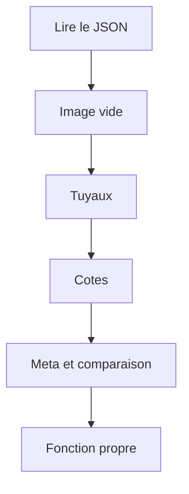

# Projet - Convertir le graphe en XML CVAT

> [!info] Le principe
> Le module `replication` produit un **graphe géométrique** en JSON (nœuds, tuyaux, cotes). CVAT, lui, ne lit que des **formes** dans son XML d'annotations. Tu écris `convertir.py`, qui transforme le premier en second, pour pouvoir réimporter le résultat dans CVAT.
> Le but : comprendre la **différence** entre les deux fichiers et savoir passer de l'un à l'autre, en tombant sur les vraies erreurs et en les corrigeant.

**À lire d'abord :** [[Cours - Du JSON au XML, convertir le graphe en annotations CVAT]]



## Les étapes
| # | Étape | Notions validées |
| --- | --- | --- |
| 1 | [[Graphe 01 - Lire et explorer le JSON]] | JSON, Liste et dictionnaire |
| 2 | [[Graphe 02 - Une image vide en XML]] | XML, XML en Python (ElementTree) |
| 3 | [[Graphe 03 - Les tuyaux]] | XML en Python (ElementTree), Format CVAT for images 1.1 |
| 4 | [[Graphe 04 - Les cotes et leurs étiquettes]] | Format CVAT for images 1.1 |
| 5 | [[Graphe 05 - Le bloc meta et la comparaison]] | Format CVAT for images 1.1 |
| 6 | [[Graphe 06 - Une fonction prête pour Nuclio]] | Exception, Journaliser avec logging |

## Pour démarrer
Dans WSL :
```bash
mkdir -p ~/projets/graphe-xml
cd ~/projets/graphe-xml
```
Crée les trois fichiers ci-dessous **tels quels** : `graph.json` (l'entrée), `attendu.xml` (ce que tu dois obtenir) et `comparer.py` (l'outil de vérification, tu n'as pas à le modifier). Tu écris seulement `convertir.py`.

Pour vérifier à tout moment :
```bash
python3 convertir.py            # produit sortie.xml
python3 comparer.py attendu.xml sortie.xml
```
`comparer.py` ignore la mise en forme (retraits, `'` ou `"`, `<a/>` ou `<a></a>`) et montre la **première** différence. Tant que tu n'as pas fini, il y en aura forcément : c'est normal, avance étape par étape.

### comparer.py
```python
"""Compare deux fichiers XML en ignorant la mise en forme."""
import sys
import xml.etree.ElementTree as ET

a = ET.canonicalize(from_file=sys.argv[1], strip_text=True)
b = ET.canonicalize(from_file=sys.argv[2], strip_text=True)
if a == b:
    print("Identiques")
else:
    for i, (ca, cb) in enumerate(zip(a, b)):
        if ca != cb:
            print("Première différence :")
            print("  attendu :", a[max(0, i - 60):i + 60])
            print("  obtenu  :", b[max(0, i - 60):i + 60])
            break
    else:
        print("Un fichier est plus long que l'autre")
```

### graph.json
```json
{
  "graph_type": "geometric",
  "image": {
    "id": "0",
    "name": "iso_080.jpg",
    "width": 800,
    "height": 600
  },
  "length_unit": null,
  "nodes": [
    {
      "id": "PC_0",
      "point": [
        100.0,
        400.0
      ],
      "is_start": true
    },
    {
      "id": "PC_1",
      "point": [
        300.0,
        284.53
      ],
      "is_start": false
    },
    {
      "id": "PC_2",
      "point": [
        300.0,
        134.53
      ],
      "is_start": false
    },
    {
      "id": "PC_3",
      "point": [
        500.0,
        250.0
      ],
      "is_start": false
    },
    {
      "id": "PC_4",
      "point": [
        420.0,
        353.81
      ],
      "is_start": false
    }
  ],
  "pipe_edges": [
    {
      "source": "PC_0",
      "target": "PC_1",
      "key": 0,
      "segment_id": 0,
      "geometry": [
        [
          100.0,
          400.0
        ],
        [
          300.0,
          284.53
        ]
      ],
      "pixel_length": 230.94008075689246,
      "constraint_ids": [
        "DC_0"
      ],
      "attributes": {
        "debut": "true"
      }
    },
    {
      "source": "PC_1",
      "target": "PC_2",
      "key": 1,
      "segment_id": 1,
      "geometry": [
        [
          300.0,
          284.53
        ],
        [
          300.0,
          134.53
        ]
      ],
      "pixel_length": 149.99999999999997,
      "constraint_ids": [
        "DC_1"
      ],
      "attributes": {
        "debut": "false"
      }
    },
    {
      "source": "PC_1",
      "target": "PC_4",
      "key": 3,
      "segment_id": 3,
      "geometry": [
        [
          300.0,
          284.53
        ],
        [
          420.0,
          353.81
        ]
      ],
      "pixel_length": 138.56304846531057,
      "constraint_ids": [],
      "attributes": {
        "debut": "false"
      }
    },
    {
      "source": "PC_2",
      "target": "PC_3",
      "key": 2,
      "segment_id": 2,
      "geometry": [
        [
          300.0,
          134.53
        ],
        [
          500.0,
          250.0
        ]
      ],
      "pixel_length": 230.94008075689243,
      "constraint_ids": [
        "DC_2"
      ],
      "attributes": {
        "debut": "false"
      }
    }
  ],
  "dimension_constraints": [
    {
      "id": "DC_0",
      "dimension_line_id": 0,
      "dimension_geometry": [
        [
          115.0,
          425.98
        ],
        [
          315.0,
          310.51
        ]
      ],
      "label_id": 0,
      "label_geometry": [
        [
          240.0,
          378.0
        ],
        [
          240.0,
          392.0
        ],
        [
          210.0,
          392.0
        ],
        [
          210.0,
          378.0
        ],
        [
          240.0,
          378.0
        ]
      ],
      "length": 2000.0,
      "unit": null,
      "start_node": "PC_0",
      "end_node": "PC_1",
      "path_nodes": [
        "PC_0",
        "PC_1"
      ],
      "path_edges": [
        {
          "source": "PC_0",
          "target": "PC_1",
          "key": 0
        }
      ],
      "label_distance": 5.948079672865546,
      "angular_error_degrees": 0.0,
      "forced_match": false
    },
    {
      "id": "DC_1",
      "dimension_line_id": 1,
      "dimension_geometry": [
        [
          270.0,
          284.53
        ],
        [
          270.0,
          134.53
        ]
      ],
      "label_id": 1,
      "label_geometry": [
        [
          265.0,
          203.0
        ],
        [
          265.0,
          217.0
        ],
        [
          235.0,
          217.0
        ],
        [
          235.0,
          203.0
        ],
        [
          265.0,
          203.0
        ]
      ],
      "length": 1500.0,
      "unit": null,
      "start_node": "PC_1",
      "end_node": "PC_2",
      "path_nodes": [
        "PC_1",
        "PC_2"
      ],
      "path_edges": [
        {
          "source": "PC_1",
          "target": "PC_2",
          "key": 1
        }
      ],
      "label_distance": 5.0,
      "angular_error_degrees": 0.0,
      "forced_match": false
    },
    {
      "id": "DC_2",
      "dimension_line_id": 2,
      "dimension_geometry": [
        [
          315.0,
          108.55
        ],
        [
          515.0,
          224.02
        ]
      ],
      "label_id": 2,
      "label_geometry": [
        [
          440.0,
          148.0
        ],
        [
          440.0,
          162.0
        ],
        [
          410.0,
          162.0
        ],
        [
          410.0,
          148.0
        ],
        [
          440.0,
          148.0
        ]
      ],
      "length": 2000.0,
      "unit": null,
      "start_node": "PC_2",
      "end_node": "PC_3",
      "path_nodes": [
        "PC_2",
        "PC_3"
      ],
      "path_edges": [
        {
          "source": "PC_2",
          "target": "PC_3",
          "key": 2
        }
      ],
      "label_distance": 1.2109201619894872,
      "angular_error_degrees": 0.0,
      "forced_match": false
    }
  ],
  "diagnostics": []
}
```

### attendu.xml
```xml
<?xml version="1.0" encoding="utf-8"?>
<annotations>
  <version>1.1</version>
  <meta>
    <task>
      <name>iso_080_test</name>
      <size>1</size>
      <mode>annotation</mode>
      <labels>
        <label>
          <name>tuyau</name>
          <type>polyline</type>
          <attributes>
            <attribute>
              <name>debut</name>
              <mutable>False</mutable>
              <input_type>checkbox</input_type>
              <default_value>false</default_value>
              <values>false</values>
            </attribute>
          </attributes>
        </label>
        <label>
          <name>ligne de cote</name>
          <type>polyline</type>
          <attributes></attributes>
        </label>
        <label>
          <name>etiquette de cote</name>
          <type>rectangle</type>
          <attributes>
            <attribute>
              <name>nom</name>
              <mutable>False</mutable>
              <input_type>text</input_type>
              <default_value></default_value>
              <values></values>
            </attribute>
          </attributes>
        </label>
      </labels>
    </task>
  </meta>
  <image id="0" name="iso_080.jpg" width="800" height="600">
    <polyline label="tuyau" source="manual" occluded="0" points="100.00,400.00;300.00,284.53" z_order="0">
      <attribute name="debut">true</attribute>
    </polyline>
    <polyline label="tuyau" source="manual" occluded="0" points="300.00,284.53;300.00,134.53" z_order="0">
      <attribute name="debut">false</attribute>
    </polyline>
    <polyline label="tuyau" source="manual" occluded="0" points="300.00,134.53;500.00,250.00" z_order="0">
      <attribute name="debut">false</attribute>
    </polyline>
    <polyline label="tuyau" source="manual" occluded="0" points="300.00,284.53;420.00,353.81" z_order="0">
      <attribute name="debut">false</attribute>
    </polyline>
    <polyline label="ligne de cote" source="manual" occluded="0" points="115.00,425.98;315.00,310.51" z_order="0">
    </polyline>
    <polyline label="ligne de cote" source="manual" occluded="0" points="270.00,284.53;270.00,134.53" z_order="0">
    </polyline>
    <polyline label="ligne de cote" source="manual" occluded="0" points="315.00,108.55;515.00,224.02" z_order="0">
    </polyline>
    <box label="etiquette de cote" source="manual" occluded="0" xtl="210.00" ytl="378.00" xbr="240.00" ybr="392.00" z_order="0">
      <attribute name="nom">2000</attribute>
    </box>
    <box label="etiquette de cote" source="manual" occluded="0" xtl="235.00" ytl="203.00" xbr="265.00" ybr="217.00" z_order="0">
      <attribute name="nom">1500</attribute>
    </box>
    <box label="etiquette de cote" source="manual" occluded="0" xtl="410.00" ytl="148.00" xbr="440.00" ybr="162.00" z_order="0">
      <attribute name="nom">2000</attribute>
    </box>
  </image>
</annotations>
```

## Journal du projet
- 16/11 — Démarrage
