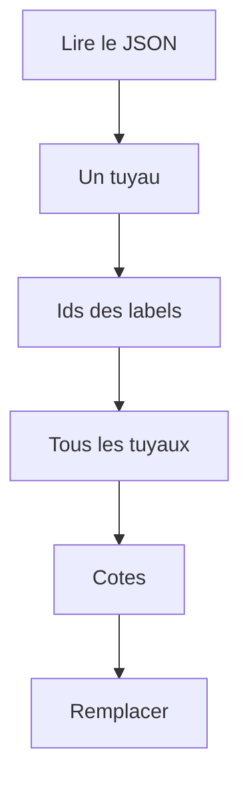

# Projet - Réannoter un job CVAT depuis le graphe

> [!info] Le principe
> Ton script lit le JSON produit par `replication` (`output/{job_id}/image_{folio_id}_geometric_graph.json`) et recrée dans CVAT, par l'API, les tuyaux, les lignes de cote et les étiquettes du folio.
> Tu pars de **ton** fichier actuel et tu l'améliores une étape à la fois. À chaque étape, tu lances le script et tu regardes le résultat dans CVAT.

**À lire d'abord :** [[Cours - Du graphe JSON aux annotations CVAT par l'API]]

## Les étapes
| # | Étape | Ce que tu apprends |
| --- | --- | --- |
| 1 | [[Réannoter 01 - Lire le JSON dans ton script]] | lire un fichier JSON, naviguer dans un dictionnaire |
| 2 | [[Réannoter 02 - Envoyer le premier tuyau]] | construire une forme à partir du JSON, `requests.patch` |
| 3 | [[Réannoter 03 - Chercher les ids des labels]] | `GET` paginé, dictionnaire nom → id |
| 4 | [[Réannoter 04 - Tous les tuyaux et leurs attributs]] | boucle, compréhension de liste, fonction |
| 5 | [[Réannoter 05 - Les lignes de cote et les étiquettes]] | cas `null`, min/max, formatage |
| 6 | [[Réannoter 06 - Remplacer au lieu d'ajouter]] | filtrer une liste, `action=delete` |
| 7 | [[Réannoter 07 - Les étiquettes tournées]] | un peu de géométrie : centre, longueur, angle |
| 8 | [[Réannoter 08 - Ranger le script]] | fonctions, exceptions, logs |

## Pour démarrer
Ton point de départ est le fichier que tu as déjà (imports, `.env`, `job_id = 1`, `folio_id = 0`, lecture du JSON). Travaille sur un **job de test** : le script modifie ses annotations.

Pour tester vite, garde sous la main un petit JSON : 2 tuyaux et 1 ligne de cote sans étiquette (celui d'`iso_080.jpg`).

## Journal du projet
- 16/11 — Démarrage, premier essai dans Bruno réussi (ajout d'un tuyau à la main)
