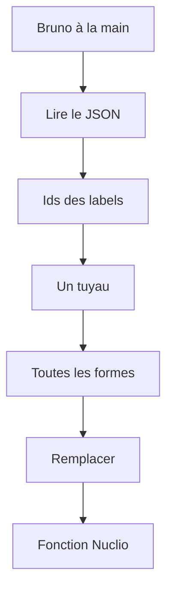

# Projet - Réannoter un job CVAT depuis le graphe

> [!info] Le principe
> `reannoter.py` lit le JSON du graphe produit par `replication`, en fait des formes CVAT (tuyaux, lignes de cote, étiquettes) et **remplace** avec elles les annotations d'un folio du job, par l'API.

**À lire d'abord :** [[Cours - Du graphe JSON aux annotations CVAT par l'API]]



## Les étapes
| # | Étape | Notions validées |
| --- | --- | --- |
| 0 | [[Réannoter 00 - Un tuyau à la main dans Bruno]] : **commence ici** | Annotations dans l'API CVAT |
| 1 | [[Réannoter 01 - Lire et explorer le JSON]] | JSON, Liste et dictionnaire |
| 2 | [[Réannoter 02 - Les ids des labels en Python]] | Appeler une API HTTP (requests), Liste et dictionnaire |
| 3 | [[Réannoter 03 - Un tuyau en Python]] | Annotations dans l'API CVAT |
| 4 | [[Réannoter 04 - Tous les tuyaux et les cotes]] | Annotations dans l'API CVAT |
| 5 | [[Réannoter 05 - Remplacer au lieu d'ajouter]] | Annotations dans l'API CVAT |
| 6 | [[Réannoter 06 - Une fonction prête pour Nuclio]] | Exception, Journaliser avec logging |

**En option, pour les autres types de formes :** [[Réannoter 07 - Les autres types de formes]]

## Pour démarrer
```bash
mkdir -p ~/projets/reannoter
cd ~/projets/reannoter
```
Crée `graph.json` ci-dessous, et un `.env` avec `CVAT_URL`, `CVAT_USERNAME`, `CVAT_PASSWORD` et `JOB_ID` (un **job de test** : le script va modifier ses annotations). Tu écris `reannoter.py`.

### graph.json
```json
{
  "graph_type": "geometric",
  "image": {
    "id": "0",
    "name": "iso_080.jpg",
    "width": 800,
    "height": 600
  },
  "length_unit": null,
  "nodes": [
    {
      "id": "PC_0",
      "point": [
        100.0,
        400.0
      ],
      "is_start": true
    },
    {
      "id": "PC_1",
      "point": [
        300.0,
        284.53
      ],
      "is_start": false
    },
    {
      "id": "PC_2",
      "point": [
        300.0,
        134.53
      ],
      "is_start": false
    },
    {
      "id": "PC_3",
      "point": [
        500.0,
        250.0
      ],
      "is_start": false
    },
    {
      "id": "PC_4",
      "point": [
        420.0,
        353.81
      ],
      "is_start": false
    }
  ],
  "pipe_edges": [
    {
      "source": "PC_0",
      "target": "PC_1",
      "key": 0,
      "segment_id": 0,
      "geometry": [
        [
          100.0,
          400.0
        ],
        [
          300.0,
          284.53
        ]
      ],
      "pixel_length": 230.94008075689246,
      "constraint_ids": [
        "DC_0"
      ],
      "attributes": {
        "debut": "true"
      }
    },
    {
      "source": "PC_1",
      "target": "PC_2",
      "key": 1,
      "segment_id": 1,
      "geometry": [
        [
          300.0,
          284.53
        ],
        [
          300.0,
          134.53
        ]
      ],
      "pixel_length": 149.99999999999997,
      "constraint_ids": [
        "DC_1"
      ],
      "attributes": {
        "debut": "false"
      }
    },
    {
      "source": "PC_1",
      "target": "PC_4",
      "key": 3,
      "segment_id": 3,
      "geometry": [
        [
          300.0,
          284.53
        ],
        [
          420.0,
          353.81
        ]
      ],
      "pixel_length": 138.56304846531057,
      "constraint_ids": [],
      "attributes": {
        "debut": "false"
      }
    },
    {
      "source": "PC_2",
      "target": "PC_3",
      "key": 2,
      "segment_id": 2,
      "geometry": [
        [
          300.0,
          134.53
        ],
        [
          500.0,
          250.0
        ]
      ],
      "pixel_length": 230.94008075689243,
      "constraint_ids": [
        "DC_2"
      ],
      "attributes": {
        "debut": "false"
      }
    }
  ],
  "dimension_constraints": [
    {
      "id": "DC_0",
      "dimension_line_id": 0,
      "dimension_geometry": [
        [
          115.0,
          425.98
        ],
        [
          315.0,
          310.51
        ]
      ],
      "label_id": 0,
      "label_geometry": [
        [
          240.0,
          378.0
        ],
        [
          240.0,
          392.0
        ],
        [
          210.0,
          392.0
        ],
        [
          210.0,
          378.0
        ],
        [
          240.0,
          378.0
        ]
      ],
      "length": 2000.0,
      "unit": null,
      "start_node": "PC_0",
      "end_node": "PC_1",
      "path_nodes": [
        "PC_0",
        "PC_1"
      ],
      "path_edges": [
        {
          "source": "PC_0",
          "target": "PC_1",
          "key": 0
        }
      ],
      "label_distance": 5.948079672865546,
      "angular_error_degrees": 0.0,
      "forced_match": false
    },
    {
      "id": "DC_1",
      "dimension_line_id": 1,
      "dimension_geometry": [
        [
          270.0,
          284.53
        ],
        [
          270.0,
          134.53
        ]
      ],
      "label_id": 1,
      "label_geometry": [
        [
          265.0,
          203.0
        ],
        [
          265.0,
          217.0
        ],
        [
          235.0,
          217.0
        ],
        [
          235.0,
          203.0
        ],
        [
          265.0,
          203.0
        ]
      ],
      "length": 1500.0,
      "unit": null,
      "start_node": "PC_1",
      "end_node": "PC_2",
      "path_nodes": [
        "PC_1",
        "PC_2"
      ],
      "path_edges": [
        {
          "source": "PC_1",
          "target": "PC_2",
          "key": 1
        }
      ],
      "label_distance": 5.0,
      "angular_error_degrees": 0.0,
      "forced_match": false
    },
    {
      "id": "DC_2",
      "dimension_line_id": 2,
      "dimension_geometry": [
        [
          315.0,
          108.55
        ],
        [
          515.0,
          224.02
        ]
      ],
      "label_id": 2,
      "label_geometry": [
        [
          440.0,
          148.0
        ],
        [
          440.0,
          162.0
        ],
        [
          410.0,
          162.0
        ],
        [
          410.0,
          148.0
        ],
        [
          440.0,
          148.0
        ]
      ],
      "length": 2000.0,
      "unit": null,
      "start_node": "PC_2",
      "end_node": "PC_3",
      "path_nodes": [
        "PC_2",
        "PC_3"
      ],
      "path_edges": [
        {
          "source": "PC_2",
          "target": "PC_3",
          "key": 2
        }
      ],
      "label_distance": 1.2109201619894872,
      "angular_error_degrees": 0.0,
      "forced_match": false
    }
  ],
  "diagnostics": []
}
```

## Journal du projet
- 16/11 — Démarrage (approche XML abandonnée pour l'API JSON)
