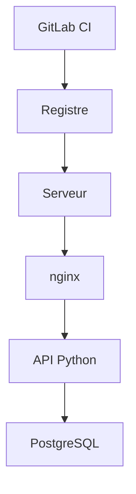

# Projet - MesDépenses

> [!info] Le principe
> Une seule application, un suivi de dépenses, qui sert de terrain d'entraînement pour **ce que tu fais au travail** : diagnostiquer le réseau, écrire un script qui parle à une API, mettre une appli dans Docker, la dépanner, la tester, la faire passer en CI, l'installer sur un serveur et la déployer. L'API est fournie en Python : tu ne codes pas l'application, tu la **fais tourner**.
> Pour chaque concept : fiche, dessin Excalidraw, exercices visuels, puis tout de suite l'étape qui l'utilise.

## Le but final
Pousser un tag Git, et voir la nouvelle version arriver toute seule sur un serveur Linux, derrière nginx en HTTPS, avec sa base PostgreSQL sauvegardée chaque nuit. Et savoir revenir en arrière si elle est cassée.

## L'architecture


Un seul dépôt `mes-depenses` :
```
mes-depenses/
├── api/             l'API (fournie)
├── client/          ton client Python en ligne de commande
├── outils/          tes scripts d'exploitation (sauvegarde)
├── nginx/           la configuration du reverse proxy
├── compose.yml      tout lancer ensemble
└── .gitlab-ci.yml   tests, image, version, déploiement
```

## L'API est fournie
Tu ne l'écris pas : elle est dans les fichiers du projet Claude, dossier **`mes-depenses/api/`**. Copie tout ce dossier dans `~/projets/mes-depenses/api/` (côté WSL, pas dans `/mnt/c`). Son `README.md` liste les routes, avec des exemples curl et une collection Bruno.

Ce qu'il faut savoir d'elle :
- FastAPI, base SQLite par défaut, PostgreSQL en changeant **une seule** variable : `DATABASE_URL` ;
- routes `/depenses` (CRUD), `/totaux`, `/categories`, `/health` ;
- **CORS n'est pas configuré** : c'est voulu, tu rencontreras la vraie erreur à l'étape 12. L'endroit où l'ajouter est marqué dans `app/main.py` ;
- des tests en `unittest` sont déjà là (tu t'en serviras dans la CI).

## Les étapes
| # | Étape | Ce qui te servira au travail |
| --- | --- | --- |
| **Niveau 1 · Réseau et API** | | |
| 1 | [[MesDépenses 01 - Prendre l'API en main]] | lancer une API, lire ses routes et ses codes HTTP |
| 2 | [[MesDépenses 02 - Suivre une requête sur le réseau]] | dire où ça bloque : nom, port, certificat, proxy |
| 3 | [[MesDépenses 03 - Un client Python pour l'API]] | un script qui automatise une API, erreurs gérées |
| **Niveau 2 · Docker** | | |
| 4 | [[MesDépenses 04 - L'API dans Docker]] | Dockerfile, registre, port, volume |
| 5 | [[MesDépenses 05 - L'API et PostgreSQL avec compose]] | compose, base de données, secrets |
| 6 | [[MesDépenses 06 - Dépanner un conteneur]] | retrouver une panne seul, ta fiche de dépannage |
| **Niveau 3 · CI et équipe** | | |
| 7 | [[MesDépenses 07 - Travailler en branche]] | branche, conflit, merge request, annuler |
| 8 | [[MesDépenses 08 - Tester l'API]] | tests, doublures, couverture, linter |
| 9 | [[MesDépenses 09 - La CI de l'API]] | pipeline, image dans la CI, rules |
| 10 | [[MesDépenses 10 - Sortir une version]] | tag, changelog, image numérotée |
| **Niveau 4 · Serveur et déploiement** | | |
| 11 | [[MesDépenses 11 - Installer l'API sur un serveur]] | SSH, utilisateurs, redémarrage, journaux |
| 12 | [[MesDépenses 12 - Derrière nginx, avec une petite page]] | reverse proxy, HTTPS, CORS |
| 13 | [[MesDépenses 13 - Sauvegarder la base avec un script]] | script d'exploitation, cron, restauration |
| 14 | [[MesDépenses 14 - Déployer depuis la CI]] | déploiement continu, retour arrière |

**Niveau 5** (se perfectionner) : à créer quand tu y seras, par exemple les comptes utilisateurs et une refonte propre.

> [!note]- Le front, à la demande (niveau 6)
> Les anciennes étapes Vue et Angular sont gardées dans le dossier « Front (à la demande) », à faire seulement si un projet te le demande :
> [[MesDépenses Front 01 - Vue, afficher la liste]] · [[MesDépenses Front 02 - Régler CORS]] · [[MesDépenses Front 03 - Vue, ajouter et supprimer]] · [[MesDépenses Front 04 - Le front Vue dans Docker]] · [[MesDépenses Front 05 - Tout lancer avec compose]] · [[MesDépenses Front 06 - La CI du front Vue]] · [[MesDépenses Front 07 - Angular, afficher la liste]] · [[MesDépenses Front 08 - Angular, ajouter et supprimer]] · [[MesDépenses Front 09 - Le front Angular dans Docker]] · [[MesDépenses Front 10 - Angular dans compose]] · [[MesDépenses Front 11 - La CI du front Angular]]

## Environnement de l'entreprise
- Images Docker : toujours par le Nexus, `vortex-nexus.assystem.com:5000/library/...` ([[Fiche - Images Docker au travail via le Nexus]]).
- `pip` et `npm` vont sur Internet : derrière le proxy, ils risquent d'être bloqués. Garde la trace de ce que tu as essayé.
- Le runner GitLab n'a pas Internet en direct : tout passe par le proxy ou le Nexus.

## Journal du projet
- 19/11 — Projet créé, API fournie.
- 19/11 — Étapes refaites pour coller au travail : réseau, Docker, CI, serveur. Le front passe à la demande.
