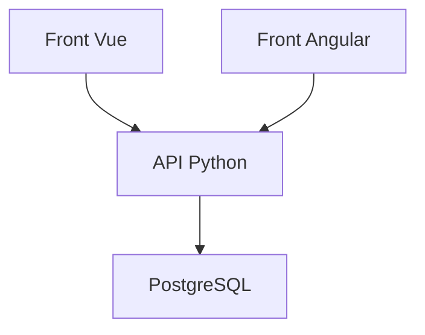

# Projet - MesDépenses

> [!info] Le principe
> Une seule application, qui grandit avec tes cours : un suivi de dépenses. Une **API** (fournie, en Python) et **deux fronts** que tu codes toi-même, d'abord en **Vue**, puis en **Angular**. Chaque partie, tu la mets dans Docker et dans la CI GitLab : tu le fais plusieurs fois exprès, pour que ça devienne un réflexe.
> Pour chaque concept : tu fais d'abord ton dessin Excalidraw (section « Mon schéma » de la fiche), Claude le valide, puis tu l'appliques ici.

## Le but final
Ouvrir le navigateur, voir ses dépenses, en ajouter, en supprimer, depuis le front Vue **ou** le front Angular. Le tout lancé par un seul `docker compose up`, et GitLab qui teste et construit chaque image tout seul.

## L'architecture


Un seul dépôt `mes-depenses` :
```
mes-depenses/
├── api/             l'API (fournie)
├── front-vue/       ton front Vue
├── front-angular/   ton front Angular
├── compose.yml      tout lancer ensemble
└── .gitlab-ci.yml   la CI de toutes les parties
```

| Partie | En dev | Dans compose |
| --- | --- | --- |
| API | http://localhost:8000 | `api:8000` |
| Front Vue | http://localhost:5173 | http://localhost:8080 |
| Front Angular | http://localhost:4200 | http://localhost:8081 |

## L'API est fournie
Tu ne l'écris pas : elle est dans les fichiers du projet Claude, dossier **`mes-depenses/api/`**. Copie tout ce dossier dans `~/projets/mes-depenses/api/` (côté WSL, pas dans `/mnt/c`). Son `README.md` liste les routes, avec des exemples curl et une collection Bruno.

Ce qu'il faut savoir d'elle :
- FastAPI, base SQLite par défaut, PostgreSQL en changeant **une seule** variable : `DATABASE_URL` ;
- routes `/depenses` (CRUD), `/totaux`, `/categories`, `/health` ;
- **CORS n'est pas configuré** : c'est voulu, tu vas rencontrer la vraie erreur. L'endroit où l'ajouter est marqué dans `app/main.py` ;
- des tests en `unittest` sont déjà là (tu t'en serviras dans la CI).

## Les étapes
| # | Étape | Ce que tu pratiques |
| --- | --- | --- |
| 1 | [[MesDépenses 01 - Prendre l'API en main]] | lancer une API Python, routes, codes HTTP |
| 2 | [[MesDépenses 02 - L'API dans Docker]] | Dockerfile, Nexus, proxy, port, volume |
| 3 | [[MesDépenses 03 - Vue, afficher la liste]] | projet Vite, composant, `fetch` |
| 4 | [[MesDépenses 04 - Régler CORS]] | lire l'erreur, origine, preflight |
| 5 | [[MesDépenses 05 - Vue, ajouter et supprimer]] | formulaire, POST, DELETE, rafraîchir |
| 6 | [[MesDépenses 06 - Le front Vue dans Docker]] | build en deux étapes, nginx |
| 7 | [[MesDépenses 07 - Tout lancer avec compose]] | services, PostgreSQL, réseau, volume |
| 8 | [[MesDépenses 08 - La CI de l'API]] | tests et image dans GitLab |
| 9 | [[MesDépenses 09 - La CI du front Vue]] | build front, image, `extends` |
| 10 | [[MesDépenses 10 - Angular, afficher la liste]] | CLI, composant, service, HttpClient |
| 11 | [[MesDépenses 11 - Angular, ajouter et supprimer]] | formulaire Angular, Observable |
| 12 | [[MesDépenses 12 - Le front Angular dans Docker]] | même chose qu'en 06, seul |
| 13 | [[MesDépenses 13 - Angular dans compose]] | un service de plus |
| 14 | [[MesDépenses 14 - La CI du front Angular]] | réutiliser sans copier |

De l'étape 12 à la 14, tu refais ce que tu as déjà fait pour Vue : essaie sans relire tes notes d'abord.

## Environnement de l'entreprise
- Images Docker : toujours par le Nexus, `vortex-nexus.assystem.com:5000/library/...` ([[Fiche - Images Docker au travail via le Nexus]]).
- `pip` et `npm` vont sur Internet : derrière le proxy, ils risquent d'être bloqués. Garde la trace de ce que tu as essayé.
- Le runner GitLab n'a pas Internet en direct : tout passe par le proxy ou le Nexus.

## Journal du projet
- 19/11 — Projet créé, API fournie.
