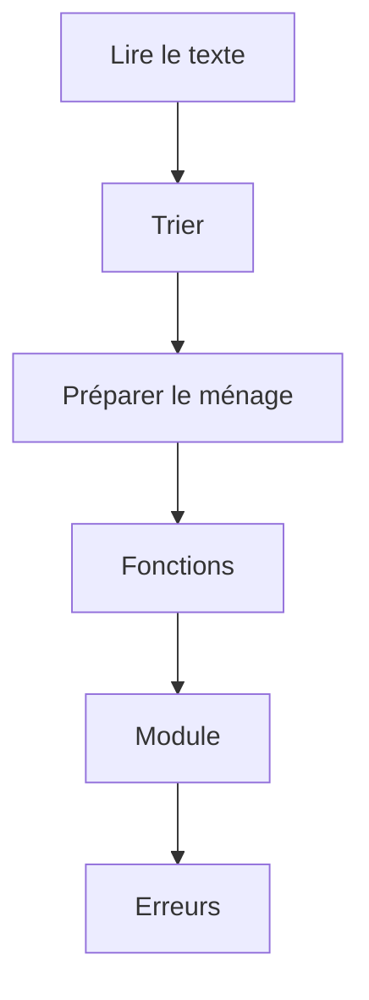

# Projet - Faire le ménage dans ses conteneurs Docker

> [!info] Le principe
> Un petit script qui analyse une liste de conteneurs Docker (lesquels tournent, lesquels sont arrêtés) et prépare la commande pour supprimer les arrêtés.
> Le but n'est pas l'outil : c'est de **vérifier que tu as compris chaque notion** du Python de base, en tombant sur les erreurs classiques et en les corrigeant. Tout ce qui n'est pas du Python de base est **fourni** : les données sont déjà dans le fichier de départ, pas besoin de Docker ni du terminal au-delà de `python3 conteneurs.py`.
> Chaque étape valide une ou deux notions, à la place des exercices.



## Les étapes
| # | Étape | Notions validées |
| --- | --- | --- |
| 1 | [[Ménage 01 - Lire la liste des conteneurs]] | Python, Variables et types en Python |
| 2 | [[Ménage 02 - Trier les conteneurs]] | Condition (if), Boucle (for, while) |
| 3 | [[Ménage 03 - Préparer le ménage]] | Liste et dictionnaire |
| 4 | [[Ménage 04 - Ranger en fonctions]] | Fonction |
| 5 | [[Ménage 05 - Un module réutilisable]] | Module et import Python |
| 6 | [[Ménage 06 - Un script qui ne plante pas]] | Exception |

## Pour démarrer
Dans WSL :
```bash
mkdir -p ~/projets/conteneurs
cd ~/projets/conteneurs
```
`conteneurs.py`, à recopier tel quel :
```python
# Liste des conteneurs Docker : identifiant;image;statut;nom
TEXTE = """3f2a9c1b7d10;script-py:1.4;Exited (0) 2 hours ago;gallant_hopper
a81c44e0f2b3;script-py:1.3;Exited (0) 3 hours ago;vibrant_curie
c09d2e7a5b11;script-py:1.3;Exited (1) 3 hours ago;eager_turing
7be1f0c3d9a4;nginx:1.27-alpine;Up 25 minutes;rapport-web
5d6a3b2e8c70;postgres:16;Up 2 days;pg-notes
e4f7a1c2b3d5;script-py:1.2;Created;quirky_lamport
9a0b1c2d3e4f;python:3.12-slim;Exited (137) 1 day ago;test_python"""

# Ton code en dessous
```
Chaque ligne décrit un conteneur, avec 4 informations séparées par `;`.

`TEXTE_ABIME`, pour l'étape 06 :
```python
TEXTE_ABIME = """3f2a9c1b7d10;script-py:1.4;Exited (0) 2 hours ago;gallant_hopper
ligne cassée sans séparateur

7be1f0c3d9a4;nginx:1.27-alpine;Up 25 minutes;rapport-web"""
```

Pas de bibliothèque à installer : tout est livré avec Python.

## Les règles du projet
- Chaque étape donne le **but**, pas le code : tu le cherches dans les cours et les fiches des notions.
- Tu vas tomber sur de vraies erreurs : c'est voulu. Lis le message, cherche, corrige. Si tu bloques, l'**indice** donne l'idée, puis demande à Claude.
- « Ça marche si… » te dit comment vérifier toi-même.
- L'étape passe en `reussi` quand le projet marche **et** que tu sais répondre aux questions.
