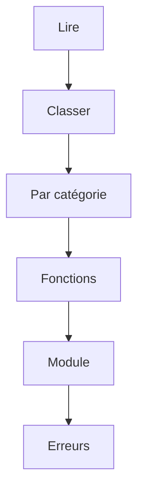

# Projet - Suivre ses dépenses en Python

> [!info] Le principe
> Un petit script qui analyse une liste de dépenses : combien, de quelle taille, combien par catégorie.
> Le but n'est pas l'outil : c'est de **vérifier que tu as compris chaque notion** du Python de base, en tombant sur les erreurs classiques et en les corrigeant. Tout le reste est **fourni** : les données sont déjà dans le fichier de départ, et tu lances seulement `python3 depenses.py`.
> Chaque étape valide une ou deux notions, à la place des exercices.



## Les étapes
| # | Étape | Notions validées |
| --- | --- | --- |
| 1 | [[Dépenses 01 - Lire les dépenses]] | Python, Variables et types en Python |
| 2 | [[Dépenses 02 - Classer les dépenses]] | Condition (if), Boucle (for, while) |
| 3 | [[Dépenses 03 - Totaux par catégorie]] | Liste et dictionnaire |
| 4 | [[Dépenses 04 - Ranger en fonctions]] | Fonction |
| 5 | [[Dépenses 05 - Un module réutilisable]] | Module et import Python |
| 6 | [[Dépenses 06 - Un script qui ne plante pas]] | Exception |

## Pour démarrer
Dans WSL :
```bash
mkdir -p ~/projets/depenses
cd ~/projets/depenses
```
`depenses.py`, à recopier tel quel :
```python
# Mes dépenses : date;catégorie;montant;description
TEXTE = """2026-11-01;courses;42.30;Supermarché
2026-11-02;transport;2.10;Ticket de métro
2026-11-03;loisirs;12.00;Cinéma
2026-11-03;courses;8.75;Boulangerie
2026-11-05;logement;650.00;Loyer
2026-11-06;transport;75.20;Pass Navigo
2026-11-07;loisirs;54.90;Concert"""

# Ton code en dessous
```
Chaque ligne est une dépense, avec 4 informations séparées par `;`.

`TEXTE_ABIME`, pour l'étape 06 :
```python
TEXTE_ABIME = """2026-11-01;courses;42.30;Supermarché
2026-11-02;transport;deux euros;Ticket de métro

2026-11-03;loisirs;Cinéma
2026-11-05;logement;650.00;Loyer"""
```

Pas de bibliothèque à installer : tout est livré avec Python.

## Les règles du projet
- Chaque étape donne le **but**, pas le code : tu le cherches dans les cours et les fiches des notions.
- Tu vas tomber sur de vraies erreurs : c'est voulu. Lis le message, cherche, corrige. Si tu bloques, l'**indice** donne l'idée, puis demande à Claude.
- « Ça marche si… » te dit comment vérifier toi-même.
- L'étape passe en `reussi` quand le projet marche **et** que tu sais répondre aux questions.
