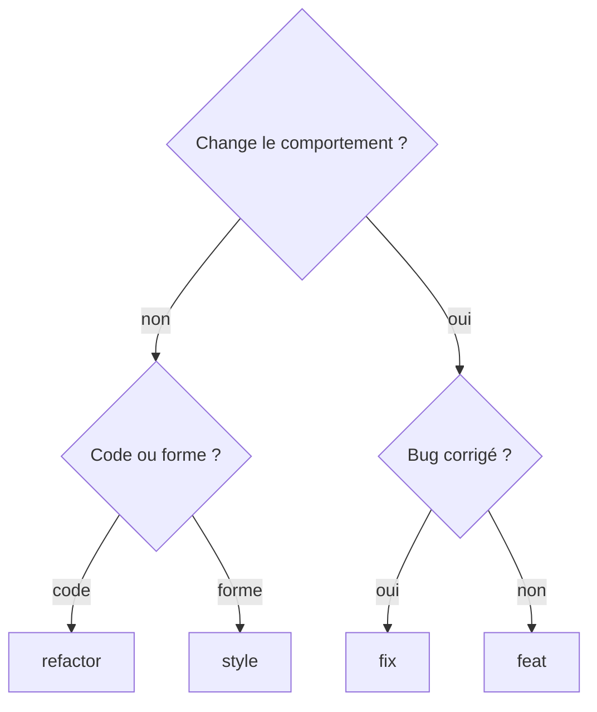

# Exemples de commits conventionnels

> [!info] À quoi sert cette page
> Un recueil d'exemples à garder ouvert quand tu écris un message de commit. La théorie est dans [[Convention de commit]], les règles générales dans [[Bonnes pratiques - Git]].

## 1. La forme d'un message
```text
type(portée): description courte          ← l'en-tête, obligatoire
                                          ← une ligne vide
Corps : le pourquoi du changement, ce     ← facultatif
qui ne marchait pas, ce qui change.
                                          ← une ligne vide
Refs: #12                                 ← pied de page, facultatif
BREAKING CHANGE: ...
```

| Partie | Règle |
| --- | --- |
| **type** | en minuscules, un mot de la liste ci-dessous |
| **portée** (*scope*) | facultative, entre parenthèses : la partie du projet touchée (`export`, `ui`, `ci`, `docker`) |
| **description** | à l'impératif ou au présent (« ajoute », « corrige »), sans majuscule obligatoire, sans point final, environ 50 à 70 caractères |
| **corps** | le **pourquoi**, pas le comment (le comment, c'est le diff) ; lignes d'environ 72 caractères |
| **pied de page** | références (`Refs: #12`, `Closes #12`), co-auteurs, `BREAKING CHANGE:` |

> [!tip] Le test de la phrase
> Un bon en-tête complète la phrase « **Si on applique ce commit, il…** » : « … corrige le nom de l'archive quand le dossier contient des espaces ».

## 2. Tous les types, avec des exemples
### `feat` : une nouvelle fonctionnalité pour l'utilisateur
```text
feat(ui): ajoute le bouton « Exporter en PNG » dans la barre d'outils
feat(export): permet de choisir la couleur des rectangles
feat(zip): accepte un dossier de destination en argument
feat(api): ajoute la route GET /api/export/{tache_id}
```

### `fix` : la correction d'un bug
```text
fix(export): corrige le nom de l'archive quand le dossier contient des espaces
fix(zip): n'inclut plus les fichiers cachés dans l'archive
fix(ui): désactive le bouton pendant l'export pour éviter les doubles clics
fix(api): renvoie 404 au lieu de 500 quand la tâche n'existe pas
```

### `docs` : la documentation seulement
```text
docs: explique comment lancer le projet avec docker compose
docs(readme): ajoute la liste des variables d'environnement
docs(api): documente les codes d'erreur de la route d'export
```

### `style` : la mise en forme, sans changer le comportement
```text
style: formate le code avec black
style(ui): réordonne les imports
```
> [!warning] Piège
> `style` concerne la **forme du code** (espaces, indentation, point-virgule), pas le CSS d'une page. Changer la couleur d'un bouton, c'est `feat` ou `fix`.

### `refactor` : réorganiser le code sans changer ce qu'il fait
```text
refactor(export): sépare la lecture des annotations et le dessin
refactor(zip): remplace la boucle while par une boucle for
refactor: extrait la configuration dans un module config.py
```

### `perf` : rendre plus rapide ou plus économe
```text
perf(export): met en cache les annotations d'une tâche
perf(docker): réduit l'image de 900 Mo à 180 Mo avec une image slim
```

### `test` : ajouter ou corriger des tests
```text
test(export): ajoute un test pour une tâche sans annotation
test(zip): vérifie le comportement avec un dossier vide
```

### `build` : le build, les dépendances, Docker
```text
build: met à jour requests en 2.32.3
build(docker): rend entrypoint.sh exécutable
build(docker): passe à l'image python:3.12-slim
```

### `ci` : la pipeline (GitLab CI, GitHub Actions)
```text
ci: récupère les images de base depuis le Nexus
ci: ajoute une étape de tests avant la construction de l'image
ci(gitlab): met en cache le dossier .venv entre les jobs
```

### `chore` : l'entretien qui ne touche ni le code livré ni les tests
```text
chore: ajoute .venv et __pycache__ au .gitignore
chore: supprime des fichiers de test oubliés
chore(release): 1.4.0
```

### `revert` : annuler un commit précédent
```text
revert: feat(ui): ajoute le bouton « Exporter en PNG »

This reverts commit 3f2a9c1.
Le bouton cassait l'affichage sur les petits écrans.
```
`git revert 3f2a9c1` écrit ce message tout seul ; complète le pourquoi.

## 3. Le changement cassant (breaking change)
Un changement **cassant** oblige ceux qui utilisent ton code ou ton API à s'adapter. On le signale de deux façons, souvent ensemble : un `!` avant les deux-points, et un pied de page `BREAKING CHANGE:`.
```text
feat(api)!: renvoie l'export en JSON au lieu de texte brut

BREAKING CHANGE: le champ `fichier` est remplacé par `chemin`.
Les clients doivent lire `reponse.chemin`.
```

## 4. Des messages complets, avec corps et pied de page
```text
fix(export): ignore les formes sans points

Certaines tâches CVAT contiennent des polygones vides après une
suppression partielle. Le dessin plantait avec un IndexError et
l'export entier échouait.

On ignore désormais ces formes et on les compte dans les logs.

Closes #27
```
```text
ci: arrête la pipeline si les tests échouent

Les images étaient publiées sur le Nexus même quand pytest
échouait, ce qui a déjà déployé une version cassée.

Refs: #31
```

## 5. Mauvais et bons messages
| ❌ À éviter | Pourquoi | ✅ Mieux |
| --- | --- | --- |
| `modif` | ne dit rien | `fix(zip): corrige le chemin de sortie sous Windows` |
| `wip` | travail inachevé dans l'historique partagé | finir, ou regrouper avant de pousser |
| `fix` | quel bug ? | `fix(api): renvoie 404 quand la tâche n'existe pas` |
| `Fixed bug.` | vague, passé, point final | `fix(export): évite le plantage sur une tâche vide` |
| `feat: ajout export + correction css + maj readme` | trois changements dans un commit | trois commits : `feat`, `fix`, `docs` |
| `refactor: corrige le bug d'export` | un refactor ne change pas le comportement | `fix(export): …` |
| `feat: j'ai modifié la fonction exporter() ligne 42 pour utiliser une boucle` | raconte le comment | `perf(export): …` ou `refactor(export): …`, et le pourquoi dans le corps |

## 6. Choisir le type

Et si seuls des fichiers « autour » du code changent : `docs`, `test`, `build`, `ci` ou `chore`.

Si tu hésites entre deux types, ton commit fait probablement **deux choses** : coupe-le avec `git add -p`.

## 7. L'effet sur les numéros de version
Avec la [gestion sémantique de version](https://semver.org/lang/fr/) (`MAJEUR.MINEUR.CORRECTIF`), des outils lisent tes commits pour calculer la prochaine version et écrire le [[Changelog]] :

| Commits depuis la dernière version | Nouvelle version (depuis 1.4.2) |
| --- | --- |
| seulement des `fix` | 1.4.**3** |
| au moins un `feat` | 1.**5**.0 |
| au moins un `!` ou `BREAKING CHANGE` | **2**.0.0 |
| seulement `docs`, `ci`, `chore`… | pas de nouvelle version |

## 8. S'aider avec des outils
**Un modèle de message**, pour ne plus partir d'une page blanche :
```bash
cat > ~/.gitmessage <<'EOF'
# type(portée): description   (feat fix docs style refactor perf test build ci chore revert)

# Pourquoi ce changement ?

# Refs: #
EOF
git config --global commit.template ~/.gitmessage
```
Ensuite `git commit` (sans `-m`) ouvre l'éditeur avec ce modèle ; les lignes en `#` sont ignorées.

**Vérifier automatiquement** : [commitlint](https://commitlint.js.org/) refuse un message mal formé, en local (avec un hook Git, par exemple via [Husky](https://typicode.github.io/husky/)) ou dans la CI.

**Générer versions et changelog** : [semantic-release](https://semantic-release.gitbook.io/) ou [release-please](https://github.com/googleapis/release-please).

## 9. Pour aller plus loin
| Ressource | Pour |
| --- | --- |
| [Conventional Commits 1.0.0 (en français)](https://www.conventionalcommits.org/fr/v1.0.0/) | la spécification officielle, courte et lisible |
| [Convention de commit d'Angular](https://github.com/angular/angular/blob/main/CONTRIBUTING.md#commit) | l'origine des types `feat`, `fix`… avec la liste des portées d'un vrai projet |
| [How to Write a Git Commit Message](https://cbea.ms/git-commit/) | les 7 règles d'un bon message (en anglais) |
| [Gestion sémantique de version](https://semver.org/lang/fr/) | le lien entre types de commits et numéros de version |
| [commitlint](https://commitlint.js.org/) | vérifier les messages automatiquement |
| `git log --oneline` sur [CVAT](https://github.com/cvat-ai/cvat) ou [Angular](https://github.com/angular/angular/commits/main) | voir de vrais historiques |

Pratique : [[Exercice - Écrire des messages de commit conventionnels]]
