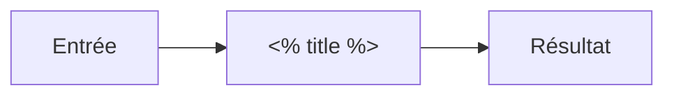

<%*
const safeName = (s) => s.replace(/[\\/:*?"<>|#^\[\]]/g, "-").replace(/\s+/g, " ").trim().slice(0, 90);
const title = safeName((await tp.system.prompt("Nom de la notion")) || tp.file.title);
const moduleFiles = app.vault.getMarkdownFiles()
  .filter(f => f.path.startsWith("99 — Archives/Modules/"))
  .map(f => f.basename).sort();
const mod = (await tp.system.suggester(["— Aucun module —", ...moduleFiles], ["", ...moduleFiles], false, "Module du parcours")) || "";
await tp.file.move("03 — Concepts/" + title);
-%>
---
type: concept
module: <% mod ? `"[[${mod}]]"` : "" %>
related: []
tags:
  - concept
---
# <% title %>

> [!info] En une phrase
>

## 1 · Comprendre
### Définition
-

### Pourquoi ça existe
-

### Le problème résolu
-

## 2 · Explorer
### Comment ça fonctionne


### Exemple concret
```text

```

### Cas d'utilisation
-

> [!warning] À ne pas confondre
>

## 3 · Relier
- **Prérequis** :
- **Notion parente** :
- **Complémentaires** :
- **Utilisé par** :
- **Commandes** :
