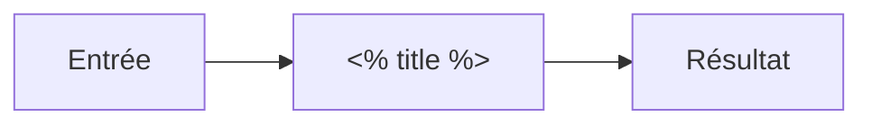

<%*
const safeName = (s) => s.replace(/[\\/:*?"<>|#^\[\]]/g, "-").replace(/\s+/g, " ").trim().slice(0, 90);
const title = safeName((await tp.system.prompt("Nom de la notion")) || tp.file.title);
const moduleFiles = app.vault.getMarkdownFiles()
  .filter(f => f.path.startsWith("01 — Parcours/Modules/"))
  .map(f => f.basename).sort();
const mod = (await tp.system.suggester(["— Aucun module —", ...moduleFiles], ["", ...moduleFiles], false, "Module du parcours")) || "";
const domain = ((await tp.system.prompt("Domaine (git, web, backend, database, devops…)", "")) || "general").toLowerCase();
const level = (await tp.system.suggester(["Débutant", "Intermédiaire", "Avancé"], ["debutant", "intermediaire", "avance"], false, "Difficulté")) || "debutant";
const niveau = (await tp.system.suggester(["0 · Bases du poste", "1 · Réseau et API", "2 · Docker", "3 · CI et équipe", "4 · Serveur et déploiement", "5 · Se perfectionner", "6 · Front, à la demande"], [0, 1, 2, 3, 4, 5, 6], false, "Niveau du parcours")) ?? 0;
await tp.file.move("03 — Concepts/" + title);
-%>
---
type: concept
domain: <% domain %>
module: <% mod ? `"[[${mod}]]"` : "" %>
status: a-decouvrir
level: <% level %>
niveau: <% niveau %>
schema: false
exercice_visuel: false
fil_rouge: false
prerequisites: []
parents: []
related: []
next_review:
tags:
  - concept
  - <% domain %>
---
# <% title %>

> [!info] En une phrase
>

```dataviewjs
await dv.view("10 — Templates/Scripts/learning", { view: "concept" })
```

## 1 · Comprendre
### Définition
-

### Pourquoi ça existe
-

### Le problème résolu
-

## 2 · Explorer
### Comment ça fonctionne


### Exemple concret
```text

```

### Cas d'utilisation
-

> [!warning] À ne pas confondre
>

## 3 · Pratiquer
### Exercice visuel
Sur Excalidraw, **sans regarder la fiche**. Puis je compare avec la fiche, je corrige en rouge ce qui était faux, et j'explique mon dessin à voix haute ou à Claude dans le chat.

> [!example] 🧠 Dessine de mémoire
> _Consigne neutre, valable pour n'importe quel projet._

> [!example] 🔄 Change de contexte
> _Le même dessin dans une autre situation._

### Mon schéma

> [!tip] Mon dessin Excalidraw
> _Je crée le dessin « Schéma - <% title %> » et je l'intègre ici avec `![[Schéma - <% title %>.excalidraw]]`, puis je coche `schema`._

### Appliquer dans le fil rouge
- Étape du fil rouge de son niveau (voir [[Niveaux]]).

## 4 · Relier
- **Prérequis** :
- **Notion parente** :
- **Complémentaires** :
- **Utilisé par** :
- **Commandes** :

## 5 · Réviser
> [!question] Me faire interroger
> Je demande à Claude de m'interroger sur cette notion pour vérifier que je l'ai comprise.

### Validation (compris, puis maîtrisé)
Trois cases à cocher dans les propriétés de la fiche :
- `schema` : mon dessin du concept est dans « Mon schéma » ;
- `exercice_visuel` : j'ai fait et corrigé les exercices visuels de la section 3 ;
- `fil_rouge` : je l'ai appliqué dans le fil rouge (coché tout seul quand une étape qui l'utilise est réussie).

Les trois cochées : la notion compte comme **comprise**. **Maîtrisé** : c'est moi qui le mets dans `status`, quand je le sens.

```dataviewjs
await dv.view("10 — Templates/Scripts/learning", { view: "maitrise" })
```
