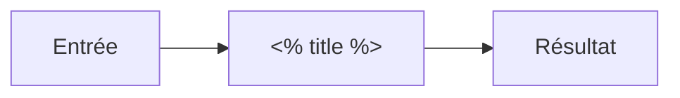

<%*
const safeName = (s) => s.replace(/[\\/:*?"<>|#^\[\]]/g, "-").replace(/\s+/g, " ").trim().slice(0, 90);
const title = safeName((await tp.system.prompt("Nom de la notion")) || tp.file.title);
const moduleFiles = app.vault.getMarkdownFiles()
  .filter(f => f.path.startsWith("01 — Parcours/Modules/"))
  .map(f => f.basename).sort();
const mod = (await tp.system.suggester(["— Aucun module —", ...moduleFiles], ["", ...moduleFiles], false, "Module du parcours")) || "";
const domain = ((await tp.system.prompt("Domaine (git, web, backend, database, devops…)", "")) || "general").toLowerCase();
const level = (await tp.system.suggester(["Débutant", "Intermédiaire", "Avancé"], ["debutant", "intermediaire", "avance"], false, "Niveau")) || "debutant";
await tp.file.move("03 — Concepts/" + title);
-%>
---
type: concept
domain: <% domain %>
module: <% mod ? `"[[${mod}]]"` : "" %>
status: a-decouvrir
level: <% level %>
prerequisites: []
parents: []
related: []
next_review:
method: []
tags:
  - concept
  - <% domain %>
---
# <% title %>

> [!info] En une phrase
>

```dataviewjs
await dv.view("10 — Templates/Scripts/learning", { view: "concept" })
```

## 1 · Comprendre
### Définition
-

### Pourquoi ça existe
-

### Le problème résolu
-

## 2 · Explorer
### Comment ça fonctionne


### Exemple concret
```text

```

### Cas d'utilisation
-

> [!warning] À ne pas confondre
>

## 3 · Pratiquer
-

## 4 · Expliquer
> [!quote] Mon résumé, avec mes mots
> _À écrire sans regarder la fiche. Si je bloque, je ne l'ai pas encore compris._

## 5 · Relier
- **Prérequis** :
- **Notion parente** :
- **Complémentaires** :
- **Utilisé par** :
- **Commandes** :

## 6 · Réviser
> [!question] Me faire interroger
> Je demande à Claude de m'interroger sur cette notion pour vérifier que je l'ai comprise.

### Validation de la maîtrise
La notion est maîtrisée quand j'ai réussi **tous les exercices** qui l'utilisent (statut `reussi` dans l'exercice).

```dataviewjs
await dv.view("10 — Templates/Scripts/learning", { view: "maitrise" })
```
