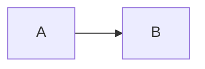

<%*
const safeName = (s) => s.replace(/[\\/:*?"<>|#^\[\]]/g, "-").replace(/\s+/g, " ").trim().slice(0, 90);
const title = safeName((await tp.system.prompt("Titre du cours (ex. Les promesses en JavaScript)")) || tp.file.title);
const moduleFiles = app.vault.getMarkdownFiles()
  .filter(f => f.path.startsWith("01 — Parcours/Modules/"))
  .map(f => f.basename).sort();
const mod = (await tp.system.suggester(["— Aucun module —", ...moduleFiles], ["", ...moduleFiles], false, "Module du parcours")) || "";const conceptFiles = app.vault.getMarkdownFiles()
  .filter(f => f.path.startsWith("03 — Concepts/") && f.basename !== "Concepts")
  .map(f => f.basename).sort();
const picked = [];
while (true) {
  const c = await tp.system.suggester(["✓ Terminé", ...conceptFiles.filter(x => !picked.includes(x))], ["", ...conceptFiles.filter(x => !picked.includes(x))], false, "Concepts liés (un par un)");
  if (!c) break;
  picked.push(c);
}
const folder = mod ? mod.replace(/^Module (\d+) - /, "$1 ") : "Divers";
await tp.file.move("02 — Cours/" + folder + "/Cours - " + title);
-%>
---
type: course
order:
module: <% mod ? `"[[${mod}]]"` : "" %>
concepts:
<% picked.length ? picked.map(c => `  - "[[${c}]]"`).join("\n") : "  []" %>
tags:
  - cours
---
# Cours - <% title %>

> [!abstract] Objectifs
> - À la fin, je saurai…
> -

**Prérequis :**

## 1.
Explication progressive : du plus simple au plus complet.

## 2. Schéma


## 3. Exemples
```js

```

## Mise en pratique
-

> [!warning] Erreurs fréquentes
> -

## Résumé
En 3 phrases, avec mes mots.

## Concepts du cours
<% picked.map(c => `[[${c}]]`).join(" · ") %>
