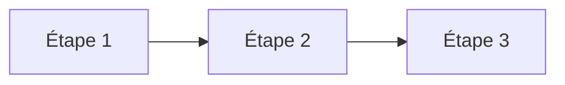

<%*
const safeName = (s) => s.replace(/[\\/:*?"<>|#^\[\]]/g, "-").replace(/\s+/g, " ").trim().slice(0, 90);
const title = safeName((await tp.system.prompt("Nom du projet")) || tp.file.title);
const conceptFiles = app.vault.getMarkdownFiles()
  .filter(f => f.path.startsWith("03 — Concepts/") && f.basename !== "Concepts")
  .map(f => f.basename).sort();
const picked = [];
while (true) {
  const c = await tp.system.suggester(["✓ Terminé", ...conceptFiles.filter(x => !picked.includes(x))], ["", ...conceptFiles.filter(x => !picked.includes(x))], false, "Concepts liés (un par un)");
  if (!c) break;
  picked.push(c);
}
await tp.file.move("07 — Exercices et projets/Projet - " + title);
-%>
---
type: project
status: a-faire
difficulty: moyen
concepts:
<% picked.length ? picked.map(c => `  - "[[${c}]]"`).join("\n") : "  []" %>
tags:
  - projet
---
# Projet — <% title %>

> [!info] Le projet
> Ce que fait l'application, pour qui, et ce que je veux apprendre en la construisant.

## Étape 1 —
- [ ]

## Étape 2 —
- [ ]

## Étape 3 —
- [ ]

## Journal du projet
- <% tp.date.now("DD/MM") %> — Démarrage
