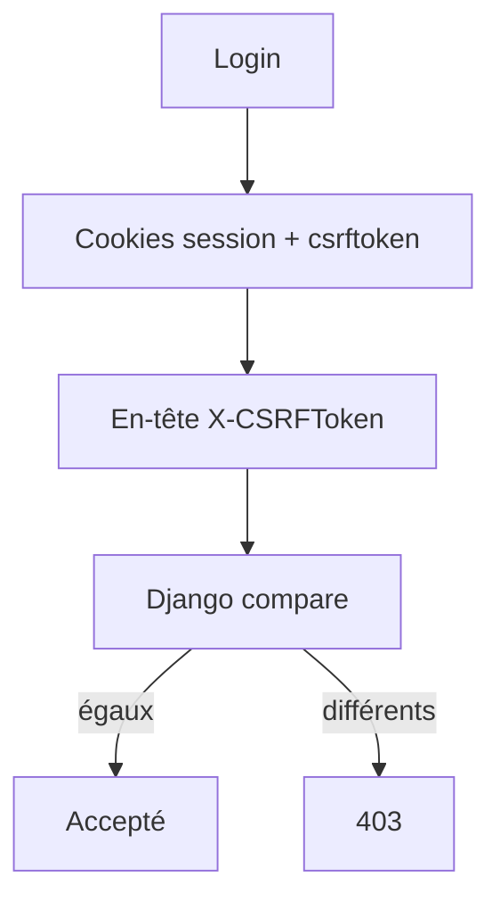

# CSRF au travail

> [!info] D'où vient cette note
> Les passages propres à mon travail (CVAT, Nuclio, réseau de l'entreprise) sortis de la fiche neutre [[CSRF]] le 19/11/2026.

## Cas d'utilisation au travail
- Applications à cookie de session, comme l'interface CVAT
- Comprendre un `403 CSRF Failed` en appelant l'API CVAT

## Dans CVAT (vérifié dans son code)
CVAT est fait avec **Django** et **Django REST Framework**. Il accepte quatre façons de prouver qui tu es :

| Façon | Ce qui est envoyé | Jeton CSRF demandé ? |
|---|---|---|
| **Session** (l'interface web) | cookie `sessionid` | **oui**, pour `POST`, `PUT`, `PATCH`, `DELETE` |
| Basic | `Authorization: Basic …` (`auth=(user, mdp)` avec requests) | non |
| Jeton | `Authorization: Token …` | non |
| Jeton d'accès personnel | `Authorization: Bearer …` | non |

Pourquoi seule la session : le cookie part **tout seul** avec chaque requête, même lancée par un autre site. Un en-tête `Authorization`, lui, n'est jamais ajouté par le navigateur sans ton code.

Ce qui se passe avec l'interface :
1. `POST /api/auth/login` : le serveur renvoie deux cookies, `sessionid` (qui tu es) et **`csrftoken`** (une valeur aléatoire).
2. À chaque requête qui modifie quelque chose, l'interface **recopie** la valeur du cookie `csrftoken` dans l'en-tête **`X-CSRFToken`**. C'est réglé une fois pour toutes dans `cvat-core` (axios : `xsrfCookieName = 'csrftoken'`, `xsrfHeaderName = 'X-CSRFTOKEN'`).
3. Django compare l'en-tête au cookie, et vérifie que l'en-tête `Origin` est bien CVAT lui-même ou une adresse de `CSRF_TRUSTED_ORIGINS`.

Le site piège ne peut pas réussir l'étape 2 : il ne peut pas **lire** le cookie `csrftoken` de CVAT, donc il ne connaît pas la valeur à mettre dans l'en-tête.

Les erreurs que tu peux croiser (toutes en `403` ; le texte exact peut varier selon la version de Django) :
- `CSRF Failed: CSRF token missing.` : cookie de session envoyé, mais pas d'en-tête `X-CSRFToken`.
- `CSRF Failed: CSRF token from the 'X-Csrftoken' HTTP header incorrect.` : l'en-tête ne correspond pas au cookie.
- `CSRF Failed: Origin checking failed - http://localhost:3000 does not match any trusted origins.` : la page vient d'une adresse que Django ne connaît pas. C'est ce que tu as réglé pour le mode dev avec `CSRF_TRUSTED_ORIGINS` (ta fiche « CVAT, mode dev de l'interface »).

Et pour toi :
- **Ta fonction Nuclio** appelle CVAT avec `auth=(user, mdp)` : c'est du Basic, donc **pas de CSRF**.
- **Le SDK CVAT** se connecte par session, et recopie lui-même `csrftoken` dans `X-CSRFToken`. Avec un jeton d'accès (`access_token=`), pas de cookie, donc pas de CSRF.
- **Le bouton** : s'il passe par `cvat-core`, c'est automatique. S'il appelle l'API de CVAT avec un `fetch` à toi (en `POST`), c'est à toi d'ajouter `X-CSRFToken`.

