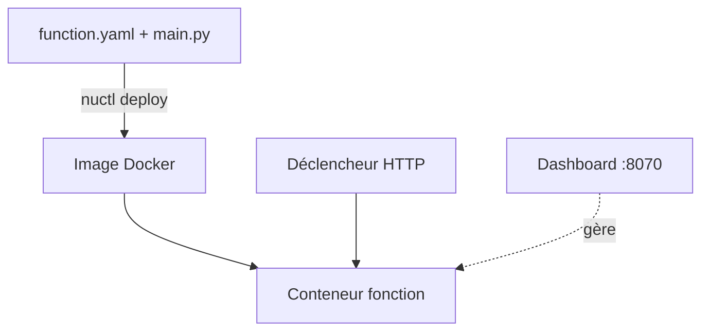

# Serverless et FaaS au travail

> [!info] D'où vient cette note
> Les passages propres à mon travail (CVAT, Nuclio, réseau de l'entreprise) sortis de la fiche neutre [[Serverless et FaaS]] le 19/11/2026.

## Cas d'utilisation au travail
- Fonctions d'annotation automatique de CVAT (Nuclio)

## Nuclio, pièce par pièce

- **Le dashboard** (port `8070`) : le chef d'orchestre. Il construit les images, lance les conteneurs, liste les fonctions. CVAT lui parle.
- **`nuctl`** : la commande pour parler au dashboard depuis le terminal (`nuctl deploy`, `nuctl get function`, `nuctl invoke`). Avec CVAT en local : `--platform local`.
- **La fonction** : un conteneur Docker à part, avec ton code et un « processeur » Nuclio qui reçoit les événements et appelle ton `handler`.
- **Le déclencheur** (*trigger*) : ce qui réveille la fonction. Pour toi, `http`, sur un port fixe (`32001`).

## Deux façons d'appeler une fonction depuis CVAT
| | Par CVAT (« Models », annotation auto) | En direct (ton bouton) |
|---|---|---|
| Qui appelle | le serveur CVAT, via le dashboard Nuclio | le navigateur, sur le port de la fonction |
| Condition | `metadata.annotations.type` connu de CVAT (`detector`, `interactor`, `tracker`…) | un port fixe dans le déclencheur |
| [[CORS]] | non (serveur à serveur) | **oui** (autre origine) |
| Qui vérifie l'utilisateur | CVAT | personne, sauf si ta fonction le fait |

Ta fonction `convert-png` est du second type (`type: external`) : CVAT l'ignore dans « Models », et c'est à toi de gérer CORS.

