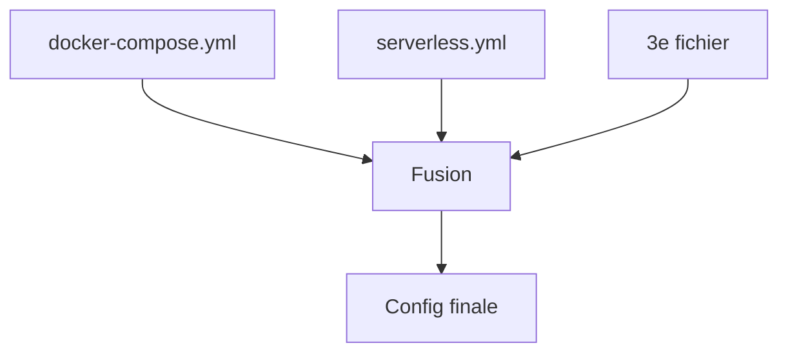

# Empiler des fichiers compose

> [!info] En une phrase
> `docker compose` accepte plusieurs fichiers avec `-f` : il les lit dans l'ordre et les **fusionne**, ce qui permet de modifier un service sans toucher au fichier d'origine.

## Exemple avec CVAT
```bash
docker compose -f docker-compose.yml \
  -f components/serverless/docker-compose.serverless.yml \
  -f <3e fichier> up -d
```



## Les règles de la fusion
- même nom de service dans deux fichiers = même service : le second le **modifie** ;
- seuls les champs écrits dans le second fichier changent ;
- pour une même clé (`image:`, une variable…), **le dernier fichier gagne** ;
- les listes comme `volumes:` s'**ajoutent**.

## Pourquoi pas modifier `docker-compose.yml` directement
C'est le fichier officiel de CVAT. Mes réglages resteraient mélangés avec le projet et feraient des conflits à chaque mise à jour. Un petit fichier à part s'ajoute quand j'en ai besoin.

> [!success] Vérifier
> `docker compose -f … -f … -f … config` affiche la configuration finale sans rien lancer.

## Où je m'en sers
- [[Fiche - CVAT, mode dev de l'interface]] : le 3e fichier modifie `cvat_server`.
- [[Fiche - CVAT, image de la CI GitLab]] : le 3e fichier modifie `cvat_ui`.

## Avec mes mots
> [!quote] Mon résumé, avec mes mots
> _Que se passe-t-il quand deux fichiers parlent du même service ?_

## Liens
[[Docker Compose]] · [[docker compose up]] · [[Fiche - CVAT, lancer mon interface]]
