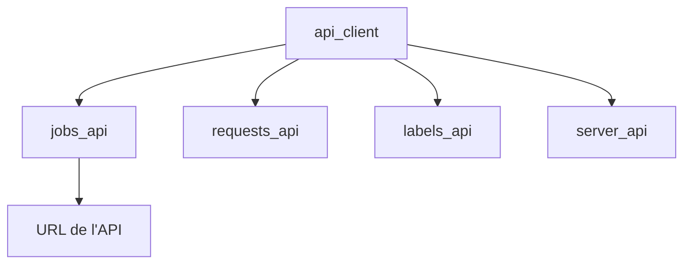

# Fiche - CVAT, api_client du SDK

> [!info] En bref
> `api_client` est l'étage **bas niveau** du SDK `cvat-sdk` (2.81.0) : **une fonction Python = une URL de l'API**.
> Il ne fait rien de plus que la requête : pas d'attente, pas de téléchargement. Chaque exemple montre un outil seul.

## La règle à retenir
| Règle | Exemple |
| --- | --- |
| les fonctions sont rangées par ressource : `<ressource>_api` | `jobs_api`, `tasks_api`, `labels_api`, `requests_api`, `server_api`, `auth_api` |
| le nom vient de la méthode HTTP | `GET` → `retrieve_…` ou `list`, `POST` → `create_…`, `PATCH` → `partial_update_…` |
| on passe d'abord les paramètres obligatoires, puis les autres **avec leur nom** | `create_dataset_export("CVAT for images 1.1", 3507, save_images=True)` |
| chaque appel renvoie **deux** valeurs | `donnees, reponse_http = …` |
| en cas d'erreur HTTP, une exception | `ApiException` (400…), `NotFoundException` (404) |
| un nom qui n'existe pas sur `api_client` | message trompeur : `cannot unpack non-iterable object object` (bug du SDK) |



## 0. Obtenir un `api_client`
| Manière | Outil | Remarque |
| --- | --- | --- |
| depuis `make_client` | `client.api_client` | **le plus simple** : déjà connecté |
| tout seul, user + mot de passe | `ApiClient(Configuration(host=…, username=…, password=…))` | authentification Basic |
| tout seul, jeton PAT | `ApiClient(Configuration(host=…, access_token=…))` | en-tête `Authorization: Bearer …` |

**Depuis `make_client`**
```python
from cvat_sdk import make_client

with make_client("http://172.28.8.57", credentials=("user", "mdp")) as client:
    api = client.api_client
```

**Tout seul**
```python
from cvat_sdk.api_client import ApiClient, Configuration

configuration = Configuration(host="http://172.28.8.57", username="user", password="mdp")
with ApiClient(configuration) as api:
    ...
```

**Tout seul, avec un jeton**
```python
configuration = Configuration(host="http://172.28.8.57", access_token="le_jeton")
```

## 1. Données du job et d'un folio
| URL | Outil | Dans `donnees` |
| --- | --- | --- |
| `GET /api/jobs/{id}` | `jobs_api.retrieve(id)` | `.task_id`, `.start_frame`, `.stop_frame` |
| `GET /api/jobs/{id}/data/meta` | `jobs_api.retrieve_data_meta(id)` | `.frames` (chaque frame : `.name`, `.width`, `.height`) |
| `GET /api/jobs/{id}/data?type=frame&number=n` | `jobs_api.retrieve_data(id, type="frame", number=n, quality="original")` | rien d'utile : l'image est dans `reponse_http.data` |
| `GET /api/jobs/{id}/annotations` | `jobs_api.retrieve_annotations(id)` | `.shapes` (chaque forme : `.frame`, `.type`, `.label_id`, `.points`) |
| `GET /api/labels?job_id={id}` | `labels_api.list(job_id=id)` | `.results` (chaque label : `.id`, `.name`) |

**Le job**
```python
job, _ = api.jobs_api.retrieve(3507)
print(job.task_id, job.start_frame, job.stop_frame)
```

**Les infos des frames**
```python
meta, _ = api.jobs_api.retrieve_data_meta(3507)
print(meta.frames[0].name, meta.frames[0].width, meta.frames[0].height)
```

**Une image**
```python
_, reponse = api.jobs_api.retrieve_data(3507, type="frame", number=0, quality="original")
contenu = reponse.data          # les bytes de l'image
```

**Les annotations**
```python
annotations, _ = api.jobs_api.retrieve_annotations(3507)
forme = annotations.shapes[0]
print(forme.frame, forme.type, forme.label_id, forme.points)
```

**Les labels**
```python
labels, _ = api.labels_api.list(job_id=3507)
for label in labels.results:
    print(label.id, label.name)
```

## 2. Exporter les annotations (« CVAT for images 1.1 »)
Trois appels, comme avec l'API à la main.

| Étape | URL | Outil | Dans `donnees` |
| --- | --- | --- | --- |
| lancer | `POST /api/jobs/{id}/dataset/export` | `jobs_api.create_dataset_export(format, id, save_images=…)` | `.rq_id` |
| suivre | `GET /api/requests/{rq_id}` | `requests_api.retrieve(rq_id)` | `.status`, `.progress`, `.message`, `.result_url` |
| télécharger | `GET result_url` | `requests.get(result_url, auth=…)` | les bytes du ZIP |

Options de `create_dataset_export` :

| Option | Rôle |
| --- | --- |
| `save_images=True/False` | avec ou sans les images |
| `filename="nom.zip"` | nom du ZIP créé par CVAT (facultatif) |
| `location="local"` | garder le ZIP sur le serveur et donner un lien (par défaut) |
| `location="cloud_storage"` + `cloud_storage_id=…` | envoyer le ZIP vers un stockage cloud |

**Lancer**
```python
rq, _ = api.jobs_api.create_dataset_export("CVAT for images 1.1", 3507, save_images=True)
print(rq.rq_id)
```

**Suivre**
```python
etat, _ = api.requests_api.retrieve("le_rq_id")
print(etat.status.value, etat.progress, etat.result_url)
```
`status.value` vaut `"queued"`, `"started"`, `"finished"` ou `"failed"`.

**Attendre une seconde** (pour une boucle)
```python
import time
time.sleep(1)
```

**Télécharger**
```python
import requests
reponse = requests.get("le_result_url", auth=("user", "mdp"), timeout=120)
contenu_zip = reponse.content
```

## 3. Utiles en plus
| Je veux… | Outil |
| --- | --- |
| la liste des formats d'export | `server_api.retrieve_annotation_formats()` → `.exporters` (chaque format : `.name`) |
| la version du serveur | `server_api.retrieve_about()` → `.version` |
| attraper une erreur HTTP | `from cvat_sdk.api_client.exceptions import ApiException` puis `except ApiException as e:` → `e.status`, `e.body` |

```python
formats, _ = api.server_api.retrieve_annotation_formats()
for f in formats.exporters:
    print(f.name)
```

> [!tip] Lire la doc générée
> Les exemples de la doc mettent des valeurs bidon (`"format_example"`) et **toutes** les options. Ne garder que les obligatoires et celles dont j'ai besoin.

## api_client ou client ?
| | `client.jobs…` | `client.api_client…` |
| --- | --- | --- |
| attente de l'export | faite pour moi | ma boucle |
| ce que je contrôle | peu | chaque requête |
| proche de l'API | non | oui, une URL = une fonction |

## Avec mes mots
> [!quote] Mon résumé, avec mes mots
>

## Liens
[[Fiche - CVAT, le SDK Python]] · [[Authentification]] · [[Appeler une API HTTP]] · [[Archive zip (zipfile)]] · [[Fichier en mémoire (io.BytesIO)]]
