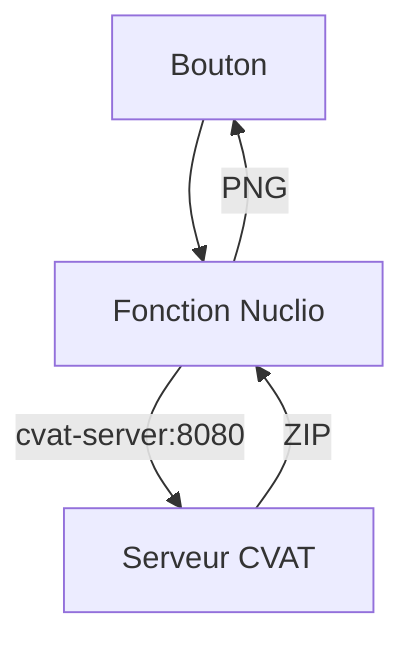

# Fiche - CVAT, la fonction Nuclio appelle le serveur

> [!info] Objectif
> Comprendre comment ma fonction Nuclio parle au serveur CVAT, et quels fichiers compose lancer dans chaque mode.

## Le trajet

La fonction est dans un conteneur, sur le réseau `cvat_cvat`. Elle appelle le serveur **directement par son nom**, sans passer par Traefik.

Deux pièges, expliqués dans leur propre note :
- quel nom utiliser → [[Noms et alias sur un réseau Docker]]
- pourquoi `cvat_server` est refusé → [[Pourquoi Django refuse cvat_server]]

## La réponse : `CVAT_URL = http://cvat-server:8080`

## Quel fichier compose dans quel mode
| Fichier ajouté avec `-f` | Rôle | Mode dev (`:3000`) | Mode normal (`:8080`) |
| --- | --- | --- | --- |
| `docker-compose.ui-dev.yml` (hors dépôt) | CSRF : variable + volume `settings.py` | ✅ | ❌ |
| `docker-compose.registry.yml` | interface construite par la CI | ❌ | ✅ si je veux l'image CI |
| `docker-compose.processing.yml` | alias `cvat-server` | ✅ | ✅ |

L'alias est dans **son propre fichier** parce qu'il sert dans les deux modes. Voir [[Empiler des fichiers compose]].

## Commandes
Mode dev :
```bash
docker compose -f docker-compose.yml \
  -f components/serverless/docker-compose.serverless.yml \
  -f docker-compose.processing.yml \
  -f ~/Projet/CVAT/dev-ui/docker-compose.ui-dev.yml up -d
```
Mode normal (image de la CI) :
```bash
CVAT_IMAGE_TAG=<commit> docker compose -f docker-compose.yml \
  -f components/serverless/docker-compose.serverless.yml \
  -f docker-compose.processing.yml \
  -f docker-compose.registry.yml up -d
```

> [!success] Vérifier
> ```bash
> docker exec $(docker ps --format '{{.Names}}' | grep convert-graph) \
>   python -c "import requests; print(requests.get('http://cvat-server:8080/api/server/about').status_code)"
> ```
> → `200`

## Avec mes mots
> [!quote] Mon résumé, avec mes mots
>

## Liens
[[Noms et alias sur un réseau Docker]] · [[Pourquoi Django refuse cvat_server]] · [[Empiler des fichiers compose]] · [[Fiche - CVAT, mode dev de l'interface]] · [[Fiche - CVAT, image de la CI GitLab]]
