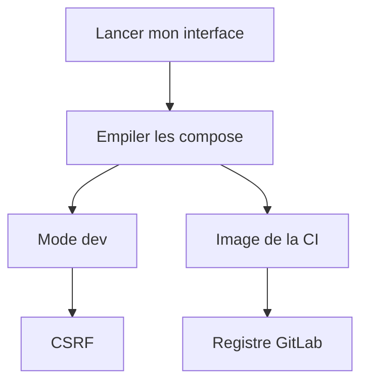

# Fiche - CVAT, lancer mon interface

> [!info] Objectif
> Choisir comment lancer CVAT avec **mon** interface (celle qui a le bouton du plugin).

Il y a deux façons. Les deux reposent sur la même astuce : [[Empiler des fichiers compose]].

| Je veux… | Note à suivre | Adresse |
| --- | --- | --- |
| coder et voir le résultat tout de suite | [[Fiche - CVAT, mode dev de l'interface]] | `localhost:3000` |
| vérifier l'image construite par GitLab | [[Fiche - CVAT, image de la CI GitLab]] | `localhost:8080` |

## Comment les notes sont reliées

## Dans quel ordre
1. Je code en [[Fiche - CVAT, mode dev de l'interface|mode dev]] jusqu'à ce que le bouton marche.
2. Je pousse sur GitLab, la CI construit l'image.
3. Je vérifie avec l'[[Fiche - CVAT, image de la CI GitLab|image de la CI]].

## Avec mes mots
> [!quote] Mon résumé, avec mes mots
> _Quand j'utilise l'une ou l'autre, et pourquoi pas toujours la même ?_

## Liens
[[Empiler des fichiers compose]] · [[Fiche - CVAT, mode dev de l'interface]] · [[Fiche - CVAT, image de la CI GitLab]]
