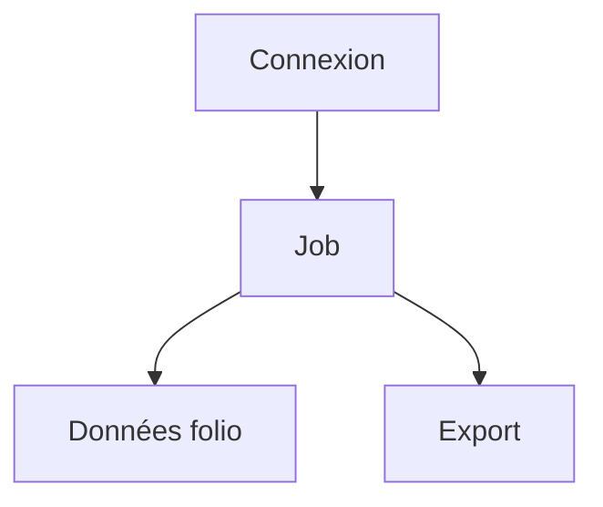
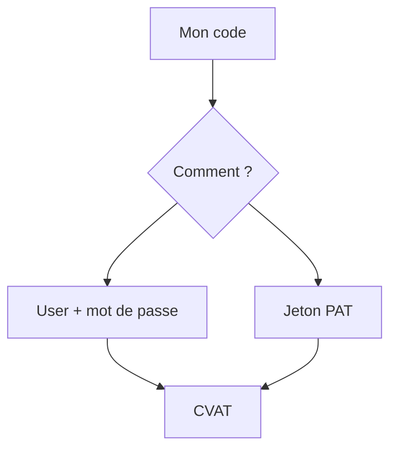

# Fiche - CVAT, le SDK Python

> [!info] En bref
> Les outils du SDK `cvat-sdk` (version 2.81.0) pour : **m'authentifier**, **récupérer les données d'un job et d'un folio**, **exporter les annotations** en « CVAT for images 1.1 ».
> Chaque exemple montre un outil seul. À moi de les assembler.



## 0. S'authentifier



### Les manières possibles
| Manière | Avec le SDK | Avec `requests` | Quand l'utiliser |
| --- | --- | --- | --- |
| **Utilisateur + mot de passe** | `make_client(url, credentials=(user, mdp))` | `auth=(user, mdp)` (Basic) | tests, scripts perso |
| **Jeton d'accès personnel (PAT)** | `make_client(url, access_token=jeton)` | en-tête `Authorization: Bearer <jeton>` | une fonction, une CI : pas de mot de passe dans le code, révocable |
| **Ancien jeton de session** | (géré tout seul par le SDK) | `POST /api/auth/login` → `{"key": …}`, puis en-tête `Authorization: Token <key>` | vieux scripts, à éviter |

> [!info] Ce que fait le SDK
> Avec `credentials=`, il appelle `POST /api/auth/login` et garde les cookies `sessionid` et `csrftoken`.
> Avec `access_token=`, il ajoute `Authorization: Bearer …` à chaque requête.
> On ne peut pas donner les deux en même temps.

**Utilisateur + mot de passe**
```python
from cvat_sdk import make_client

with make_client("http://172.28.8.57", credentials=("user", "mdp")) as client:
    ...   # tout le reste se fait ici, avec client
```

**Jeton PAT** (créé dans CVAT : menu du compte en haut à droite → profil → jetons d'accès personnels)
```python
with make_client("http://172.28.8.57", access_token="le_jeton") as client:
    ...
```

**Avec `requests`, sans le SDK**
```python
requests.get(url, auth=("user", "mdp"))                              # user + mot de passe
requests.get(url, headers={"Authorization": "Bearer le_jeton"})      # PAT
```

**Se connecter / se déconnecter à la main**
```python
client.login(("user", "mdp"))
client.has_credentials()     # True si connecté
client.logout()
```

### Où ranger les secrets
| Où | Comment | Remarque |
| --- | --- | --- |
| variable d'environnement | `os.environ["CVAT_PASSWORD"]` | rien dans le code |
| fichier `.env` | `set -a; source .env; set +a` ou `python-dotenv` | **toujours** dans `.gitignore` |
| fonction Nuclio | `spec.env` dans `function.yaml`, secret via `nuctl deploy --env` | jamais le mot de passe dans le YAML |
| CI GitLab | *Settings → CI/CD → Variables*, cochée « Masked » | n'apparaît pas dans les logs |

> [!warning] Erreurs à reconnaître
> `400 Unable to log in with provided credentials` → mauvais user ou mot de passe (ou compte d'un autre CVAT).
> `401` → pas authentifié (jeton absent ou invalide).
> `403` → authentifié, mais pas le droit sur ce job.

## 1. Récupérer les données du job et d'un folio

| Outil | Ce que ça donne | Équivalent API |
| --- | --- | --- |
| `client.jobs.retrieve(id)` | le job | `GET /api/jobs/{id}` |
| `job.start_frame`, `job.stop_frame` | 1re et dernière frame du job | |
| `job.get_frames_info()` | les infos de chaque frame | `GET /api/jobs/{id}/data/meta` |
| `job.get_frame(n, quality="original")` | l'image n°n en mémoire | `GET /api/jobs/{id}/data?type=frame&number=n` |
| `job.get_annotations()` | toutes les annotations | `GET /api/jobs/{id}/annotations` |
| `job.get_labels()` | les labels (id → nom) | `GET /api/labels?job_id={id}` |

**Le job**
```python
job = client.jobs.retrieve(3507)
print(job.task_id, job.start_frame, job.stop_frame)
```

**Les infos des frames**
```python
frames = job.get_frames_info()
print(len(frames))                       # nombre de frames
print(frames[0].name, frames[0].width, frames[0].height)
```

**Une image**
```python
image = job.get_frame(0, quality="original")
contenu = image.read()                   # les bytes de l'image
```

**Les annotations**
```python
annotations = job.get_annotations()
forme = annotations.shapes[0]
print(forme.frame, forme.type, forme.label_id, forme.points)
```

**Les labels**
```python
for label in job.get_labels():
    print(label.id, label.name)
```

> [!warning] Numérotation
> `forme.frame` est un numéro de frame **de la tâche**. `job.start_frame` dit où commence le job.

## 2. Exporter les annotations (« CVAT for images 1.1 »)

### Version courte : tout en un
| Outil | Rôle |
| --- | --- |
| `job.export_dataset(format, fichier, include_images=…)` | demande, attend et télécharge le ZIP |

```python
job.export_dataset("CVAT for images 1.1", "export.zip", include_images=True)
```
`include_images=False` → seulement `annotations.xml`.

### Version manuelle : étape par étape
| Étape | Outil | Équivalent API |
| --- | --- | --- |
| lancer l'export | `client.api_client.jobs_api.create_dataset_export(format, id, save_images=…)` | `POST /api/jobs/{id}/dataset/export?format=…&save_images=…` |
| attendre la fin | `client.wait_for_completion(rq_id)` | `GET /api/requests/{rq_id}` en boucle |
| le lien du ZIP | `requete.result_url` | champ `result_url` |

**Lancer**
```python
rq, _ = client.api_client.jobs_api.create_dataset_export(
    "CVAT for images 1.1", 3507, save_images=True
)
print(rq.rq_id)
```

**Attendre**
```python
requete, _ = client.wait_for_completion("le_rq_id")
print(requete.status, requete.result_url)
```

**Télécharger** (le lien demande d'être connecté)
```python
import requests
reponse = requests.get("le_result_url", auth=("user", "mdp"), timeout=120)
contenu_zip = reponse.content
```

## 3. Lire le ZIP et le XML
| Outil | Rôle |
| --- | --- |
| `io.BytesIO(contenu)` | faire passer des bytes pour un fichier |
| `zipfile.ZipFile(...)` | ouvrir le ZIP |
| `xml.etree.ElementTree` | lire `annotations.xml` |

```python
import io, zipfile
with zipfile.ZipFile(io.BytesIO(contenu_zip)) as z:
    print(z.namelist())                  # annotations.xml, images/...
    xml_bytes = z.read("annotations.xml")
```

```python
import xml.etree.ElementTree as ET
racine = ET.fromstring(xml_bytes)
for image in racine.findall("image"):
    print(image.get("id"), image.get("name"))
```

## 4. Si un outil manque
`client.api_client.<nom>_api` : une fonction par URL (`jobs_api`, `tasks_api`, `requests_api`, `server_api`). Chaque appel renvoie `donnees, reponse_http`.
Liste des formats d'export : `client.api_client.server_api.retrieve_annotation_formats()`.

## Avec mes mots
> [!quote] Mon résumé, avec mes mots
>

## Liens
[[Authentification]] · [[Variable d'environnement]] · [[Appeler une API HTTP]] · [[Archive zip (zipfile)]] · [[Fichier en mémoire (io.BytesIO)]] · [[Fiche - Nuclio, le SDK Python]]
