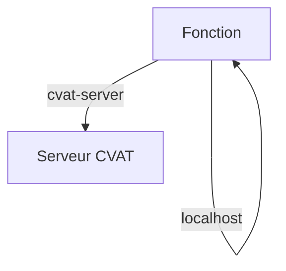

# Noms et alias sur un réseau Docker

> [!info] En une phrase
> Sur un même réseau Docker, un conteneur en joint un autre **par son nom** : Docker a un petit annuaire (DNS interne) qui traduit le nom en adresse IP.

## `localhost` dans un conteneur
`localhost` = **le conteneur lui-même**, jamais mon PC ni un autre conteneur.
Ma fonction avec `localhost:8080` s'appelait **elle-même** (Nuclio écoute sur 8080 dans son conteneur).



## Qui décide des noms ?
Le **fichier compose** :
```yaml
services:
  cvat_server:                    # nom du service      (choisi par CVAT)
    container_name: cvat_server   # nom du conteneur    (choisi par CVAT)
    networks:
      cvat:
        aliases:
          - cvat-server           # alias               (choisi par moi)
```
Docker connaît les trois. Il faut être **sur le même réseau** (pour ma fonction : `--platform-config '{"attributes": {"network": "cvat_cvat"}}'` au `nuctl deploy`).

## Un alias
Un **deuxième nom** pour le même conteneur. Il **ajoute**, il ne retire rien : `cvat_server` marche toujours pour Docker (`docker exec cvat_server …`).

Pourquoi un alias plutôt que…
| Autre idée | Problème |
| --- | --- |
| renommer le conteneur | nom défini dans le compose officiel, utilisé ailleurs |
| utiliser l'IP | change à chaque redémarrage |
| forcer l'en-tête `Host` | bricolage, compliqué avec le SDK |

Précautions : nom **unique** sur le réseau, et nom du réseau tel qu'écrit dans le compose (`cvat`, que Docker appelle `cvat_cvat`).

## Avec mes mots
> [!quote] Mon résumé, avec mes mots
>

## Liens
[[Fiche - CVAT, la fonction Nuclio appelle le serveur]] · [[Pourquoi Django refuse cvat_server]] · [[Conteneur]] · [[Port]]
