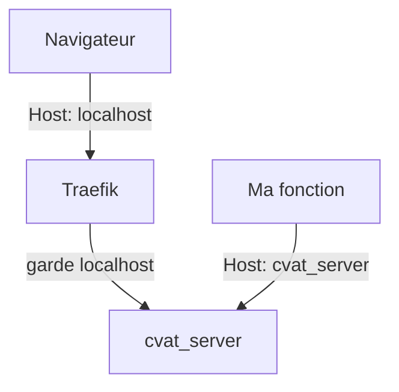

# Pourquoi Django refuse cvat_server

> [!info] En une phrase
> Django lit le **nom** écrit dans chaque requête (en-tête `Host`) et refuse un nom invalide : `cvat_server` contient un `_`, interdit dans un nom de machine.

## Le symptôme
```
400 Bad Request (page HTML vide)
```
Dans `docker logs cvat_server` :
```
DisallowedHost: Invalid HTTP_HOST header: 'cvat_server:8080'.
The domain name provided is not valid according to RFC 1034/1035.
```

| Nom dans `CVAT_URL` | Docker le trouve ? | Django l'accepte ? |
| --- | --- | --- |
| `cvat_server` | ✅ | ❌ `_` interdit |
| `cvat-server` | ✅ | ✅ |

## Pourquoi ça n'avait jamais cassé
Personne n'appelait Django avec ce nom avant ma fonction.

- le **navigateur** appelle `localhost:8080` → Traefik garde le nom `localhost` → valide ;
- `cvat_ui` ne parle **jamais** au serveur : il donne juste les fichiers, c'est le navigateur qui appelle l'API ;
- les workers passent par la base et redis, pas par l'API ;
- **ma fonction** appelle directement par le nom du conteneur → le `_` arrive à Django.

## Ce qui ne marche PAS
`ALLOWED_HOSTS` : il valait déjà `*` (tous les noms **valides**). Un nom invalide est refusé avant même cette liste. La restreindre n'aide pas.

## La solution
Un alias sans `_` → [[Noms et alias sur un réseau Docker]], et `CVAT_URL = http://cvat-server:8080`.

## Avec mes mots
> [!quote] Mon résumé, avec mes mots
>

## Liens
[[Fiche - CVAT, la fonction Nuclio appelle le serveur]] · [[Noms et alias sur un réseau Docker]] · [[CSRF]]
