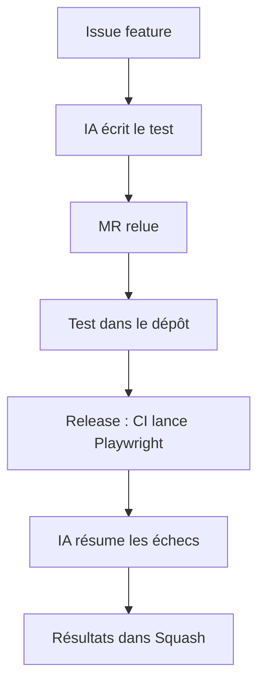
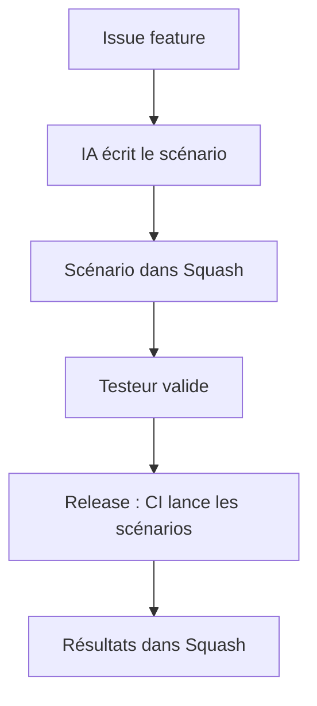
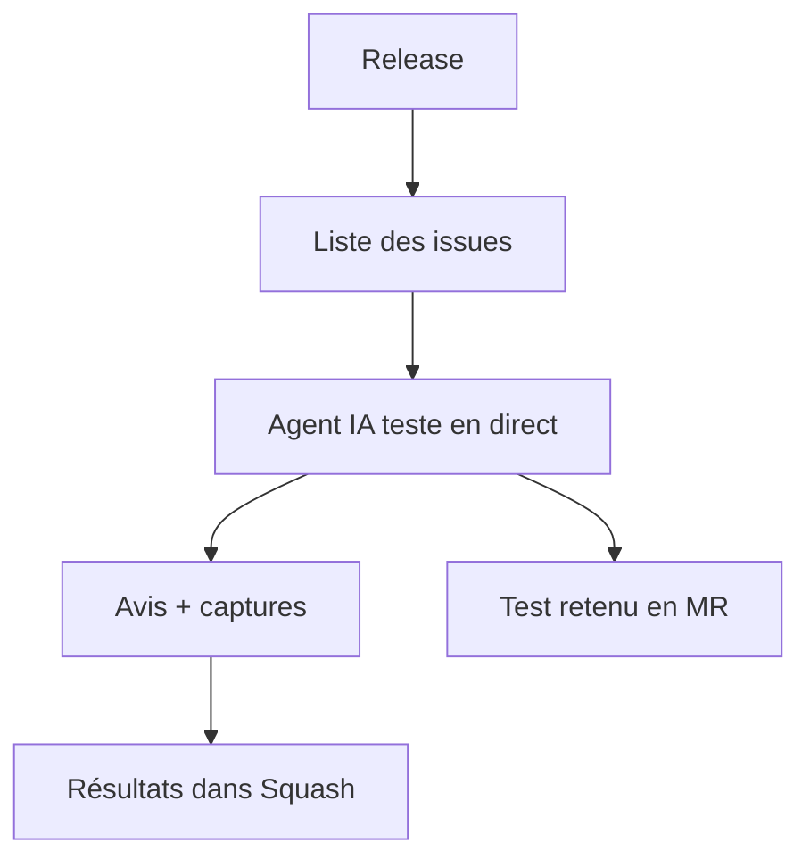

# 3 solutions pour ton mémoire : Playwright + IA + Squash TM

Le but est le même dans les 3 cas : **à chaque release, l'application est testée avec Playwright, une IA aide à créer les tests à partir des issues, et les résultats arrivent dans Squash TM.**

Ce qui change d'une solution à l'autre, c'est **ce que fait l'IA** et **à quel moment** elle le fait.

> Petit vocabulaire avant de commencer
> - **Issue feature** : la fiche GitLab qui décrit une nouvelle fonctionnalité.
> - **Critère d'acceptation** : une phrase qui dit quand la fonctionnalité est « bonne ». Exemple : « si le mot de passe est faux, un message d'erreur s'affiche ».
> - **Test Playwright** : un petit programme qui ouvre un navigateur, clique comme un humain et vérifie ce qui s'affiche.
> - **Squash TM** : l'outil où l'on range les cas de test et où l'on voit lesquels ont réussi ou échoué.
> - **Merge request (MR)** : une demande pour ajouter du code au projet, que quelqu'un relit avant d'accepter.

---

## Solution 1 : l'IA écrit le code des tests, un humain relit

**L'idée en une phrase :** l'IA est un *stagiaire qui écrit les tests*, un humain les relit une fois, puis ils sont rejoués automatiquement à chaque release.

### Comment ça marche



1. Pendant le dev, quand une issue est prête, l'IA lit l'issue, ouvre l'application de recette et écrit un fichier de test Playwright.
2. Ce test arrive dans une merge request. Un humain le relit (2 à 3 minutes) et l'accepte ou le corrige.
3. Le test porte l'identifiant du cas Squash dans son nom (ex. `TC-42`).
4. À la release, GitLab CI lance tous les tests. Un petit script Python lit les résultats et les envoie à Squash par son API.
5. Pour chaque test qui échoue, l'IA écrit un court résumé de la cause, ajouté dans Squash.

### Une image pour comprendre

C'est comme un stagiaire qui écrit des recettes de cuisine. Le chef relit chaque recette une fois. Ensuite, on la refait à chaque service sans redemander au stagiaire.

### Points forts
- **Fiable** : les tests sont toujours les mêmes à chaque release, donc les résultats sont comparables.
- **Pas cher** : l'IA ne travaille qu'une fois par issue.
- **Facile à expliquer** dans le mémoire et facile à mesurer (temps gagné, % de tests acceptés sans retouche).

### Points faibles
- Il faut quelqu'un qui sache lire du code Playwright pour relire.
- Squash ne contient que les résultats : les cas de test y sont créés à la main (ou par un script).

### Coût
Outils gratuits (GitLab, Playwright, Squash TM Community). Seul l'appel à l'IA coûte un peu, une fois par issue.

---

## Solution 2 : l'IA écrit les cas de test en français dans Squash, le code suit

**L'idée en une phrase :** l'IA n'écrit pas du code mais des **scénarios en langage naturel** (format « Étant donné… Quand… Alors… »), rangés dans Squash. Ces phrases sont ensuite reliées à des petits morceaux de code Playwright réutilisables.

### Comment ça marche



1. L'IA lit l'issue et écrit un scénario, par exemple :
   ```gherkin
   Étant donné que je suis sur la page de connexion
   Quand je saisis un mauvais mot de passe
   Alors je vois le message "Identifiants incorrects"
   ```
2. Ce scénario est créé directement dans **Squash** (Squash sait gérer ce format, appelé BDD ou Gherkin). Un testeur le relit **dans Squash**, sans lire de code.
3. Chaque phrase (« je saisis un mauvais mot de passe ») correspond à un petit bloc de code Playwright écrit une seule fois et réutilisé partout. Si une phrase nouvelle apparaît, l'IA propose le bloc de code qui manque.
4. À la release, la CI lance les scénarios avec Playwright (outil `playwright-bdd`) et renvoie les résultats dans Squash.

### Une image pour comprendre

C'est comme des briques de Lego. Les scénarios sont les plans de montage, écrits en français. Les blocs de code sont les briques. Avec peu de briques, on construit beaucoup de scénarios différents.

### Points forts
- **Squash est vraiment au centre** : les cas de test, les exigences et les résultats sont au même endroit. Très bonne traçabilité, ce que les entreprises aiment.
- **Lisible par tout le monde** : un chef de projet ou un testeur non développeur peut relire et valider.
- **Intelligent dans la durée** : plus on a de briques, moins l'IA a de code à écrire.

### Points faibles
- Un peu plus de choses à apprendre (Gherkin, `playwright-bdd`, cas BDD dans Squash).
- Au début, il faut écrire les premières briques avant que ça devienne rapide.

### Coût
Gratuit pour les outils. L'IA coûte un peu moins que dans la solution 1, car elle écrit surtout des phrases.

---

## Solution 3 : un agent IA teste lui-même l'application à la release

**L'idée en une phrase :** à la release, un **agent IA pilote le navigateur lui-même**, comme un testeur humain, en suivant les critères d'acceptation des issues. C'est la solution la plus proche de ce qui est dessiné sur le tableau.

### Comment ça marche



1. À la release, la CI récupère la liste des issues livrées dans cette version.
2. Pour chaque issue, un agent IA (via Playwright MCP) ouvre l'application, clique, remplit les champs et vérifie les critères d'acceptation, tout seul.
3. Il donne son avis (« OK » ou « problème ») avec des captures d'écran et la trace de ce qu'il a fait.
4. Ces résultats sont envoyés dans Squash, marqués comme **« test exploratoire IA »**.
5. Quand l'agent a réussi un parcours, il peut le transformer en vrai test Playwright, proposé en merge request, pour qu'il soit rejoué aux releases suivantes.

### Une image pour comprendre

C'est comme engager un testeur qui découvre l'application le jour de la livraison. Il est rapide et curieux, mais il peut se tromper : son rapport doit être lu.

### Points forts
- **Très impressionnant** pour une démonstration et très « IA » pour un mémoire.
- **Rien à écrire à l'avance** : l'agent part directement des issues.
- Peut trouver des problèmes que personne n'avait prévus.

### Points faibles
- **Pas toujours le même résultat** : deux exécutions peuvent donner deux avis différents. Un « OK » de l'IA n'est pas une preuve.
- **Plus cher** : l'IA travaille à chaque release et pour chaque issue, avec beaucoup d'images à analyser.
- **Plus lent** qu'un test Playwright classique.
- Il faut accepter d'envoyer des écrans de l'application à un service d'IA (question de confidentialité à poser à l'entreprise).

### Coût
Le plus élevé des trois, et il augmente avec le nombre d'issues par release.

---

## Comparaison

| Critère | Solution 1 : IA écrit le code | Solution 2 : IA écrit en français dans Squash | Solution 3 : agent IA teste en direct |
| --- | --- | --- | --- |
| Ce que fait l'IA | Écrit le code des tests | Écrit les scénarios, complète les briques | Teste elle-même l'application |
| Quand | Pendant le dev | Pendant le dev | À la release |
| Qui relit | Un développeur (code) | Un testeur (français, dans Squash) | Quelqu'un lit le rapport |
| Fiabilité des résultats | Haute | Haute | Moyenne |
| Coût IA | Faible | Faible | Plus élevé |
| Difficulté pour toi | Moyenne | Moyenne à élevée | Moyenne |
| Place de Squash | Reçoit les résultats | Au centre de tout | Reçoit les résultats |
| Effet « waouh » | Bon | Bon | Très fort |

## Mon conseil

**Commence par la solution 1**, c'est la plus courte pour avoir une chaîne complète qui marche (issue → test → CI → Squash).

Ensuite, deux pistes pour rendre ton mémoire plus riche :
- ajouter **un peu de la solution 3** en bonus : l'agent IA fait un tour exploratoire à la release, en plus des tests fiables. Tu pourras comparer les deux dans ton mémoire (fiabilité, coût, bugs trouvés) ;
- ou passer à la **solution 2** si l'entreprise veut que les testeurs non développeurs valident tout dans Squash.

Avant de choisir, demande à ton entreprise : qui relira les tests (un dev ou un testeur ?) et a-t-on le droit d'envoyer des écrans de l'application à une IA ?
