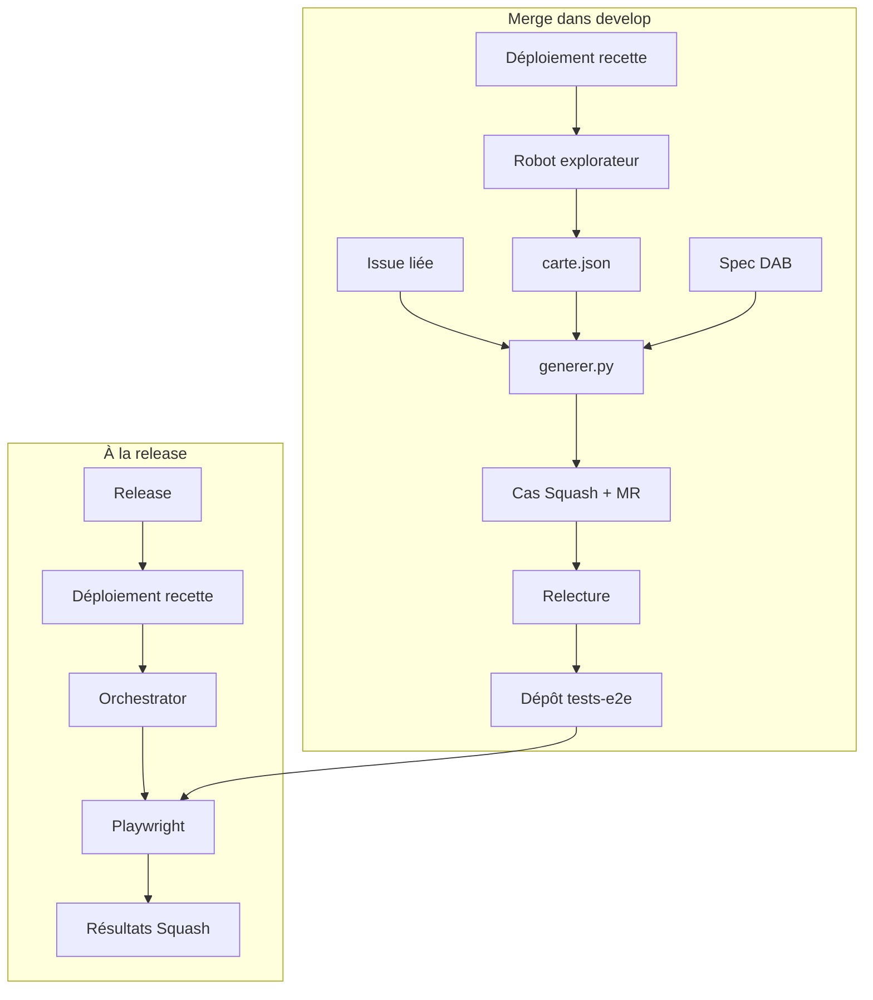
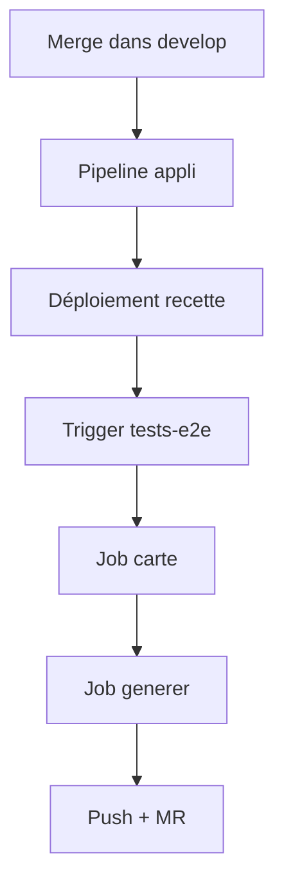
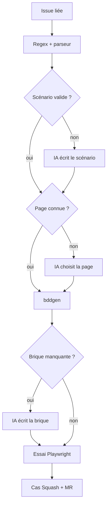
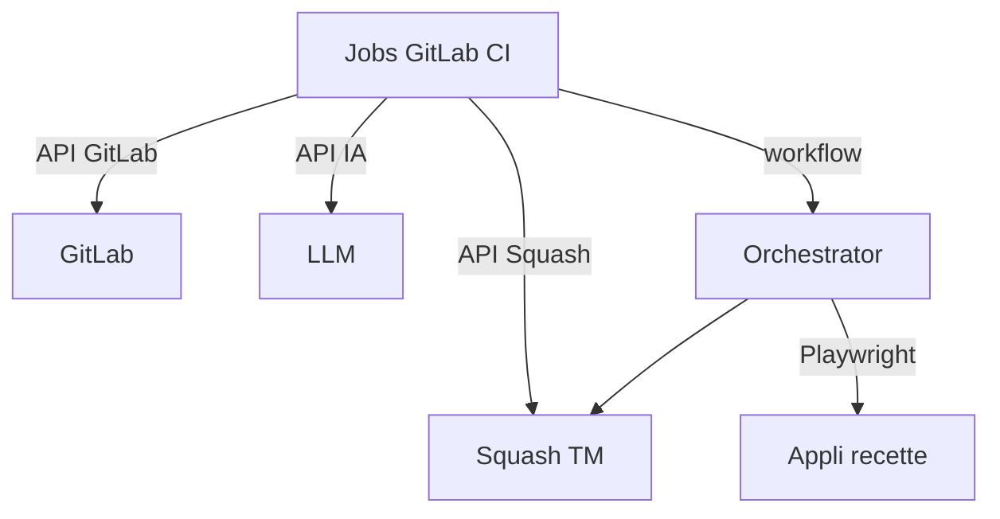

# Projet global : tests Playwright générés avec l'IA, pilotés par Squash TM

> Projet de mémoire. Objectif : à chaque release, tester automatiquement l'application avec Playwright. Les tests sont préparés à partir des issues feature, avec l'IA seulement quand c'est nécessaire, et les résultats sont dans Squash TM. Contrainte : coût minimal pour l'entreprise.

> **Décision encore ouverte :** ce que l'auteur de l'issue doit écrire (3 options, section 6). Tout le reste de la solution est identique, quelle que soit l'option choisie.

## Sommaire
1. [L'idée en 30 secondes](#1-lidée-en-30-secondes)
2. [Vocabulaire](#2-vocabulaire)
3. [Les 4 briques de la solution](#3-les-4-briques-de-la-solution)
4. [Vue d'ensemble](#4-vue-densemble)
5. [Étape A : la carte de l'application](#5-étape-a--la-carte-de-lapplication)
6. [Étape B : l'issue feature, 3 options au choix](#6-étape-b--lissue-feature-3-options-au-choix)
7. [Étape C : préparer le test (script + IA)](#7-étape-c--préparer-le-test-script--ia)
8. [Étape D : valider le test](#8-étape-d--valider-le-test)
9. [Étape E : la release](#9-étape-e--la-release)
10. [Outils, hébergement et coût](#10-outils-hébergement-et-coût)
11. [Comment les outils communiquent](#11-comment-les-outils-communiquent)
12. [Le dépôt tests-e2e](#12-le-dépôt-tests-e2e)
13. [Pourquoi ces choix](#13-pourquoi-ces-choix)
14. [Plan du POC](#14-plan-du-poc)
15. [Ce qu'on mesure pour le mémoire](#15-ce-quon-mesure-pour-le-mémoire)
16. [Questions à poser à l'entreprise](#16-questions-à-poser-à-lentreprise)

---

## 1. L'idée en 30 secondes

**Moment 1 : à chaque merge d'une feature dans `develop`** (une fois par feature), un **bloc de tests IA** s'ajoute à la CI :
1. La nouvelle version est **déployée sur la recette**.
2. Le **robot explorateur** met à jour la **carte** du site (pages, champs, boutons).
3. Le script récupère les **critères d'acceptation** de l'issue liée et la **spec** du dossier DAB.
4. L'**IA écrit le scénario**, et le script crée le **cas de test dans Squash** (API).
5. L'**IA écrit les briques manquantes**, et le script vérifie qu'elles marchent.
6. Le script pousse le tout sur une branche, ce qui ouvre une **merge request**. Un **humain relit** et valide.

**Moment 2 : à chaque release** (à chaque fois) :

7. **Squash Orchestrator** rejoue tous les tests validés avec **Playwright** et range les résultats dans **Squash TM**.

> **L'IA ne travaille qu'une fois par nouveauté, jamais à chaque release.** C'est ce qui rend la solution fiable et pas chère.

---

## 2. Vocabulaire

| Mot | Sens simple |
| --- | --- |
| **Spec** | Document qui décrit ce que l'application doit faire (rangé dans le **dossier DAB** du tableau). |
| **Issue feature** | Fiche GitLab d'une fonctionnalité à développer (la « tâche DEV » du tableau). |
| **Scénario Gherkin** | Test écrit en français : **Étant donné / Quand / Alors**. |
| **Brique** (step) | Petit morceau de code Playwright qui réalise **une phrase** de scénario. Écrit une fois, réutilisé partout. |
| **playwright-bdd** / **`bddgen`** | Outil qui relie les phrases aux briques et assemble des tests Playwright. Il signale les phrases sans brique. |
| **Playwright** | Programme qui pilote un vrai navigateur avec du code : aller, remplir, cliquer, vérifier. |
| **Snapshot d'accessibilité** | Description texte d'une page (titres, champs, boutons), obtenue avec `ariaSnapshot()`. |
| **Carte de l'application** | Fichier `carte.json` produit par le robot explorateur : toutes les pages et leurs éléments. |
| **Squash TM** | Logiciel de gestion des tests : exigences, cas de test, campagnes, résultats. |
| **Squash Orchestrator** | Outil de l'éditeur de Squash qui **exécute** les tests et **renvoie les résultats** dans Squash TM. |
| **CI/CD, pipeline, job, runner** | Les robots de GitLab qui lancent des tâches automatiquement, et la machine qui les exécute. |
| **Merge request (MR)** | Demande d'ajout de code, relue par un humain avant d'être acceptée. |
| **API** | « Porte » qui permet à un programme de parler à un autre par HTTP. |

---

## 3. Les 4 briques de la solution

| Brique | Rôle | Qui la fait |
| --- | --- | --- |
| **Robot explorateur** (`explorer.py`) | Construit et met à jour la carte de l'application | Ton script, sans IA |
| **Préparateur** (`generer.py`) | Transforme une issue en scénario + briques, crée le cas Squash et la MR | Ton script + l'IA si besoin |
| **Tests** (dépôt `tests-e2e`) | Scénarios, briques, configuration Playwright | Toi au début, puis le préparateur |
| **Exécution et résultats** | Lance les tests à la release, range les résultats | Squash Orchestrator + Squash TM |

---

## 4. Vue d'ensemble



Lien avec le tableau : **Spec → dossier DAB → tâche DEV → issue feature** à droite, **IA + spec → Playwright → Squash** à gauche, et la **CI/CD de `develop` à `release`** qui déclenche les tests.

---

## 5. Étape A : la carte de l'application

**But :** que le script et l'IA connaissent **les vraies pages** de l'application, sans rien remplir à la main.

**Comment :** le robot explorateur fait un **parcours en largeur**.
1. Il se connecte avec un compte de test et part de l'accueil.
2. Il garde une **file « à visiter »** et une liste **« déjà vus »**.
3. Pour chaque page : il note son nom et son adresse, prend le **snapshot d'accessibilité** (champs, boutons, liens) et ajoute à la file les liens pas encore vus.
4. Il s'arrête quand la file est vide (ou à 50 pages).

**Règles de sécurité :** il **ne clique jamais** (il lit l'adresse des liens et y va), il ignore les liens dangereux (« Déconnexion », « Supprimer »…) et les autres sites. Il regroupe `/projets/12` et `/projets/57` en `/projets/:id`.

**Résultat (`carte.json`) :**
```json
{
  "Connexion": {
    "adresse": "/login",
    "champs": ["Identifiant", "Mot de passe"],
    "boutons": ["Se connecter"],
    "liens": ["Mot de passe oublié ?"]
  }
}
```

**Quand :** à chaque merge dans `develop`, juste après le déploiement sur la recette, et avant la génération des tests. La carte connaît donc déjà la nouvelle page de la feature. Si elle change, elle part dans la même MR que les tests. **Le script ne change pas quand le site change** : seule la carte change.

---

## 6. Étape B : l'issue feature, 3 options au choix

Le dev (ou le chef de projet) écrit l'issue dans GitLab, avec le lien vers la spec du dossier DAB. La merge request de la feature mentionne l'issue (« Closes #128 »). C'est ce lien qui permet au script de retrouver l'issue au moment du merge.

La question ouverte est : **qu'écrit-il dans la partie « Critères d'acceptation » ?** Trois options.

### Option 1 : le scénario Gherkin complet

````markdown
## Critères d'acceptation
```gherkin
Scénario: Mot de passe incorrect
  Étant donné que je suis sur la page "Connexion"
  Quand je remplis le champ "Mot de passe" avec "faux"
  Et je clique sur le bouton "Se connecter"
  Alors je vois le message "Identifiants incorrects"
```
````

- Le script **extrait** le bloc (regex + parseur `gherkin-official`). **Pas d'IA** pour le scénario.
- **Pour :** résultat identique à chaque fois, coût IA nul, l'intention humaine est exacte.
- **Contre :** l'auteur doit apprendre le Gherkin et écrire le test lui-même dans l'issue. C'est le plus d'effort humain.

### Option 2 : des critères d'acceptation en français libre (conseillée)

```markdown
## Critères d'acceptation
- Si le mot de passe est faux, un message d'erreur s'affiche.
- Après 3 erreurs, le compte est bloqué 5 minutes.
```

- L'**IA transforme** chaque critère en scénario Gherkin, avec la **carte de l'application** pour les vrais noms de pages, champs et boutons, et en réutilisant les phrases des briques existantes.
- **Pour :** peu d'effort (ces critères font de toute façon partie d'une bonne issue), l'humain dit **ce qui est attendu** et l'IA s'occupe du **comment tester**.
- **Contre :** un petit coût IA par issue, et une relecture du scénario obligatoire.

### Option 3 : rien de plus, juste la description et la spec

- L'**IA déduit les critères et les scénarios** à partir de la description, de la spec du DAB et de la carte.
- **Pour :** aucun effort en plus pour l'auteur de l'issue.
- **Contre :** la plus variable. L'IA peut oublier un cas ou en inventer un. La relecture devient plus longue et plus importante. Coût IA plus élevé (la spec peut être longue).

### Comparaison

| Critère | Option 1 : Gherkin complet | Option 2 : critères en français | Option 3 : spec seule |
| --- | --- | --- | --- |
| Effort de l'auteur de l'issue | Élevé | Faible | Aucun |
| Rôle de l'IA pour le scénario | Aucun | Traduire en Gherkin | Tout déduire |
| Fiabilité du scénario | Très haute | Bonne | Variable |
| Coût IA | Nul | Faible | Moyen |
| Temps de relecture | Court | Moyen | Long |
| Intérêt pour le mémoire | Chaîne classique | Bon équilibre humain + IA | IA la plus autonome |

### Bonne nouvelle : le script peut accepter les trois

Le script peut **détecter automatiquement** ce qu'il trouve dans l'issue :
- un bloc ` ```gherkin ` valide → option 1, pas d'IA ;
- une liste de critères → option 2, l'IA traduit ;
- rien → option 3, l'IA part de la spec.

Tu peux donc choisir l'option **par défaut** que l'entreprise recommandera aux auteurs d'issues, tout en laissant les autres possibles. Pour le mémoire, tu peux même **comparer les trois** sur les mêmes issues : qualité des scénarios, temps de relecture, coût.

> Dans tous les cas, si la page de départ n'est pas indiquée, l'IA la choisit dans la carte (étape C).

---

## 7. Étape C : préparer le test (script + IA)

**Quand et où ça tourne :** à **chaque merge d'une feature dans `develop`**, sur les **runners GitLab existants**. Il n'y a **rien à héberger en plus**.



1. La MR de la feature est fusionnée dans `develop`.
2. Le pipeline de l'application **déploie** la version `develop` sur la recette.
3. Un job `trigger` lance le pipeline de `tests-e2e` en lui passant le **SHA** du commit de merge (variable CI).
4. Le job `carte` lance `explorer.py`, puis le job `generer` lance `generer.py`.
5. Pour retrouver l'issue, `generer.py` appelle l'API GitLab :
   - `GET /projects/:id/repository/commits/:sha/merge_requests` → la MR fusionnée ;
   - `GET /projects/:id/merge_requests/:iid/closes_issues` → l'issue liée (« Closes #128 »).
6. Si la MR n'est liée à aucune issue (une correction technique, par exemple), le script s'arrête sans appeler l'IA.

**Le principe : script d'abord, IA seulement si nécessaire.**



**En détail :**

1. **Lire l'issue liée** au merge avec l'API GitLab (titre, description, critères, lien vers la spec).
2. **Reconnaître l'option** (section 6) : une **regex** cherche un bloc ` ```gherkin ` (option 1), sinon une liste de critères (option 2), sinon rien (option 3).
3. **Obtenir le scénario :**
   - option 1 : le **parseur `gherkin-official`** découpe le bloc en scénarios et en phrases, et vérifie qu'il est bien écrit ;
   - option 2 : l'IA traduit chaque critère en scénario ;
   - option 3 : l'IA déduit les scénarios de la description et de la spec du DAB ;
   - dans les options 2 et 3, l'IA reçoit aussi la carte et la liste des phrases existantes, à réutiliser **mot pour mot**.
4. **Si la page de départ manque**, l'IA la choisit **dans la liste de la carte**. Le script vérifie que la réponse existe bien dans la carte.
5. **Écrire `features/TC-xx.feature`** et lancer **`npx bddgen`**. Il liste les phrases sans brique.
6. **Pour chaque phrase sans brique :**
   - le script donne à l'IA la phrase + le détail de la page dans la carte ;
   - si l'élément n'est pas dans la carte (fenêtre, message après une action), le script **joue le scénario jusqu'à cette phrase** et prend le **snapshot d'accessibilité** à ce moment-là ;
   - l'IA écrit la brique ;
   - le script **lance le test**. S'il échoue, il renvoie l'erreur à l'IA, **2 essais au maximum**, puis passe la main à un humain.
7. **Créer dans Squash TM** l'exigence (l'issue) et le cas de test, reliés entre eux (API Squash).
8. **Ajouter le code au dépôt** : l'IA a renvoyé ses fichiers en JSON (nom + contenu). Le script les écrit sur le disque, puis :
   ```bash
   git checkout -b ia/TC-42
   git add features/TC-42.feature steps/
   git commit -m "test: scénario TC-42 généré depuis l'issue #128"
   git push origin ia/TC-42 -o merge_request.create -o merge_request.target=main
   ```
   L'option `-o merge_request.create` fait **créer la MR par GitLab** au moment du push. Il faut un jeton de projet avec le droit `write_repository`, rangé dans une variable CI masquée. *(Variante sans Git : `POST /projects/:id/repository/commits`, puis `POST /projects/:id/merge_requests`.)*
9. **Commenter l'issue** avec les liens vers le cas Squash et la MR.
10. **Mettre à jour l'étiquette de l'issue** (voir ci-dessous).

### Suivre l'avancement avec des étiquettes

Chaque issue porte **une étiquette** qui dit où en sont ses tests. C'est le script qui la change (API GitLab : `PUT /projects/:id/issues/:iid` avec `add_labels` et `remove_labels`), jamais à la main, sauf `sans-test`.

| Étiquette | Sens | Posée par |
| --- | --- | --- |
| `tests-en-relecture` | Scénario et briques générés, MR ouverte, en attente d'un humain | `generer.py` |
| `tests-valides` | MR fusionnée, cas Squash approuvé, le test sera rejoué à chaque release | job `sync` |
| `tests-a-reprendre` | L'IA n'a pas réussi (2 essais ratés, scénario invalide) : un humain doit finir | `generer.py` |
| `sans-test` | Volontairement pas de test (correction de texte, technique…) | Un humain |

Elles servent à trois choses :
- **éviter le travail en double** : si le pipeline se relance, `generer.py` ignore les issues qui ont déjà une de ces étiquettes ;
- **voir l'avancement d'un coup d'œil** : un tableau d'issues GitLab avec une colonne par étiquette ;
- **mesurer pour le mémoire** : combien d'issues finissent en `tests-valides` sans passer par `tests-a-reprendre`.

> Les « étiquettes à portée » de GitLab (`tests::valides`, une seule à la fois automatiquement) sont réservées aux versions payantes. Avec des étiquettes simples, c'est le script qui retire l'ancienne quand il pose la nouvelle.

> Le code de l'IA ne va **jamais directement sur `main`** : toujours une branche `ia/...` et une MR relue par un humain.

---

## 8. Étape D : valider le test

Un test passe en **« Approuvé »** dans Squash seulement s'il réussit cette **grille de 5 contrôles** :

| # | Contrôle | Comment | Automatique ? |
| --- | --- | --- | --- |
| 1 | Aucune phrase sans code | `bddgen` refuse sinon | Oui |
| 2 | Chaque brique fait ce que dit sa phrase | Relecture du code de la brique par un dev | Non (une seule fois par brique) |
| 3 | Le test vérifie vraiment quelque chose | Chaque « Alors » contient un `expect(...)` | Oui (le script le contrôle) |
| 4 | Le test sait échouer | On casse volontairement une attente, le test doit devenir rouge | À la main au début, puis automatisable |
| 5 | Le test est stable | Lancé 5 fois, même résultat | Oui (job CI) |

Et un humain vérifie que **le scénario correspond bien à l'issue** (relecture dans la MR ou dans Squash).

À la fusion de la MR, un job `sync` met le cas Squash à jour (version finale, statut « Approuvé », référence du test automatisé).

> Règle : on modifie un scénario **uniquement dans le dépôt**. Squash est la vitrine, le dépôt est la référence.

---

## 9. Étape E : la release

1. Le code passe de `develop` à `release`.
2. Le pipeline de l'application **déploie** la version sur la recette.
3. Il **déclenche** le pipeline de `tests-e2e` (mot-clé `trigger` de GitLab).
4. Un job envoie à **Squash Orchestrator** : « exécute le plan de l'itération `vX.Y.Z` ».
5. L'Orchestrator récupère le plan dans Squash TM, lance **`npx bddgen` puis Playwright**, et **publie les résultats** (statuts, rapports, captures) dans Squash TM.
6. *(Bonus)* Un job lit les échecs et ajoute un **résumé de l'IA** en commentaire dans Squash (« bouton Connexion introuvable, sans doute renommé »).

Un testeur peut aussi lancer le plan **directement depuis Squash TM**, sans passer par GitLab.

**Si un test échoue :** soit c'est un **bug** (on corrige l'application), soit c'est un **changement voulu** (on corrige le scénario, souvent un seul mot grâce aux briques génériques, ou l'IA propose la correction en MR).

---

## 10. Outils, hébergement et coût

| Outil | Rôle | Hébergement | Coût |
| --- | --- | --- | --- |
| GitLab + GitLab CI | Issues, dépôts, pipelines | Existant dans l'entreprise | 0 € de plus |
| Nexus | Images Docker et paquets (le proxy bloque Internet) | Existant | 0 € de plus |
| Playwright + playwright-bdd | Exécuter les tests | Dans les jobs (image Playwright via le Nexus) | Gratuit |
| Playwright pour Python | Robot explorateur | Dans un job CI | Gratuit |
| Squash TM Community | Exigences, cas de test, résultats | VM de l'entreprise, Docker + PostgreSQL | Gratuit |
| Squash Orchestrator Community | Lancer les tests et publier les résultats | Même VM, Docker + un environnement d'exécution (Node + Playwright) | Gratuit |
| LLM | Scénario, page, briques manquantes, résumé des échecs | IA déjà payée par l'entreprise (ex. Azure OpenAI, région UE) ou Ollama en interne | Faible, et seulement pour les nouveautés |
| Scripts Python | `explorer.py`, `generer.py`, `sync_squash.py` | Dans les jobs CI | Gratuit |

D'après la [FAQ des offres Squash](https://tm-en.doc.squashtest.com/v12/faq/offer.html), la version **Community** permet déjà de lancer un plan depuis la CI ou depuis Squash TM, de publier les résultats, et elle prend en charge Playwright.

---

## 11. Comment les outils communiquent



| Qui → qui | Pour quoi | Authentification |
| --- | --- | --- |
| Job → API GitLab | Lire les issues, créer branche + MR, commenter | Jeton de projet (`PRIVATE-TOKEN`) |
| Job → API du LLM | Scénario, page, brique, résumé | Clé API (format compatible OpenAI : on change d'IA en changeant une adresse) |
| Job → API Squash TM | Exigence, cas de test, mise à jour après fusion | Compte technique ou jeton d'API |
| Job → Orchestrator | Lancer le plan d'une itération | Jeton de l'Orchestrator |
| Orchestrator → Squash TM | Lire le plan, publier les résultats | Configuré une fois |
| Playwright → appli de recette | Tester | Compte de test de l'application |

Tous les jetons sont dans des **variables CI masquées et protégées**, jamais dans le code. Les chemins exacts de l'API Squash dépendent de la version installée : sa documentation est disponible sur l'instance.

---

## 12. Le dépôt `tests-e2e`

```
tests-e2e/
├── carte.json                ← carte de l'application (robot explorateur)
├── features/                 ← un scénario par cas Squash (@TC-xx)
├── steps/                    ← les briques Playwright génériques
├── scripts/
│   ├── explorer.py           ← robot explorateur
│   ├── generer.py            ← issue → scénario + briques → Squash + MR
│   └── sync_squash.py        ← après fusion, met le cas Squash à jour
├── prompts/                  ← consignes données à l'IA
├── playwright.config.ts
└── .gitlab-ci.yml            ← jobs explorer, generer, sync, tester
```

Les briques sont **génériques** (« je clique sur le bouton "…" »), donc une brique sert pour tous les boutons. Plus il y a de briques, moins l'IA a de code à écrire.

---

## 13. Pourquoi ces choix

| Choix | Pourquoi |
| --- | --- |
| **Playwright** plutôt que Cypress, Robot Framework ou Cucumber JVM | Les meilleurs outils pour l'IA (snapshot d'accessibilité, MCP, agents), moderne et rapide, pris en charge par Squash Community |
| **Scénarios Gherkin + briques** | Lisibles par tout le monde, relus dans Squash, et de moins en moins de code à écrire |
| **Script d'abord, IA si besoin** | Résultat identique à chaque fois, coût minimal, l'IA sert là où elle apporte vraiment quelque chose |
| **Carte de l'application** | L'IA choisit parmi de vraies pages au lieu d'inventer (pas d'hallucination d'adresse) |
| **Relecture humaine une seule fois** | Un test faux donnerait du vert trompeur ; ensuite, il est rejoué sans coût |
| **Squash Orchestrator** | Solution officielle, gratuite, résultats publiés automatiquement, lancement possible depuis Squash |
| **Déclenchement au merge dans `develop`** | Le test est préparé dès que la feature existe sur la recette, sans serveur à héberger ni attente |

**Pour aller plus loin : MCP.** MCP est une prise standard qui donne des **outils** à une IA. Avec **Playwright MCP**, l'IA peut aller voir elle-même une page quand un élément manque dans la carte. Plus loin encore, un **agent IA** équipé de Playwright MCP, d'un MCP GitLab et d'un MCP Squash (à créer en Python avec le SDK `mcp`) pourrait remplacer `generer.py`. C'est plus autonome, mais plus cher et moins prévisible : une bonne comparaison « script + IA » contre « agent autonome » pour la fin du mémoire.

**Plans B :**
- si l'Orchestrator gère mal `playwright-bdd` : un script `push_resultats.py` qui envoie le rapport JUnit à l'API Squash, ou **Robot Framework + Browser** (qui utilise Playwright en dessous) ;
- si l'IA cloud est refusée pour des raisons de confidentialité : **Ollama** sur un serveur interne.

---

## 14. Plan du POC

| Phase | Ce que tu fais | C'est bon quand… |
| --- | --- | --- |
| 1. Playwright seul | Installer Playwright, écrire 2 tests sur l'appli de recette | `npx playwright test` passe |
| 2. Robot explorateur | Écrire `explorer.py` et produire `carte.json` | La carte liste les vraies pages, sans lien dangereux visité |
| 3. BDD | Ajouter playwright-bdd, 5 à 10 briques génériques, 3 scénarios à la main | Les 3 scénarios passent en local |
| 4. CI + Squash | Dépôt `tests-e2e`, Squash TM + Orchestrator, tester `bddgen` dans l'Orchestrator | Une release déclenche les tests et Squash affiche les 3 résultats |
| 5. Préparateur sans IA | Modèle d'issue, `generer.py` avec regex + parseur (option 1), cas Squash + MR | Une issue en Gherkin devient une MR et un cas Squash automatiquement |
| 6. Ajouter l'IA | Options 2 et 3 (scénario par l'IA), choix de la page, briques manquantes, 2 essais max | Une issue en français libre aboutit à un scénario relu et à des briques qui marchent |
| 7. Qualité et bonus | Grille des 5 contrôles en CI, résumé IA des échecs | Les mesures du mémoire sont collectées |

Si le temps manque, les phases 1 à 5 forment déjà une chaîne complète **sans IA**, et la phase 6 ajoute « l'intelligence ».

---

## 15. Ce qu'on mesure pour le mémoire

- répartition des issues entre les **options 1, 2 et 3**, et qualité des scénarios pour chacune ;
- % de scénarios obtenus **sans IA** (option 1) ;
- % de **pages bien choisies** par l'IA ;
- % de briques générées qui **passent du premier coup**, puis après 2 essais ;
- % de tests **acceptés sans retouche** à la relecture ;
- nombre de **nouvelles briques par issue**, release après release (doit baisser) ;
- **coût IA** par issue (jetons) ;
- **temps** pour obtenir un test : à la main contre avec la chaîne ;
- **durée** du pipeline de tests, et bugs trouvés avant livraison.

---

## 16. Questions à poser à l'entreprise

- [ ] Que veut dire **« DAB »** et sous quelle forme sont les specs (Word, PDF, Markdown) ?
- [ ] Issues et CI : bien sur **GitLab** ?
- [ ] **Squash TM** : déjà installé ? Quelle version ? Compte technique possible ?
- [ ] **Squash Orchestrator** : OK pour l'installer sur quelle machine ?
- [ ] Quelle **IA** est déjà disponible, et a-t-on le droit d'y envoyer specs, issues et descriptions d'écrans ?
- [ ] Quelle **application** tester ? Une **recette** joignable depuis les runners, avec un **compte de test** ?
- [ ] Qui **relit** les scénarios (testeur) et les briques (dev) ?
- [ ] Une release = une **branche** `release`, un **tag**, ou les deux ?
- [ ] Une équipe utilise-t-elle déjà **Robot Framework** ou **Cypress** ?
- [ ] Quelle **option d'issue** (1, 2 ou 3) les auteurs d'issues sont-ils prêts à suivre ?
