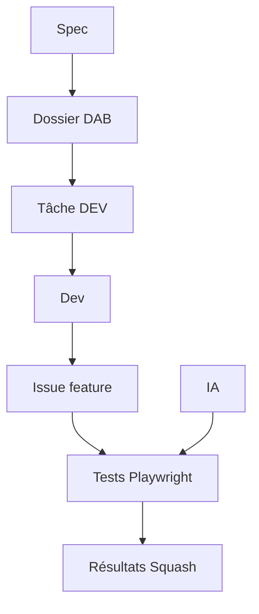
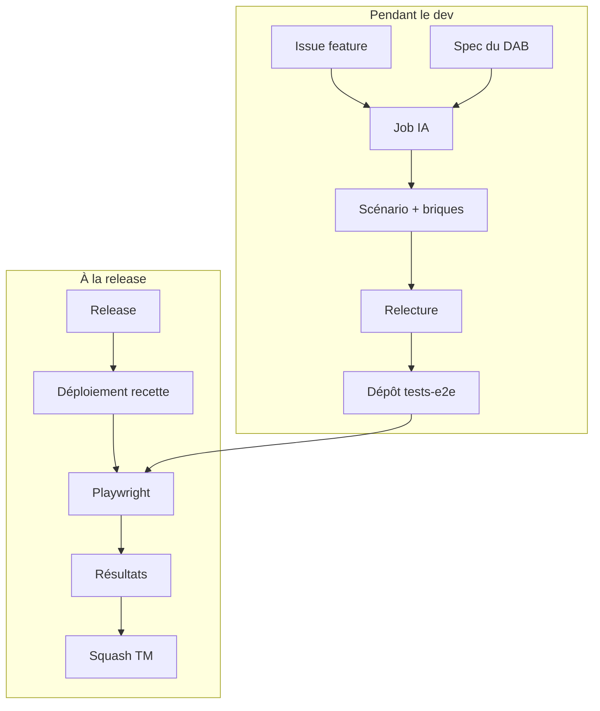
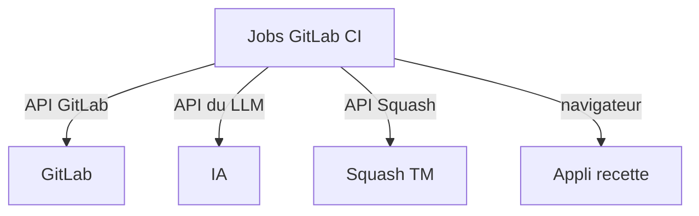
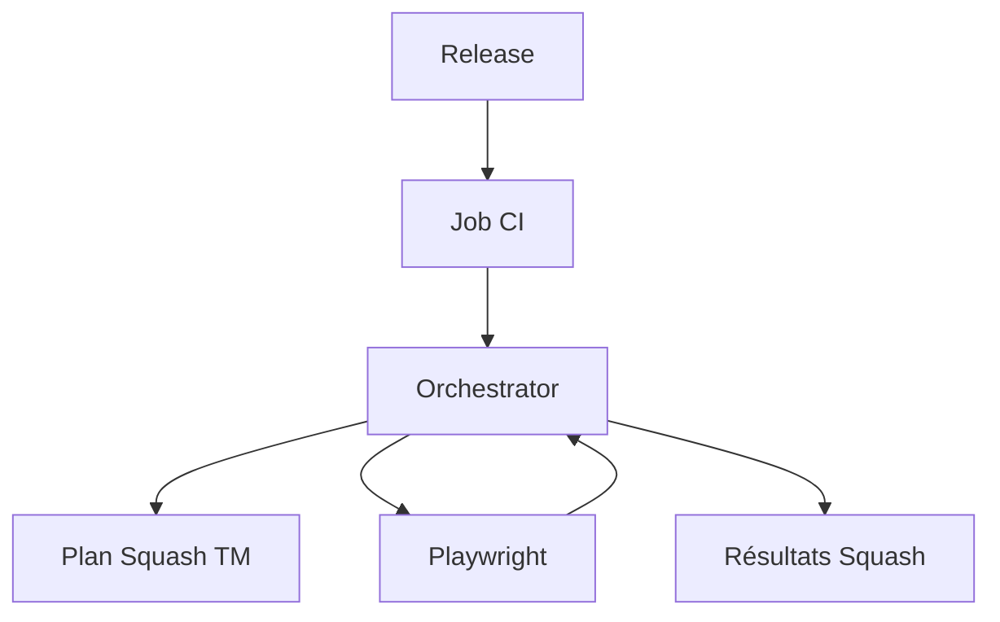

# Solution 2, expliquée de A à Z
## L'IA écrit les scénarios de test en français, Squash TM les gère, Playwright les exécute

Ce document part de zéro. Lis-le dans l'ordre : chaque partie s'appuie sur la précédente.

1. [Le problème à résoudre](#1-le-problème-à-résoudre)
2. [Le vocabulaire](#2-le-vocabulaire)
3. [Ce que dit le tableau](#3-ce-que-dit-le-tableau)
4. [La solution en une image](#4-la-solution-en-une-image)
5. [Les outils et où ils sont hébergés](#5-les-outils-et-où-ils-sont-hébergés)
6. [Où tourne « la fonction » IA ?](#6-où-tourne-la-fonction-ia-)
7. [Le déroulé complet, étape par étape](#7-le-déroulé-complet-étape-par-étape)
8. [Comment les outils communiquent (les API)](#8-comment-les-outils-communiquent-les-api), puis la variante avec Squash Orchestrator (8 bis)
9. [À quoi ressemblent les fichiers](#9-à-quoi-ressemblent-les-fichiers)
10. [Sécurité et coût](#10-sécurité-et-coût)
11. [Plan pour construire le POC](#11-plan-pour-construire-le-poc)
12. [Questions à poser à l'entreprise](#12-questions-à-poser-à-lentreprise)

---

## 1. Le problème à résoudre

Aujourd'hui, avant chaque **release** (nouvelle version de l'application), quelqu'un doit vérifier que tout marche. Le faire à la main est long, et on oublie des choses.

Le but du projet :
- **automatiser** ces vérifications avec Playwright ;
- utiliser une **IA** pour préparer les tests à partir des issues, au lieu de tout écrire à la main ;
- **ranger les tests et leurs résultats dans Squash TM**, pour savoir à tout moment ce qui est testé et ce qui marche ;
- en dépensant **le moins d'argent possible**.

---

## 2. Le vocabulaire

| Mot | Ce que ça veut dire, simplement |
| --- | --- |
| **Spec** (spécification) | Le document qui décrit ce que l'application doit faire. |
| **Dossier DAB** | Sur le tableau, l'endroit où sont rangées les specs. *(Le sens exact de « DAB » est à confirmer avec ton entreprise.)* |
| **Issue feature** | Une fiche dans GitLab qui décrit une fonctionnalité à développer. C'est la « tâche DEV » du tableau. |
| **Critère d'acceptation** | Une phrase qui dit quand la fonctionnalité est réussie. Ex. : « si le mot de passe est faux, un message d'erreur s'affiche ». |
| **Branche `develop` / `release`** | Deux versions du code. `develop` = en cours de travail. `release` = la version qu'on livre. |
| **CI/CD** | Des robots (GitLab CI) qui lancent automatiquement des tâches quand le code change : compiler, tester, déployer. |
| **Pipeline / job** | Un pipeline est une suite de tâches de la CI. Chaque tâche s'appelle un job. |
| **Runner** | La machine qui exécute les jobs de la CI. |
| **Application de recette** | Une copie de l'application, installée sur un serveur de test, où l'on peut tout essayer sans risque. |
| **Playwright** | Un outil qui pilote un navigateur (clique, tape, vérifie l'écran) comme un humain, mais très vite. |
| **Scénario BDD / Gherkin** | Un test écrit en français avec les mots **Étant donné / Quand / Alors**. Un humain peut le lire sans connaître le code. |
| **Brique** (step) | Un petit morceau de code Playwright qui réalise **une** phrase d'un scénario. On l'écrit une fois, on le réutilise partout. |
| **Squash TM** | Le logiciel de gestion des tests : on y range les exigences, les cas de test, et les résultats de chaque campagne. |
| **Exigence** (Squash) | Ce que l'application doit faire. Ici : une issue feature recopiée dans Squash. |
| **Cas de test** (Squash) | Un test précis. Ici : un scénario Gherkin. |
| **Campagne / itération** (Squash) | Une campagne regroupe des séries de tests. Une itération = une série, ici **une par release**. |
| **Exécution** (Squash) | Le résultat d'un cas de test lors d'une itération : réussi, échoué, bloqué… |
| **LLM** | Le modèle d'IA qui lit et écrit du texte (comme ChatGPT). |
| **API** | Une « porte » qu'un programme ouvre pour qu'un autre programme lui parle par Internet (requêtes HTTP). |
| **Jeton (token)** | Un mot de passe spécial réservé aux programmes, pour utiliser une API. |
| **Merge request (MR)** | Une demande pour ajouter du code dans un dépôt. Quelqu'un la relit avant de l'accepter. |

---

## 3. Ce que dit le tableau

Le bas du tableau raconte ceci :



Et en parallèle : la CI/CD fait passer le code de `develop` à `release`.

**Ce que la solution 2 garde du tableau :** la spec du dossier DAB, l'issue feature, l'IA, Playwright, Squash, la CI de `develop` vers `release`.

**Ce qu'elle ajoute :** l'IA ne produit pas directement du code de test. Elle produit d'abord un **scénario en français**, que l'on peut relire dans Squash. Le code vient ensuite, en petites briques réutilisables.

---

## 4. La solution en une image

Il y a **deux moments** : pendant le développement (l'IA prépare), et à la release (on teste).



**En une phrase :** l'IA transforme chaque issue en scénario lisible et en briques de code ; un humain valide ; à chaque release, Playwright rejoue tous les scénarios validés et Squash affiche les résultats.

---

## 5. Les outils et où ils sont hébergés

| Outil | À quoi il sert ici | Où il tourne | Coût |
| --- | --- | --- | --- |
| **GitLab** (issues + dépôts) | Les issues feature, le code de l'application, le dépôt des tests | Le GitLab de l'entreprise (déjà là) | 0 € de plus |
| **GitLab CI** + runner Docker | Lance le job IA, les tests et l'envoi vers Squash | Les runners de l'entreprise (déjà là) | 0 € de plus |
| **Nexus** | Fournit les images Docker et les paquets (le proxy bloque Internet) | Le Nexus de l'entreprise (déjà là) | 0 € de plus |
| **Playwright** + **playwright-bdd** | Exécute les scénarios en pilotant un navigateur | Dans un job CI (image Docker Playwright via le Nexus) | Gratuit, open source |
| **Squash TM Community** | Exigences, cas de test, campagnes, résultats | Un serveur ou une VM de l'entreprise, en Docker, avec une base PostgreSQL | Gratuit, open source |
| **LLM** (l'IA) | Écrit les scénarios et les briques manquantes, résume les échecs | Service cloud déjà payé par l'entreprise (ex. Azure OpenAI) **ou** Ollama sur un serveur interne | Petit coût à l'usage, ou 0 € en local |
| **Scripts Python** | `generer.py`, `sync_squash.py`, `push_resultats.py` : la colle entre les outils | Dans les jobs CI | Gratuit |
| **Application de recette** | L'application à tester | Le serveur de recette de l'entreprise | Déjà là |

À retenir : **aucun nouveau serveur à louer**. Le seul élément à installer, si ce n'est pas déjà fait, est Squash TM.

---

## 6. Où tourne « la fonction » IA ?

Le « cerveau » de la solution est un **script Python** (`generer.py`). Il lit l'issue, appelle l'IA et range le résultat. La question est : **où et quand le lancer ?**

Trois possibilités, de la plus simple à la plus automatique :

| Option | Comment ça se déclenche | Hébergement | Pour qui |
| --- | --- | --- | --- |
| **A. Job CI lancé à la main** | Tu cliques sur « Run pipeline » dans GitLab en donnant le numéro de l'issue | Runner GitLab | Phase 1 du POC |
| **B. Job CI programmé** (recommandé) | Toutes les heures (ou chaque nuit), le job cherche les issues avec l'étiquette `a-tester` et traite les nouvelles | Runner GitLab | La version finale du POC |
| **C. Webhook + fonction** | GitLab prévient une petite fonction (Nuclio, que tu connais, ou Azure Function) dès qu'une étiquette change, et la fonction lance le job | Nuclio ou Azure | Si l'entreprise veut du temps réel |

**Je recommande B** : c'est automatique, il n'y a **rien à héberger** en plus (le runner existe déjà), et une heure d'attente ne gêne personne. L'option C ajoute un service à maintenir pour un gain faible.

Concrètement, avec l'option B :
- le script vit **dans le dépôt `tests-e2e`** ;
- le job s'appelle `generer` et tourne grâce à un **pipeline programmé** (menu *Build > Pipeline schedules* dans GitLab) ;
- comme le job tourne dans le dépôt `tests-e2e`, il **voit directement les briques existantes** (le dossier `steps/`), sans appel d'API.

---

## 7. Le déroulé complet, étape par étape

### Étape 0 : une seule fois, la mise en place
- Créer le dépôt GitLab `tests-e2e` (structure en partie 9).
- Installer ou obtenir un projet dans Squash TM, avec un **compte technique** pour l'API.
- Créer dans Squash une **campagne** « Releases ».
- Écrire à la main **les 5 à 10 premières briques** (aller sur une page, cliquer sur un bouton, remplir un champ, vérifier un texte). Elles serviront de modèle à l'IA.
- Créer un **modèle d'issue feature** dans GitLab, avec une section « Critères d'acceptation » et un lien vers la spec du dossier DAB.

### Étape 1 : le dev écrit l'issue
La spec est dans le dossier DAB. Le dev (ou le chef de projet) crée l'issue feature avec ses critères d'acceptation et le lien vers la spec. Quand la fonctionnalité est prête à être testée, il ajoute l'étiquette **`a-tester`**.

### Étape 2 : le job IA prépare le test
Le job `generer` se lance (programmé) et, pour chaque nouvelle issue `a-tester` :

1. **Il lit l'issue** via l'API GitLab : titre, description, critères d'acceptation.
2. **Il lit la spec** liée dans le dossier DAB (si elle est en Markdown ou en texte ; si c'est un Word ou un PDF, le script en extrait le texte).
3. **Il lit la liste des briques existantes** dans `steps/` (juste les phrases, pas tout le code).
4. **Il appelle l'IA** avec ces trois éléments et une consigne claire : « écris un scénario en français, réutilise au maximum les phrases existantes, et écris le code seulement pour les phrases nouvelles ».
5. **Il vérifie la réponse** : le scénario est-il un Gherkin valide ? Les briques compilent-elles ? Sinon, il redemande une fois à l'IA, puis abandonne et commente l'issue.
6. **Il crée l'exigence et le cas de test dans Squash** via l'API Squash. Squash renvoie un numéro, par exemple `TC-42`.
7. **Il ouvre une merge request** sur `tests-e2e` avec le fichier `features/TC-42.feature` et les nouvelles briques.
8. **Il commente l'issue** : « Scénario proposé : lien Squash, lien MR », et remplace l'étiquette `a-tester` par `scenario-propose`.

### Étape 3 : les humains valident
- **Le testeur ou le chef de projet** lit le scénario (en français) dans Squash ou dans la MR. Si une phrase est fausse, il le dit en commentaire de la MR.
- **Un développeur** relit seulement les **nouvelles briques** de code.
- Quand tout est bon, la MR est **fusionnée**. Un job `sync` met alors le cas Squash à jour avec la version finale et le passe au statut « Approuvé ».

> Règle simple pour ne pas se perdre : **on modifie un scénario uniquement dans le dépôt**, jamais à la main dans Squash. Squash est la vitrine, le dépôt est la référence.

### Étape 4 : la release
1. Le code passe de `develop` à `release` (la CI/CD du tableau).
2. Le pipeline de l'application **déploie** la nouvelle version sur l'application de recette.
3. Il **déclenche le pipeline de `tests-e2e`** (en GitLab, c'est un simple job `trigger`, sans API à écrire).
4. Le job `tester` lance **tous les scénarios** avec Playwright. Chaque scénario porte son étiquette `@TC-42`.
5. Playwright produit un **rapport JUnit** (résultats lisibles par un programme) et un **rapport HTML** (lisible par un humain, avec captures d'écran).

### Étape 5 : les résultats arrivent dans Squash
Le job `rapport` lance `push_resultats.py`, qui :
1. crée dans Squash une **itération** au nom de la version (ex. `v1.4.0`) ;
2. y ajoute les cas de test exécutés ;
3. pour chaque cas, crée une **exécution** avec le statut **réussi** ou **échoué** ;
4. ajoute en commentaire le message d'erreur, **un résumé de l'IA** pour les échecs (deux phrases : « le bouton Connexion n'a pas été trouvé, sans doute renommé ») et le lien vers le rapport HTML.

Le chef de projet ouvre Squash et voit, pour la release, quelles exigences sont couvertes et lesquelles échouent.

---

## 8. Comment les outils communiquent (les API)

Toutes les communications se font en **HTTPS** avec des **jetons** rangés dans des **variables CI masquées** (jamais dans le code).



Les jobs CI sont **le seul acteur** qui parle aux autres. GitLab, Squash et l'IA ne se parlent jamais directement. C'est plus simple à comprendre, à sécuriser et à dépanner.

### Qui appelle quoi

| Appel | Pourquoi | Exemple de requête | Authentification |
| --- | --- | --- | --- |
| Job → **API GitLab** | Lire les issues `a-tester` | `GET /api/v4/projects/:id/issues?labels=a-tester` | En-tête `PRIVATE-TOKEN` (jeton de projet) |
| Job → **API GitLab** | Créer une branche avec les fichiers | `POST /api/v4/projects/:id/repository/commits` | idem |
| Job → **API GitLab** | Ouvrir la merge request | `POST /api/v4/projects/:id/merge_requests` | idem |
| Job → **API GitLab** | Commenter l'issue, changer l'étiquette | `POST .../issues/:iid/notes`, `PUT .../issues/:iid` | idem |
| Job → **API du LLM** | Générer le scénario, résumer un échec | `POST .../chat/completions` (format compatible OpenAI) | En-tête `api-key` ou `Authorization: Bearer` |
| Job → **API Squash TM** | Créer l'exigence et le cas de test, les relier | `POST /api/rest/latest/requirements`, `POST /api/rest/latest/test-cases` | Compte technique (Basic) ou jeton d'API |
| Job → **API Squash TM** | Créer l'itération et les exécutions | `POST .../iterations`, `.../executions`, puis mise à jour du statut | idem |
| Pipeline appli → pipeline tests | Lancer les tests à la release | mot-clé `trigger` dans `.gitlab-ci.yml` | géré par GitLab |
| Playwright → **appli de recette** | Tester | un vrai navigateur (Chromium) | un compte de test de l'application |

> Les chemins exacts de l'API Squash (et le nom du type « cas de test Gherkin ») **dépendent de la version installée**. Squash fournit sa documentation d'API sur sa propre instance : c'est la première chose à ouvrir.

### Bon à savoir : le format « compatible OpenAI »
Azure OpenAI, Ollama et la plupart des LLM acceptent le même format de requête. Si le script l'utilise, on peut **changer d'IA en modifiant seulement une adresse et un jeton** dans les variables CI. Très utile pour comparer coût et qualité dans le mémoire.

---

## 8 bis. Variante recommandée : Squash Orchestrator à la place du script de résultats

L'entreprise accepte d'installer **Squash Orchestrator**, l'outil de l'éditeur de Squash qui **exécute** les tests et **renvoie les résultats** dans Squash TM. Il remplace alors le job `rapport` et le script `push_resultats.py`.



1. À la release, le job CI envoie à l'Orchestrator un fichier qui dit « exécute le plan de test de l'itération v1.4.0 ».
2. L'Orchestrator **demande à Squash TM** la liste des cas de test de ce plan.
3. Il fait exécuter les tests Playwright dans un **environnement d'exécution** (une machine ou un conteneur avec Node et Playwright).
4. Il **publie lui-même** les résultats et les rapports dans Squash TM.
5. Un testeur peut aussi lancer le même plan **depuis l'interface de Squash TM**, sans passer par GitLab.

**Ce qui est gratuit (Community)** selon la [FAQ des offres Squash](https://tm-en.doc.squashtest.com/v12/faq/offer.html) : lancer un plan depuis Squash TM, lancer un plan depuis un pipeline CI, publier les résultats dans Squash TM, et Playwright fait partie des outils pris en charge. Les versions payantes ajoutent surtout le support de l'éditeur, la comparaison de résultats entre exécutions et les journaux en temps réel. Rien d'indispensable pour le POC.

**Ce qui change dans l'architecture :**

| Élément | Avec le script | Avec l'Orchestrator |
| --- | --- | --- |
| À installer | Rien de plus | Orchestrator (conteneur Docker) + un environnement d'exécution |
| Lancer les tests | Job CI `tester` | Job CI qui envoie le plan à l'Orchestrator |
| Résultats dans Squash | `push_resultats.py` | Automatique |
| Lancer depuis Squash | Non | Oui |
| Lien test ↔ cas Squash | Étiquette `@TC-42` lue par le script | Champ « référence du test automatisé » du cas Squash |

**Point à vérifier en premier :** l'Orchestrator lance des tests Playwright classiques. Avec playwright-bdd, les scénarios doivent d'abord être transformés en tests Playwright (commande `npx bddgen`). Il faut vérifier que cette étape peut se faire avant l'exécution dans l'environnement de l'Orchestrator. C'est un petit test à faire au début de la phase 4. Si ça bloque, on revient au script, qui marche à coup sûr.

L'IA garde exactement le même rôle : générer les scénarios et les briques, et résumer les échecs.

---

## 9. À quoi ressemblent les fichiers

### Le dépôt `tests-e2e`

```
tests-e2e/
├── features/                 ← les scénarios (un fichier par cas Squash)
│   ├── TC-41.feature
│   └── TC-42.feature
├── steps/                    ← les briques de code, rangées par thème
│   ├── navigation.steps.ts
│   ├── formulaires.steps.ts
│   └── connexion.steps.ts
├── scripts/
│   ├── generer.py            ← issue + spec + briques → IA → Squash + MR
│   ├── sync_squash.py        ← après fusion, met Squash à jour
│   └── push_resultats.py     ← après les tests, envoie les résultats
├── prompts/
│   └── generer.md            ← la consigne donnée à l'IA
├── playwright.config.ts
├── package.json
└── .gitlab-ci.yml            ← les jobs generer, sync, tester, rapport
```

### Un scénario (`features/TC-42.feature`)

```gherkin
# language: fr
@TC-42 @issue-128
Fonctionnalité: Connexion

  Scénario: Mot de passe incorrect
    Étant donné que je suis sur la page "Connexion"
    Quand je remplis le champ "Identifiant" avec "test.user"
    Et je remplis le champ "Mot de passe" avec "faux"
    Et je clique sur le bouton "Se connecter"
    Alors je vois le message "Identifiants incorrects"
```

Remarque : les phrases sont **génériques** (« je clique sur le bouton "…" »). Une seule brique sert pour tous les boutons de l'application. C'est ce qui rend la solution économique.

### Des briques (`steps/formulaires.steps.ts`)

```ts
import { expect } from '@playwright/test';
import { createBdd } from 'playwright-bdd';
const { Given, When, Then } = createBdd();

Given('je suis sur la page {string}', async ({ page }, nom) => {
  await page.getByRole('link', { name: nom }).click();
});

When('je remplis le champ {string} avec {string}', async ({ page }, champ, valeur) => {
  await page.getByLabel(champ).fill(valeur);
});

When('je clique sur le bouton {string}', async ({ page }, nom) => {
  await page.getByRole('button', { name: nom }).click();
});

Then('je vois le message {string}', async ({ page }, texte) => {
  await expect(page.getByText(texte)).toBeVisible();
});
```

### La consigne donnée à l'IA (`prompts/generer.md`, en résumé)

```
Tu écris des tests d'acceptation en Gherkin français.
Voici l'issue : {issue}
Voici l'extrait de spec : {spec}
Voici les phrases déjà disponibles : {liste_des_briques}

Règles :
1. Un scénario par critère d'acceptation.
2. Réutilise les phrases disponibles mot pour mot.
3. N'invente une phrase que si aucune ne convient, et donne son code Playwright.
4. Réponds en JSON : { "feature": "...", "nouvelles_briques": "..." }
```

### Les jobs CI (`.gitlab-ci.yml`, en résumé)

```yaml
generer:      # pipeline programmé, toutes les heures
  rules: [ { if: '$CI_PIPELINE_SOURCE == "schedule"' } ]
  script: python scripts/generer.py

sync:         # après fusion d'une MR sur main
  rules: [ { if: '$CI_COMMIT_BRANCH == "main"' } ]
  script: python scripts/sync_squash.py

tester:       # déclenché par la release de l'application
  rules: [ { if: '$CI_PIPELINE_SOURCE == "pipeline"' } ]
  image: <nexus>/playwright:<version>
  script: npx bddgen && npx playwright test --reporter=junit,html

rapport:
  needs: [tester]
  script: python scripts/push_resultats.py
```

*(Ce sont des esquisses pour comprendre la logique, pas des fichiers prêts à l'emploi.)*

---

## 10. Sécurité et coût

### Sécurité
- **Aucun mot de passe dans le code** : jetons GitLab, Squash et IA dans des variables CI **masquées et protégées**.
- **Droits minimaux** : le jeton GitLab ne peut agir que sur `tests-e2e` et lire les issues ; le compte Squash ne voit que le projet de test.
- **Confidentialité** : les specs et issues partent vers l'IA. Il faut l'accord de l'entreprise, et de préférence une IA hébergée dans l'UE (Azure OpenAI en région Europe) ou en interne (Ollama).
- **Compte de test** sur l'application de recette, jamais un vrai compte.

### Coût

| Poste | Coût |
| --- | --- |
| GitLab, runners, Nexus | Déjà payés par l'entreprise |
| Playwright, playwright-bdd, Squash TM Community | Gratuits, open source |
| Serveur pour Squash TM | Une petite VM existante suffit pour un POC |
| IA | Seulement à la génération (une fois par issue) et pour résumer les échecs. Avec un petit modèle, de l'ordre de quelques centimes par issue (ordre de grandeur à vérifier). 0 € avec Ollama, mais il faut un serveur assez puissant. |

**Pourquoi c'est économique :** l'IA ne travaille **pas** à chaque release, et elle écrit **de moins en moins de code** au fil du temps grâce aux briques.

---

## 11. Plan pour construire le POC

Chaque phase donne quelque chose qui marche tout seul. Si le temps manque, les phases 1 à 4 suffisent déjà pour une démonstration.

| Phase | Ce que tu fais | Tu sais que c'est bon quand… |
| --- | --- | --- |
| **1. Playwright seul** | Installer Playwright, écrire 2 tests classiques sur l'application de recette | `npx playwright test` passe sur ton poste |
| **2. Passer en BDD** | Ajouter playwright-bdd, écrire 5 à 10 briques génériques et 3 scénarios à la main | Les 3 scénarios passent en local |
| **3. Dans la CI** | Créer `tests-e2e` sur GitLab, le job `tester` avec l'image Playwright du Nexus | Le pipeline est vert et le rapport HTML est téléchargeable |
| **4. Vers Squash** | Installer Squash Orchestrator, vérifier qu'il lance les scénarios playwright-bdd, relier les 3 cas Squash à leurs tests (sinon : `push_resultats.py`) | Après le pipeline, ou après un clic dans Squash, l'itération affiche 3 exécutions avec le bon statut |
| **5. L'IA génère** | Écrire `generer.py` et la consigne, lancer à la main (option A) sur une issue | Une MR et un cas Squash apparaissent, le scénario a du sens |
| **6. Automatiser** | Pipeline programmé (option B), job `sync`, déclenchement depuis la release de l'application | Une nouvelle issue `a-tester` devient un test exécuté à la release suivante, sans action manuelle sauf la relecture |
| **7. Mesurer** | Résumé IA des échecs, puis les chiffres du mémoire | Tu as tes mesures (ci-dessous) |

### Les chiffres à mesurer pour le mémoire
- % de scénarios générés **acceptés sans retouche** ;
- nombre de **nouvelles briques par issue**, release après release (doit baisser) ;
- **temps** pour obtenir un test : à la main contre avec l'IA ;
- **coût** en jetons d'IA par issue ;
- **durée** du pipeline de tests ;
- bugs trouvés par les tests avant la livraison.

### Les notions à apprendre (dans cet ordre)
1. Tests de bout en bout et pyramide des tests
2. Playwright : locators, assertions, configuration, rapports
3. BDD et Gherkin, puis playwright-bdd
4. Squash TM : exigence, cas de test, campagne, itération, exécution, puis son API
5. API REST de GitLab et pipelines (programmés, `trigger`)
6. LLM : consigne (prompt), réponse en JSON, coût en jetons, limites

---

## 12. Questions à poser à l'entreprise

- [ ] Que veut dire **« DAB »** et sous quelle forme sont les specs (Word, PDF, Markdown, Confluence) ?
- [ ] Les issues et la CI sont-elles bien sur **GitLab** ?
- [ ] **Squash TM** est-il déjà installé ? Quelle version ? Puis-je avoir un compte technique ?
- [ ] Quelle **IA** l'entreprise utilise-t-elle déjà (Azure OpenAI, Copilot…) et a-t-on le droit d'y envoyer des specs et des issues ?
- [ ] Quelle **application** tester, et existe-t-il un environnement de recette joignable depuis les runners ?
- [ ] Qui **relira** les scénarios (testeur, chef de projet) et les briques (développeur) ?
- [ ] Une release, c'est une **branche** `release`, un **tag**, ou les deux ?
