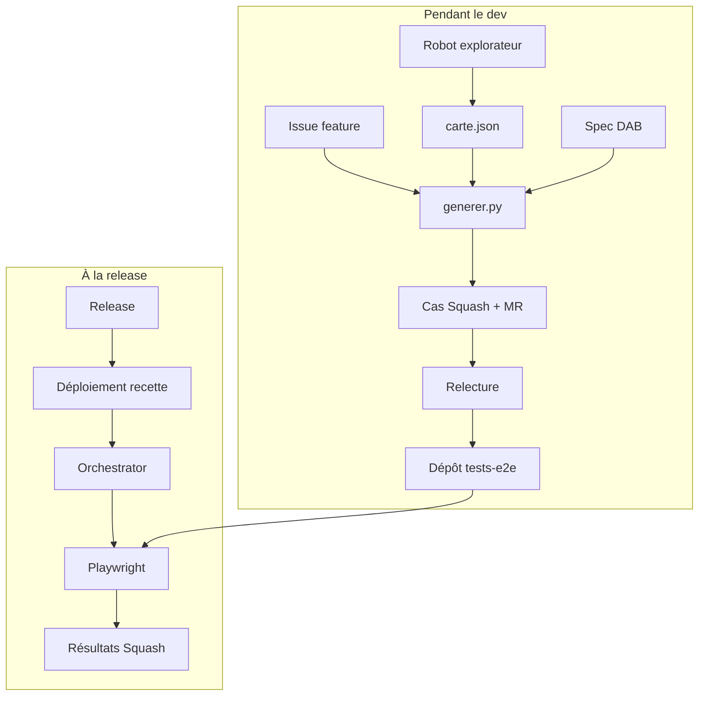
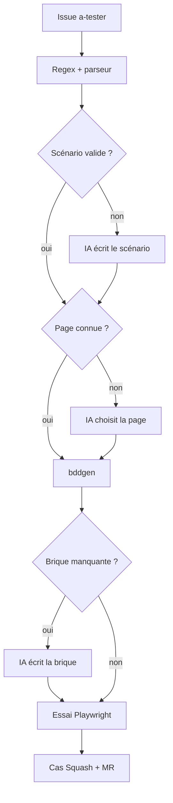
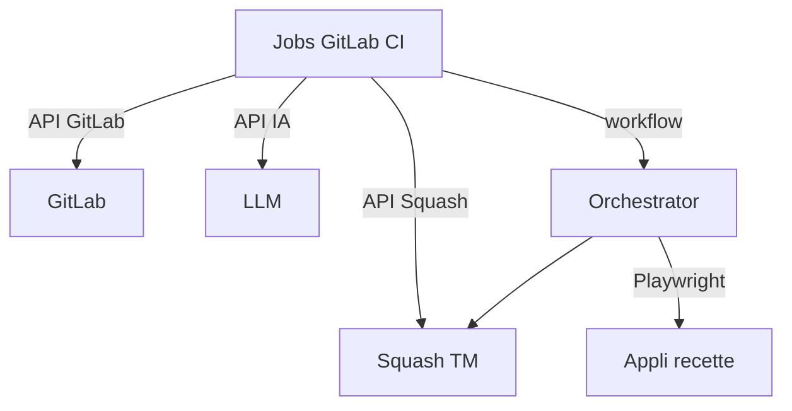

# Solution finale : tests Playwright générés avec l'IA, pilotés par Squash TM

> Projet de mémoire. Objectif : à chaque release, tester automatiquement l'application avec Playwright. Les tests sont préparés à partir des issues feature, avec l'IA seulement quand c'est nécessaire, et les résultats sont dans Squash TM. Contrainte : coût minimal pour l'entreprise.

## Sommaire
1. [L'idée en 30 secondes](#1-lidée-en-30-secondes)
2. [Vocabulaire](#2-vocabulaire)
3. [Les 4 briques de la solution](#3-les-4-briques-de-la-solution)
4. [Vue d'ensemble](#4-vue-densemble)
5. [Étape A : la carte de l'application](#5-étape-a--la-carte-de-lapplication)
6. [Étape B : l'issue feature](#6-étape-b--lissue-feature)
7. [Étape C : préparer le test (script + IA)](#7-étape-c--préparer-le-test-script--ia)
8. [Étape D : valider le test](#8-étape-d--valider-le-test)
9. [Étape E : la release](#9-étape-e--la-release)
10. [Outils, hébergement et coût](#10-outils-hébergement-et-coût)
11. [Comment les outils communiquent](#11-comment-les-outils-communiquent)
12. [Le dépôt tests-e2e](#12-le-dépôt-tests-e2e)
13. [Pourquoi ces choix](#13-pourquoi-ces-choix)
14. [Plan du POC](#14-plan-du-poc)
15. [Ce qu'on mesure pour le mémoire](#15-ce-quon-mesure-pour-le-mémoire)
16. [Questions à poser à l'entreprise](#16-questions-à-poser-à-lentreprise)

---

## 1. L'idée en 30 secondes

1. Un **robot explorateur** visite l'application et fabrique une **carte** (pages, champs, boutons).
2. Le dev écrit une **issue feature** avec ses scénarios en français (format imposé).
3. Un **script** extrait ces scénarios. L'**IA** intervient seulement pour ce qui manque : choisir la page, écrire une phrase, coder une brique.
4. Un **humain relit** une fois, puis le test est rangé pour toujours.
5. À chaque **release**, **Squash Orchestrator** lance tous les tests avec **Playwright** et range les résultats dans **Squash TM**.

> **L'IA ne travaille qu'une fois par nouveauté, jamais à chaque release.** C'est ce qui rend la solution fiable et pas chère.

---

## 2. Vocabulaire

| Mot | Sens simple |
| --- | --- |
| **Spec** | Document qui décrit ce que l'application doit faire (rangé dans le **dossier DAB** du tableau). |
| **Issue feature** | Fiche GitLab d'une fonctionnalité à développer (la « tâche DEV » du tableau). |
| **Scénario Gherkin** | Test écrit en français : **Étant donné / Quand / Alors**. |
| **Brique** (step) | Petit morceau de code Playwright qui réalise **une phrase** de scénario. Écrit une fois, réutilisé partout. |
| **playwright-bdd** / **`bddgen`** | Outil qui relie les phrases aux briques et assemble des tests Playwright. Il signale les phrases sans brique. |
| **Playwright** | Programme qui pilote un vrai navigateur avec du code : aller, remplir, cliquer, vérifier. |
| **Snapshot d'accessibilité** | Description texte d'une page (titres, champs, boutons), obtenue avec `ariaSnapshot()`. |
| **Carte de l'application** | Fichier `carte.json` produit par le robot explorateur : toutes les pages et leurs éléments. |
| **Squash TM** | Logiciel de gestion des tests : exigences, cas de test, campagnes, résultats. |
| **Squash Orchestrator** | Outil de l'éditeur de Squash qui **exécute** les tests et **renvoie les résultats** dans Squash TM. |
| **CI/CD, pipeline, job, runner** | Les robots de GitLab qui lancent des tâches automatiquement, et la machine qui les exécute. |
| **Merge request (MR)** | Demande d'ajout de code, relue par un humain avant d'être acceptée. |
| **API** | « Porte » qui permet à un programme de parler à un autre par HTTP. |

---

## 3. Les 4 briques de la solution

| Brique | Rôle | Qui la fait |
| --- | --- | --- |
| **Robot explorateur** (`explorer.py`) | Construit et met à jour la carte de l'application | Ton script, sans IA |
| **Préparateur** (`generer.py`) | Transforme une issue en scénario + briques, crée le cas Squash et la MR | Ton script + l'IA si besoin |
| **Tests** (dépôt `tests-e2e`) | Scénarios, briques, configuration Playwright | Toi au début, puis le préparateur |
| **Exécution et résultats** | Lance les tests à la release, range les résultats | Squash Orchestrator + Squash TM |

---

## 4. Vue d'ensemble



Lien avec le tableau : **Spec → dossier DAB → tâche DEV → issue feature** à droite, **IA + spec → Playwright → Squash** à gauche, et la **CI/CD de `develop` à `release`** qui déclenche les tests.

---

## 5. Étape A : la carte de l'application

**But :** que le script et l'IA connaissent **les vraies pages** de l'application, sans rien remplir à la main.

**Comment :** le robot explorateur fait un **parcours en largeur**.
1. Il se connecte avec un compte de test et part de l'accueil.
2. Il garde une **file « à visiter »** et une liste **« déjà vus »**.
3. Pour chaque page : il note son nom et son adresse, prend le **snapshot d'accessibilité** (champs, boutons, liens) et ajoute à la file les liens pas encore vus.
4. Il s'arrête quand la file est vide (ou à 50 pages).

**Règles de sécurité :** il **ne clique jamais** (il lit l'adresse des liens et y va), il ignore les liens dangereux (« Déconnexion », « Supprimer »…) et les autres sites. Il regroupe `/projets/12` et `/projets/57` en `/projets/:id`.

**Résultat (`carte.json`) :**
```json
{
  "Connexion": {
    "adresse": "/login",
    "champs": ["Identifiant", "Mot de passe"],
    "boutons": ["Se connecter"],
    "liens": ["Mot de passe oublié ?"]
  }
}
```

**Quand :** au début, puis à chaque release. Si la carte change, elle est mise à jour par une MR. **Le script ne change pas quand le site change** : seule la carte change.

---

## 6. Étape B : l'issue feature

Le dev écrit l'issue avec un **modèle imposé** dans GitLab :

````markdown
## Description
Un utilisateur doit pouvoir…

## Spec
Lien vers le document du dossier DAB

## Critères d'acceptation
```gherkin
Scénario: Mot de passe incorrect
  Étant donné que je suis sur la page "Connexion"
  Quand je remplis le champ "Mot de passe" avec "faux"
  Et je clique sur le bouton "Se connecter"
  Alors je vois le message "Identifiants incorrects"
```
````

Quand la fonctionnalité est prête à tester, il ajoute l'étiquette **`a-tester`**.

> La ligne « Étant donné que je suis sur la page "…" » est conseillée mais pas obligatoire : si elle manque, l'IA choisit la page grâce à la carte (étape C).

---

## 7. Étape C : préparer le test (script + IA)

**Où ça tourne :** le script `generer.py` est lancé par un **pipeline programmé** du dépôt `tests-e2e` (par exemple toutes les heures), sur les **runners GitLab existants**. Il n'y a **rien à héberger en plus**.

**Le principe : script d'abord, IA seulement si nécessaire.**



**En détail :**

1. **Lire l'issue** avec l'API GitLab (issues étiquetées `a-tester`).
2. **Extraire le scénario** : une **regex** trouve le bloc ` ```gherkin `, puis le **parseur `gherkin-official`** le découpe en scénarios et en phrases, et vérifie qu'il est bien écrit.
3. **Si le scénario manque ou est mal écrit**, l'IA l'écrit à partir de l'issue, de la spec du DAB et de la carte, en réutilisant **mot pour mot** les phrases des briques existantes.
4. **Si la page de départ manque**, l'IA la choisit **dans la liste de la carte**. Le script vérifie que la réponse existe bien dans la carte.
5. **Écrire `features/TC-xx.feature`** et lancer **`npx bddgen`**. Il liste les phrases sans brique.
6. **Pour chaque phrase sans brique :**
   - le script donne à l'IA la phrase + le détail de la page dans la carte ;
   - si l'élément n'est pas dans la carte (fenêtre, message après une action), le script **joue le scénario jusqu'à cette phrase** et prend le **snapshot d'accessibilité** à ce moment-là ;
   - l'IA écrit la brique ;
   - le script **lance le test**. S'il échoue, il renvoie l'erreur à l'IA, **2 essais au maximum**, puis passe la main à un humain.
7. **Créer dans Squash TM** l'exigence (l'issue) et le cas de test, reliés entre eux (API Squash).
8. **Ouvrir une MR** sur `tests-e2e` (scénario + nouvelles briques) et **commenter l'issue** avec les liens. L'étiquette devient `scenario-propose`.

---

## 8. Étape D : valider le test

Un test passe en **« Approuvé »** dans Squash seulement s'il réussit cette **grille de 5 contrôles** :

| # | Contrôle | Comment | Automatique ? |
| --- | --- | --- | --- |
| 1 | Aucune phrase sans code | `bddgen` refuse sinon | Oui |
| 2 | Chaque brique fait ce que dit sa phrase | Relecture du code de la brique par un dev | Non (une seule fois par brique) |
| 3 | Le test vérifie vraiment quelque chose | Chaque « Alors » contient un `expect(...)` | Oui (le script le contrôle) |
| 4 | Le test sait échouer | On casse volontairement une attente, le test doit devenir rouge | À la main au début, puis automatisable |
| 5 | Le test est stable | Lancé 5 fois, même résultat | Oui (job CI) |

Et un humain vérifie que **le scénario correspond bien à l'issue** (relecture dans la MR ou dans Squash).

À la fusion de la MR, un job `sync` met le cas Squash à jour (version finale, statut « Approuvé », référence du test automatisé).

> Règle : on modifie un scénario **uniquement dans le dépôt**. Squash est la vitrine, le dépôt est la référence.

---

## 9. Étape E : la release

1. Le code passe de `develop` à `release`.
2. Le pipeline de l'application **déploie** la version sur la recette.
3. Il **déclenche** le pipeline de `tests-e2e` (mot-clé `trigger` de GitLab).
4. Un job envoie à **Squash Orchestrator** : « exécute le plan de l'itération `vX.Y.Z` ».
5. L'Orchestrator récupère le plan dans Squash TM, lance **`npx bddgen` puis Playwright**, et **publie les résultats** (statuts, rapports, captures) dans Squash TM.
6. *(Bonus)* Un job lit les échecs et ajoute un **résumé de l'IA** en commentaire dans Squash (« bouton Connexion introuvable, sans doute renommé »).
7. Le robot explorateur repasse et met la carte à jour si l'application a changé.

Un testeur peut aussi lancer le plan **directement depuis Squash TM**, sans passer par GitLab.

**Si un test échoue :** soit c'est un **bug** (on corrige l'application), soit c'est un **changement voulu** (on corrige le scénario, souvent un seul mot grâce aux briques génériques, ou l'IA propose la correction en MR).

---

## 10. Outils, hébergement et coût

| Outil | Rôle | Hébergement | Coût |
| --- | --- | --- | --- |
| GitLab + GitLab CI | Issues, dépôts, pipelines | Existant dans l'entreprise | 0 € de plus |
| Nexus | Images Docker et paquets (le proxy bloque Internet) | Existant | 0 € de plus |
| Playwright + playwright-bdd | Exécuter les tests | Dans les jobs (image Playwright via le Nexus) | Gratuit |
| Playwright pour Python | Robot explorateur | Dans un job CI | Gratuit |
| Squash TM Community | Exigences, cas de test, résultats | VM de l'entreprise, Docker + PostgreSQL | Gratuit |
| Squash Orchestrator Community | Lancer les tests et publier les résultats | Même VM, Docker + un environnement d'exécution (Node + Playwright) | Gratuit |
| LLM | Scénario, page, briques manquantes, résumé des échecs | IA déjà payée par l'entreprise (ex. Azure OpenAI, région UE) ou Ollama en interne | Faible, et seulement pour les nouveautés |
| Scripts Python | `explorer.py`, `generer.py`, `sync_squash.py` | Dans les jobs CI | Gratuit |

D'après la [FAQ des offres Squash](https://tm-en.doc.squashtest.com/v12/faq/offer.html), la version **Community** permet déjà de lancer un plan depuis la CI ou depuis Squash TM, de publier les résultats, et elle prend en charge Playwright.

---

## 11. Comment les outils communiquent



| Qui → qui | Pour quoi | Authentification |
| --- | --- | --- |
| Job → API GitLab | Lire les issues, créer branche + MR, commenter | Jeton de projet (`PRIVATE-TOKEN`) |
| Job → API du LLM | Scénario, page, brique, résumé | Clé API (format compatible OpenAI : on change d'IA en changeant une adresse) |
| Job → API Squash TM | Exigence, cas de test, mise à jour après fusion | Compte technique ou jeton d'API |
| Job → Orchestrator | Lancer le plan d'une itération | Jeton de l'Orchestrator |
| Orchestrator → Squash TM | Lire le plan, publier les résultats | Configuré une fois |
| Playwright → appli de recette | Tester | Compte de test de l'application |

Tous les jetons sont dans des **variables CI masquées et protégées**, jamais dans le code. Les chemins exacts de l'API Squash dépendent de la version installée : sa documentation est disponible sur l'instance.

---

## 12. Le dépôt `tests-e2e`

```
tests-e2e/
├── carte.json                ← carte de l'application (robot explorateur)
├── features/                 ← un scénario par cas Squash (@TC-xx)
├── steps/                    ← les briques Playwright génériques
├── scripts/
│   ├── explorer.py           ← robot explorateur
│   ├── generer.py            ← issue → scénario + briques → Squash + MR
│   └── sync_squash.py        ← après fusion, met le cas Squash à jour
├── prompts/                  ← consignes données à l'IA
├── playwright.config.ts
└── .gitlab-ci.yml            ← jobs explorer, generer, sync, tester
```

Les briques sont **génériques** (« je clique sur le bouton "…" »), donc une brique sert pour tous les boutons. Plus il y a de briques, moins l'IA a de code à écrire.

---

## 13. Pourquoi ces choix

| Choix | Pourquoi |
| --- | --- |
| **Playwright** plutôt que Cypress, Robot Framework ou Cucumber JVM | Les meilleurs outils pour l'IA (snapshot d'accessibilité, MCP, agents), moderne et rapide, pris en charge par Squash Community |
| **Scénarios Gherkin + briques** | Lisibles par tout le monde, relus dans Squash, et de moins en moins de code à écrire |
| **Script d'abord, IA si besoin** | Résultat identique à chaque fois, coût minimal, l'IA sert là où elle apporte vraiment quelque chose |
| **Carte de l'application** | L'IA choisit parmi de vraies pages au lieu d'inventer (pas d'hallucination d'adresse) |
| **Relecture humaine une seule fois** | Un test faux donnerait du vert trompeur ; ensuite, il est rejoué sans coût |
| **Squash Orchestrator** | Solution officielle, gratuite, résultats publiés automatiquement, lancement possible depuis Squash |
| **Pipeline programmé** | Automatique sans serveur à héberger |

**Plans B :**
- si l'Orchestrator gère mal `playwright-bdd` : un script `push_resultats.py` qui envoie le rapport JUnit à l'API Squash, ou **Robot Framework + Browser** (qui utilise Playwright en dessous) ;
- si l'IA cloud est refusée pour des raisons de confidentialité : **Ollama** sur un serveur interne.

---

## 14. Plan du POC

| Phase | Ce que tu fais | C'est bon quand… |
| --- | --- | --- |
| 1. Playwright seul | Installer Playwright, écrire 2 tests sur l'appli de recette | `npx playwright test` passe |
| 2. Robot explorateur | Écrire `explorer.py` et produire `carte.json` | La carte liste les vraies pages, sans lien dangereux visité |
| 3. BDD | Ajouter playwright-bdd, 5 à 10 briques génériques, 3 scénarios à la main | Les 3 scénarios passent en local |
| 4. CI + Squash | Dépôt `tests-e2e`, Squash TM + Orchestrator, tester `bddgen` dans l'Orchestrator | Une release déclenche les tests et Squash affiche les 3 résultats |
| 5. Préparateur sans IA | Modèle d'issue, `generer.py` avec regex + parseur, cas Squash + MR | Une issue bien écrite devient une MR et un cas Squash automatiquement |
| 6. Ajouter l'IA | Scénario si absent, choix de la page, briques manquantes, 2 essais max | Une issue avec une phrase nouvelle aboutit à une brique qui marche |
| 7. Qualité et bonus | Grille des 5 contrôles en CI, résumé IA des échecs | Les mesures du mémoire sont collectées |

Si le temps manque, les phases 1 à 5 forment déjà une chaîne complète **sans IA**, et la phase 6 ajoute « l'intelligence ».

---

## 15. Ce qu'on mesure pour le mémoire

- % de scénarios extraits **sans IA** (format respecté) ;
- % de **pages bien choisies** par l'IA ;
- % de briques générées qui **passent du premier coup**, puis après 2 essais ;
- % de tests **acceptés sans retouche** à la relecture ;
- nombre de **nouvelles briques par issue**, release après release (doit baisser) ;
- **coût IA** par issue (jetons) ;
- **temps** pour obtenir un test : à la main contre avec la chaîne ;
- **durée** du pipeline de tests, et bugs trouvés avant livraison.

---

## 16. Questions à poser à l'entreprise

- [ ] Que veut dire **« DAB »** et sous quelle forme sont les specs (Word, PDF, Markdown) ?
- [ ] Issues et CI : bien sur **GitLab** ?
- [ ] **Squash TM** : déjà installé ? Quelle version ? Compte technique possible ?
- [ ] **Squash Orchestrator** : OK pour l'installer sur quelle machine ?
- [ ] Quelle **IA** est déjà disponible, et a-t-on le droit d'y envoyer specs, issues et descriptions d'écrans ?
- [ ] Quelle **application** tester ? Une **recette** joignable depuis les runners, avec un **compte de test** ?
- [ ] Qui **relit** les scénarios (testeur) et les briques (dev) ?
- [ ] Une release = une **branche** `release`, un **tag**, ou les deux ?
- [ ] Une équipe utilise-t-elle déjà **Robot Framework** ou **Cypress** ?
