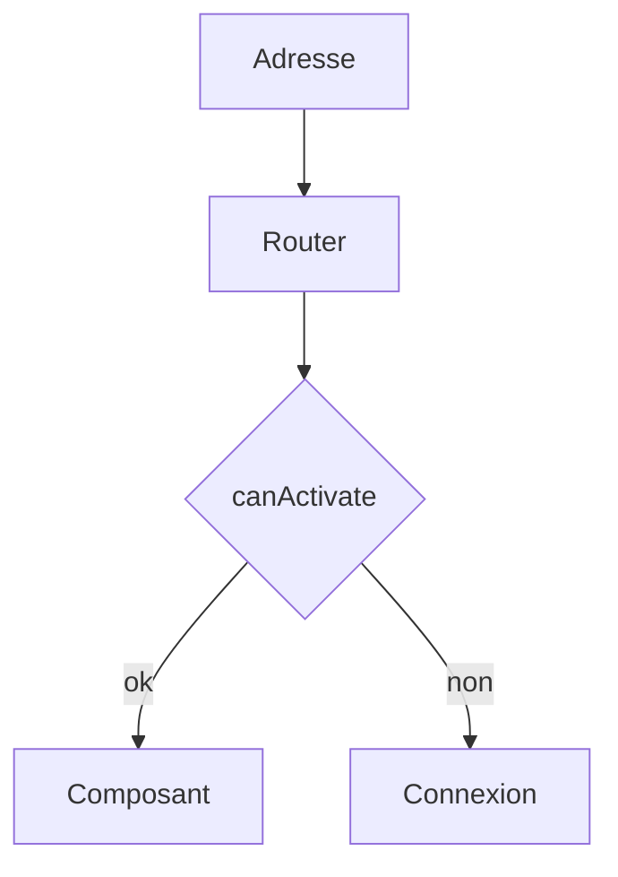

# Angular Router

> [!warning] Fiche fusionnée le 19/11/2026
> Un concept = une fiche, quel que soit le langage ou le framework : voir [[Application monopage et routage]].

> [!info] En une phrase
> Le routeur d'Angular associe des adresses à des composants, avec paramètres, chargement à la demande et gardes qui contrôlent l'accès aux pages.

```dataviewjs
await dv.view("10 — Templates/Scripts/learning", { view: "concept" })
```

## 1 · Comprendre
### Définition
```ts
// app.routes.ts
export const routes: Routes = [
  { path: "", component: AccueilComponent },
  { path: "taches", component: ListeTachesComponent },
  { path: "taches/:id", component: DetailTacheComponent },
  { path: "admin", loadComponent: () => import("./admin/admin.component").then((m) => m.AdminComponent),
    canActivate: [authGuard] },
  { path: "**", component: IntrouvableComponent },
];
export const authGuard: CanActivateFn = () =>
  inject(AuthService).connecte() ? true : inject(Router).parseUrl("/connexion");
```
- `<router-outlet />` : là où s'affiche la page ; `<a routerLink="/taches">` pour naviguer.
- Lire un paramètre : `inject(ActivatedRoute).snapshot.paramMap.get("id")`, ou avec `withComponentInputBinding()` une simple entrée `id = input<string>()`.
- `loadComponent` : la page est téléchargée seulement à la première visite.

### Pourquoi ça existe
Une application Angular a de nombreux écrans, dont certains réservés.

### Le problème résolu
Navigation instantanée, adresses partageables, chargement à la demande et redirection des utilisateurs non connectés.

## 2 · Explorer
### Comment ça fonctionne


### Exemple concret
```html
<nav><a routerLink="/" routerLinkActive="actif">Accueil</a> <a routerLink="/taches">Tâches</a></nav>
<router-outlet />
```
Même règle que toute [[Application monopage et routage|SPA]] : le serveur renvoie `index.html` pour toutes les adresses.

### Cas d'utilisation
- Toute application Angular
- Espaces d'administration

> [!warning] À ne pas confondre
> Une garde protège l'**interface**, pas les **données** : l'API doit vérifier l'autorisation elle-même.

## 3 · Pratiquer

### Exercice visuel

Sur Excalidraw, **sans regarder la fiche**. Puis je compare avec la fiche, je corrige en rouge ce qui était faux, et j'explique mon dessin à voix haute ou à Claude dans le chat.

> [!example] 🛣️ Suis le trajet
> Dessine une navigation vers une route protégée par une garde : l'adresse, la garde qui vérifie, le composant affiché ou la redirection.

> [!example] 🔄 Change de contexte
> Redessine-la avec une route chargée à la demande. Quand le code du module est-il téléchargé ?

### Mon schéma

> [!tip] Mon dessin Excalidraw
> _Je crée le dessin « Schéma - Angular Router » et je l'intègre ici avec `![[Schéma - Angular Router.excalidraw]]`, puis je coche `schema`._

### Appliquer dans le fil rouge
- Pas encore d'étape du fil rouge pour cette notion : elle sera pratiquée dans le fil rouge de son niveau (voir [[Niveaux]]).

## 4 · Relier
- **Prérequis** : [[Application monopage et routage]] · [[Composant Angular]]
- **Complémentaires** : [[Vue Router]]

## 5 · Réviser
> [!question] Me faire interroger
> Je demande à Claude de m'interroger sur cette notion pour vérifier que je l'ai comprise.

### Validation de la maîtrise
Trois cases à cocher dans les propriétés de la fiche :
- `schema` : mon dessin du concept est dans « Mon schéma » ;
- `exercice_visuel` : j'ai fait et corrigé les exercices visuels de la section 3 ;
- `fil_rouge` : je l'ai appliqué dans le fil rouge (coché tout seul quand une étape qui l'utilise est réussie).

Les trois cochées : la notion compte comme **comprise**. **Maîtrisé** : c'est moi qui le mets dans `status`, quand je le sens.

```dataviewjs
await dv.view("10 — Templates/Scripts/learning", { view: "maitrise" })
```
