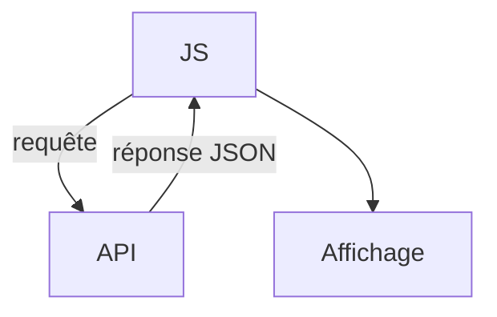

# Appeler une API avec fetch

> [!warning] Fiche fusionnée le 19/11/2026
> Un concept = une fiche, quel que soit le langage ou le framework : voir [[Appeler une API HTTP]].

> [!info] En une phrase
> fetch envoie une requête HTTP depuis JavaScript et renvoie une Promesse de réponse, qu'on lit ensuite en JSON.

```dataviewjs
await dv.view("10 — Templates/Scripts/learning", { view: "concept" })
```

## 1 · Comprendre
### Définition
```js
const rep = await fetch("https://api.exemple.com/taches?page=1", {
  method: "POST",                                   // GET par défaut
  headers: { "Content-Type": "application/json",
             Authorization: `Bearer ${jeton}` },
  body: JSON.stringify({ nom: "Chantier" }),        // objet → texte JSON
});
if (!rep.ok) {                                       // statut hors 200-299
  throw new Error(`Erreur ${rep.status}`);
}
const donnees = await rep.json();                    // texte JSON → objet
```
`fetch` existe dans le navigateur et dans Node (depuis la version 18).

### Pourquoi ça existe
Une interface moderne charge ses données depuis une [[API REST]] au lieu de tout recevoir dans le HTML.

### Le problème résolu
Parler [[HTTP]] depuis le code, avec méthode, en-têtes et corps, puis exploiter la réponse.

## 2 · Explorer
### Comment ça fonctionne


### Exemple concret
```js
async function afficherTaches() {
  const rep = await fetch("/api/taches");
  if (!rep.ok) { document.querySelector("#err").textContent = "Erreur " + rep.status; return; }
  const taches = await rep.json();
  document.querySelector("#liste").innerHTML = "";
  for (const t of taches) {
    const li = document.createElement("li");
    li.textContent = t.nom;
    document.querySelector("#liste").append(li);
  }
}
```
Une API publique pour s'entraîner : `https://jsonplaceholder.typicode.com/todos`.

### Cas d'utilisation
- Charger des données dans React
- Envoyer un formulaire à une API

> [!warning] À ne pas confondre
> `fetch` ne lève **pas** d'erreur pour un 404 ou un 500 : seulement si le réseau échoue. Il faut tester `rep.ok`. Et une erreur [[CORS]] vient du **serveur** qui n'autorise pas ton site, pas de ton code.

## 3 · Pratiquer

### Exercice visuel

Sur Excalidraw, **sans regarder la fiche**. Puis je compare avec la fiche, je corrige en rouge ce qui était faux, et j'explique mon dessin à voix haute ou à Claude dans le chat.

> [!example] 🛣️ Suis le trajet
> Dessine le trajet de `fetch("http://localhost:8000/depenses")` dans le front Vue : la Promesse, la requête, la réponse, `res.json()`, l'affichage.

> [!example] 🔍 Trouve l'erreur
> Ce schéma est faux. Corrige-le en rouge et explique l'erreur.
>
> ```mermaid
> flowchart TD
>   F[fetch] --> R[Réponse 404]
>   R --> C[catch déclenché]
> ```

### Mon schéma

> [!tip] Mon dessin Excalidraw
> _Je crée le dessin « Schéma - Appeler une API avec fetch » et je l'intègre ici avec `![[Schéma - Appeler une API avec fetch.excalidraw]]`, puis je coche `schema`._

### Appliquer dans le fil rouge
- [[MesDépenses Front 01 - Vue, afficher la liste]]
- [[MesDépenses Front 03 - Vue, ajouter et supprimer]]

## 4 · Relier
- **Au travail** : [[Appeler une API avec fetch au travail]]
- **Prérequis** : [[async et await]] · [[HTTP]] · [[JSON]]
- **Complémentaires** : [[Appeler une API HTTP (requests)]] · [[Code de statut HTTP]]
- **Utilisé par** : [[React]]

## 5 · Réviser
> [!question] Me faire interroger
> Je demande à Claude de m'interroger sur cette notion pour vérifier que je l'ai comprise.

### Validation de la maîtrise
Trois cases à cocher dans les propriétés de la fiche :
- `schema` : mon dessin du concept est dans « Mon schéma » ;
- `exercice_visuel` : j'ai fait et corrigé les exercices visuels de la section 3 ;
- `fil_rouge` : je l'ai appliqué dans le fil rouge (coché tout seul quand une étape qui l'utilise est réussie).

Les trois cochées : la notion compte comme **comprise**. **Maîtrisé** : c'est moi qui le mets dans `status`, quand je le sens.

```dataviewjs
await dv.view("10 — Templates/Scripts/learning", { view: "maitrise" })
```
