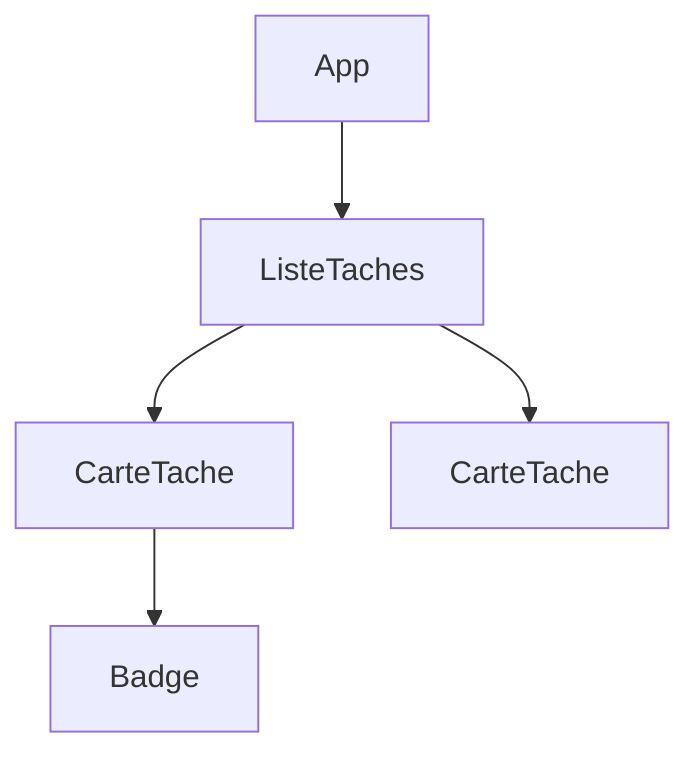

# Composant React

> [!warning] Fiche fusionnée le 19/11/2026
> Un concept = une fiche, quel que soit le langage ou le framework : voir [[Composant d'interface]].

> [!info] En une phrase
> Un composant React est une fonction qui reçoit des données (props) et renvoie du JSX, une syntaxe proche du HTML qui décrit ce qu'il faut afficher.

```dataviewjs
await dv.view("10 — Templates/Scripts/learning", { view: "concept" })
```

## 1 · Comprendre
### Définition
```tsx
function Badge({ statut }: { statut: string }) {
  return <span className={`badge ${statut}`}>{statut}</span>;
}
function CarteTache({ nom, statut }: { nom: string; statut: string }) {
  return (
    <article className="carte">
      <h2>{nom}</h2>
      <Badge statut={statut} />
    </article>
  );
}
```
**JSX** :
- `{ }` insère une expression JavaScript (variable, calcul, appel).
- `className` au lieu de `class`, `htmlFor` au lieu de `for`, événements en camelCase (`onClick`).
- Un composant renvoie **un seul** élément racine (sinon un fragment `<>…</>`).
- Le nom d'un composant commence par une **majuscule** (`<Badge />`), les balises HTML en minuscule.
- Affichage conditionnel : `{erreur && <p>{erreur}</p>}` ou `{ok ? <A /> : <B />}`.

### Pourquoi ça existe
Une interface se répète (cartes, boutons, lignes) : il faut pouvoir écrire un morceau une fois et le réutiliser.

### Le problème résolu
Découper l'interface en pièces simples, testables et réutilisables, chacune dans son fichier.

## 2 · Explorer
### Comment ça fonctionne


### Exemple concret
```tsx
// App.tsx
import CarteTache from "./CarteTache";
export default function App() {
  return (
    <main>
      <h1>Mes tâches</h1>
      <CarteTache nom="Chantier" statut="en-cours" />
      <CarteTache nom="Route" statut="fini" />
    </main>
  );
}
```
JSX est transformé en appels JavaScript (`React.createElement`) par l'outil de build.

### Cas d'utilisation
- Chaque morceau d'une interface React
- Bibliothèques de composants (boutons, tableaux, fenêtres)

> [!warning] À ne pas confondre
> JSX n'est **pas** du HTML : `class` devient `className`, toute balise doit être fermée (``), et les commentaires s'écrivent `{/* … */}`.

## 3 · Pratiquer

### Exercice visuel

Sur Excalidraw, **sans regarder la fiche**. Puis je compare avec la fiche, je corrige en rouge ce qui était faux, et j'explique mon dessin à voix haute ou à Claude dans le chat.

> [!example] 🧠 Dessine de mémoire
> Dessine un écran découpé en composants : App, ListeDepenses, LigneDepense, Formulaire. Relie-les en arbre.

> [!example] 🔄 Change de contexte
> Redessine le même découpage pour le front Vue de ton application. Qu'est-ce qui reste identique ?

### Mon schéma

> [!tip] Mon dessin Excalidraw
> _Je crée le dessin « Schéma - Composant React » et je l'intègre ici avec `![[Schéma - Composant React.excalidraw]]`, puis je coche `schema`._

### Appliquer dans le fil rouge
- Pas encore d'étape du fil rouge pour cette notion : elle sera pratiquée dans le fil rouge de son niveau (voir [[Niveaux]]).

## 4 · Relier
- **Au travail** : [Composant React au travail](obsidian://open?vault=Travail&file=Composant%20React%20au%20travail)
- **Prérequis** : [[React]] · [[HTML]] · [[Fonction fléchée et callback]]
- **Complémentaires** : [[Props React]]

## 5 · Réviser
> [!question] Me faire interroger
> Je demande à Claude de m'interroger sur cette notion pour vérifier que je l'ai comprise.

### Validation de la maîtrise
Trois cases à cocher dans les propriétés de la fiche :
- `schema` : mon dessin du concept est dans « Mon schéma » ;
- `exercice_visuel` : j'ai fait et corrigé les exercices visuels de la section 3 ;
- `fil_rouge` : je l'ai appliqué dans le fil rouge (coché tout seul quand une étape qui l'utilise est réussie).

Les trois cochées : la notion compte comme **comprise**. **Maîtrisé** : c'est moi qui le mets dans `status`, quand je le sens.

```dataviewjs
await dv.view("10 — Templates/Scripts/learning", { view: "maitrise" })
```
