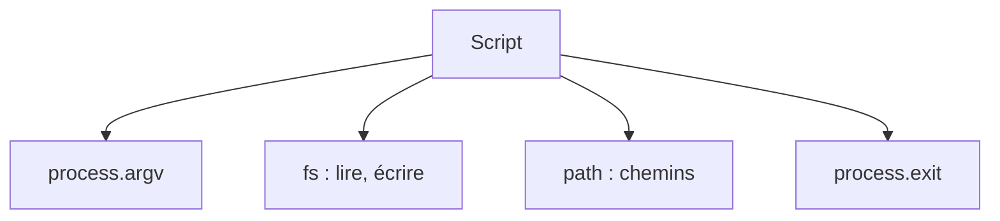

# Fichiers et chemins avec Node (fs et path)

> [!warning] Fiche fusionnée le 19/11/2026
> Un concept = une fiche, quel que soit le langage : voir [[Lire et écrire un fichier]].

> [!info] En une phrase
> Les modules intégrés fs et path permettent à un programme Node de lire, écrire, lister des fichiers et construire des chemins sans erreur.

```dataviewjs
await dv.view("10 — Templates/Scripts/learning", { view: "concept" })
```

## 1 · Comprendre
### Définition
```js
import { readFile, writeFile, readdir, mkdir, stat } from "node:fs/promises";
import path from "node:path";

const texte = await readFile("config.json", "utf8");
const config = JSON.parse(texte);
await mkdir("sortie", { recursive: true });
await writeFile(path.join("sortie", "rapport.txt"), "fini\n");
for (const nom of await readdir(".")) {
  const infos = await stat(nom);
  console.log(nom, infos.isDirectory() ? "dossier" : `${infos.size} octets`);
}
```
- **`path.join`**, `path.extname`, `path.basename`, `path.resolve` : construire des chemins portables (Windows/Linux).
- Version **promesses** (`fs/promises` + `await`) à préférer ; les versions `…Sync` bloquent la [[Boucle d'événements]].
- **`process.argv`** : arguments de la commande ; **`process.env`** : [[Variable d'environnement|variables d'environnement]] ; **`process.exit(1)`** : sortir avec un code d'erreur.

### Pourquoi ça existe
Beaucoup d'outils (build, scripts, serveurs) lisent et écrivent des fichiers : c'est la base d'un script Node utile.

### Le problème résolu
Faire en Node ce que tu fais en Python avec `pathlib` et `open`, sans dépendance externe.

## 2 · Explorer
### Comment ça fonctionne


### Exemple concret
```js
// compter.js : node compter.js ./images .png
import { readdir } from "node:fs/promises";
import path from "node:path";
const [dossier = ".", ext = ".png"] = process.argv.slice(2);
try {
  const fichiers = (await readdir(dossier)).filter((f) => path.extname(f) === ext);
  console.log(`${fichiers.length} fichiers ${ext}`);
} catch (e) {
  console.error(`Dossier introuvable : ${dossier}`);
  process.exit(1);
}
```

### Cas d'utilisation
- Scripts d'automatisation en JavaScript
- Serveurs qui stockent des fichiers
- Outils de build

> [!warning] À ne pas confondre
> Les chemins relatifs partent du **dossier où la commande est lancée** (`process.cwd()`), pas du fichier du script. Pour partir du script : `new URL("./data.json", import.meta.url)`.

## 3 · Pratiquer

### Exercice visuel

Sur Excalidraw, **sans regarder la fiche**. Puis je compare avec la fiche, je corrige en rouge ce qui était faux, et j'explique mon dessin à voix haute ou à Claude dans le chat.

> [!example] 🛣️ Suis le trajet
> Dessine un script Node qui lit `data/depenses.json` : le dossier courant, `path.join`, `fs.readFile`, le contenu.

> [!example] 🔄 Change de contexte
> Fais le même dessin en Python avec pathlib. Quelles pièces se correspondent ?

### Mon schéma

> [!tip] Mon dessin Excalidraw
> _Je crée le dessin « Schéma - Fichiers et chemins avec Node (fs et path) » et je l'intègre ici avec `![[Schéma - Fichiers et chemins avec Node (fs et path).excalidraw]]`, puis je coche `schema`._

### Appliquer dans le fil rouge
- Pas encore d'étape du fil rouge pour cette notion : elle sera pratiquée dans le fil rouge de son niveau (voir [[Niveaux]]).

## 4 · Relier
- **Prérequis** : [[Node.js]] · [[async et await]] · [[Système de fichiers]]
- **Complémentaires** : [[Chemin de fichier en Python (pathlib)]] · [[Arguments de ligne de commande]] · [[Code de sortie]]

## 5 · Réviser
> [!question] Me faire interroger
> Je demande à Claude de m'interroger sur cette notion pour vérifier que je l'ai comprise.

### Validation de la maîtrise
Trois cases à cocher dans les propriétés de la fiche :
- `schema` : mon dessin du concept est dans « Mon schéma » ;
- `exercice_visuel` : j'ai fait et corrigé les exercices visuels de la section 3 ;
- `fil_rouge` : je l'ai appliqué dans le fil rouge (coché tout seul quand une étape qui l'utilise est réussie).

Les trois cochées : la notion compte comme **comprise**. **Maîtrisé** : c'est moi qui le mets dans `status`, quand je le sens.

```dataviewjs
await dv.view("10 — Templates/Scripts/learning", { view: "maitrise" })
```
