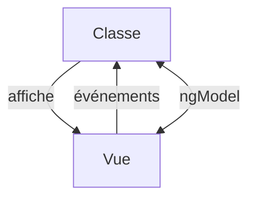

# Template et liaison de données Angular

> [!warning] Fiche fusionnée le 19/11/2026
> Un concept = une fiche, quel que soit le langage ou le framework : voir [[Template et liaison de données]].

> [!info] En une phrase
> Le template Angular relie la classe et le HTML : {{ }} affiche, [propriété] lie une valeur, (événement) écoute, [(ngModel)] lie dans les deux sens, et @if / @for contrôlent l'affichage.

```dataviewjs
await dv.view("10 — Templates/Scripts/learning", { view: "concept" })
```

## 1 · Comprendre
### Définition
| Syntaxe | Sens | Exemple |
| --- | --- | --- |
| `{{ expr }}` | interpolation (échappée) | `{{ tache.nom }}` |
| `[prop]="expr"` | liaison de propriété (classe → vue) | `[disabled]="!valide"` |
| `(evt)="code"` | liaison d'événement (vue → classe) | `(click)="sauver()"` |
| `[(ngModel)]="champ"` | double liaison (formulaires) | `<input [(ngModel)]="texte">` |
| `@if (cond) { } @else { }` | condition | |
| `@for (t of taches; track t.id) { } @empty { }` | boucle | |
| `expr \| pipe` | transformation d'affichage | `{{ date \| date:'dd/MM/yyyy' }}` |
Anciennes directives que tu verras partout : `*ngIf`, `*ngFor`.
Pour les formulaires sérieux : les **formulaires réactifs** (`FormGroup`, `FormControl`, `Validators`).

### Pourquoi ça existe
Le template doit afficher les données de la classe et lui renvoyer les actions de l'utilisateur.

### Le problème résolu
Une liaison déclarative : on ne touche jamais au DOM directement.

## 2 · Explorer
### Comment ça fonctionne


### Exemple concret
```html
<form (ngSubmit)="ajouter()">
  <input [(ngModel)]="texte" name="texte" required />
  <button [disabled]="!texte">Ajouter</button>
</form>
@for (t of taches(); track t.id) {
  <li [class.fini]="t.fini" (click)="basculer(t.id)">{{ t.nom | uppercase }}</li>
} @empty {
  <p>Aucune tâche</p>
}
```
`[(ngModel)]` demande d'importer `FormsModule` dans le composant.

### Cas d'utilisation
- Tout écran Angular
- Formulaires
- Mise en forme de dates et de nombres avec les pipes

> [!warning] À ne pas confondre
> `[valeur]="x"` (la variable x) et `valeur="x"` (le texte « x »). Et `[innerHTML]` peut être dangereux ([[XSS]]), même si Angular nettoie une partie du contenu.

## 3 · Pratiquer

### Exercice visuel

Sur Excalidraw, **sans regarder la fiche**. Puis je compare avec la fiche, je corrige en rouge ce qui était faux, et j'explique mon dessin à voix haute ou à Claude dans le chat.

> [!example] 🧠 Dessine de mémoire
> Dessine les quatre liaisons (`{{ }}`, `[propriété]`, `(événement)`, `[(ngModel)]`) avec une flèche dans le bon sens entre la classe et le HTML.

> [!example] 🔄 Change de contexte
> Redessine les mêmes liaisons avec leurs équivalents Vue. Lesquelles se correspondent ?

### Mon schéma

> [!tip] Mon dessin Excalidraw
> _Je crée le dessin « Schéma - Template et liaison de données Angular » et je l'intègre ici avec `![[Schéma - Template et liaison de données Angular.excalidraw]]`, puis je coche `schema`._

### Appliquer dans le fil rouge
- [[MesDépenses 11 - Angular, ajouter et supprimer]]

## 4 · Relier
- **Prérequis** : [[Composant Angular]] · [[Formulaire HTML]]
- **Complémentaires** : [[Directives Vue]]

## 5 · Réviser
> [!question] Me faire interroger
> Je demande à Claude de m'interroger sur cette notion pour vérifier que je l'ai comprise.

### Validation de la maîtrise
Trois cases à cocher dans les propriétés de la fiche :
- `schema` : mon dessin du concept est dans « Mon schéma » ;
- `exercice_visuel` : j'ai fait et corrigé les exercices visuels de la section 3 ;
- `fil_rouge` : je l'ai appliqué dans le fil rouge (coché tout seul quand une étape qui l'utilise est réussie).

Les trois cochées : la notion compte comme **comprise**. **Maîtrisé** : c'est moi qui le mets dans `status`, quand je le sens.

```dataviewjs
await dv.view("10 — Templates/Scripts/learning", { view: "maitrise" })
```
