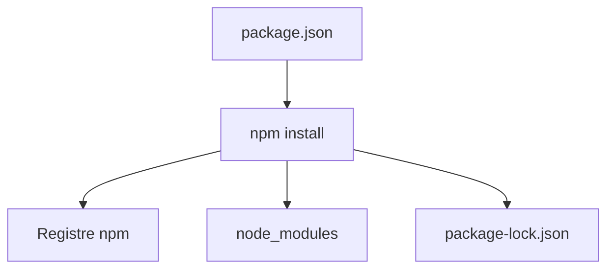

# npm

> [!warning] Fiche fusionnée le 19/11/2026
> Un concept = une fiche, quel que soit le langage ou le framework : voir [[Gestionnaire de paquets]].

> [!info] En une phrase
> Le gestionnaire de paquets de Node.js : il installe les bibliothèques déclarées dans package.json et lance les scripts du projet.

```dataviewjs
await dv.view("10 — Templates/Scripts/learning", { view: "concept" })
```

## 1 · Comprendre
### Définition
**npm** lit [[package.json]], télécharge les paquets depuis le registre npmjs.com dans le dossier `node_modules`, et écrit les versions exactes dans `package-lock.json`.

| Commande | Rôle |
| --- | --- |
| `npm install` | installe tout ce que déclare `package.json` |
| `npm install express` | ajoute une dépendance |
| `npm install -D vitest` | ajoute une dépendance de développement |
| `npm ci` | installe **exactement** le lock (CI, Docker) |
| `npm run build` | lance le script `build` |
| `npx outil` | exécute l'outil installé dans le projet |
| `npm outdated` / `npm update` | versions périmées / mise à jour dans les limites |
| `npm audit` | failles connues dans les dépendances |
Ce que npm fait pour Node, [[pip]] le fait pour Python : c'est un [[Gestionnaire de paquets]].

### Pourquoi ça existe
Personne n'écrit tout : un projet web utilise des dizaines de bibliothèques, qui ont elles-mêmes des dépendances.

### Le problème résolu
Installer, mettre à jour et reproduire le même ensemble de bibliothèques sur chaque machine et dans la CI.

## 2 · Explorer
### Comment ça fonctionne


### Exemple concret
```bash
npm init -y
npm install express
npm install -D nodemon
npm run dev              # lance "dev" défini dans package.json
rm -rf node_modules && npm ci   # réinstallation propre, comme la CI
```
`node_modules` ne se versionne **jamais** (il est dans `.gitignore`) ; `package-lock.json` **se versionne**.

### Cas d'utilisation
- Installer les dépendances d'un projet cloné
- L'étape `npm ci` puis `npm run build` d'un Dockerfile ou d'une pipeline
- Lancer les outils (tests, lint, build)

> [!warning] À ne pas confondre
> **npm** (installe, lance les scripts) et **npx** (exécute un outil). Et `npm install` (peut mettre à jour le lock) contre `npm ci` (respecte le lock à la lettre, échoue s'il ne correspond pas).

## 3 · Pratiquer

### Exercice visuel

Sur Excalidraw, **sans regarder la fiche**. Puis je compare avec la fiche, je corrige en rouge ce qui était faux, et j'explique mon dessin à voix haute ou à Claude dans le chat.

> [!example] 🛣️ Suis le trajet
> Dessine `npm install` dans un front : package.json, le registre npm (ou un miroir interne), node_modules, package-lock.json.

> [!example] 🔄 Change de contexte
> Redessine-le dans la CI GitLab derrière le proxy. Que faut-il régler pour que le paquet arrive ?

### Mon schéma

> [!tip] Mon dessin Excalidraw
> _Je crée le dessin « Schéma - npm » et je l'intègre ici avec `![[Schéma - npm.excalidraw]]`, puis je coche `schema`._

### Appliquer dans le fil rouge
- Pas encore d'étape du fil rouge pour cette notion : elle sera pratiquée dans le fil rouge de son niveau (voir [[Niveaux]]).

## 4 · Relier
- **Prérequis** : [[Node.js]] · [[Gestionnaire de paquets]]
- **Complémentaires** : [[package.json]] · [[Version sémantique (semver)]]
- **Utilisé par** : [[Express]]

## 5 · Réviser
> [!question] Me faire interroger
> Je demande à Claude de m'interroger sur cette notion pour vérifier que je l'ai comprise.

### Validation de la maîtrise
Trois cases à cocher dans les propriétés de la fiche :
- `schema` : mon dessin du concept est dans « Mon schéma » ;
- `exercice_visuel` : j'ai fait et corrigé les exercices visuels de la section 3 ;
- `fil_rouge` : je l'ai appliqué dans le fil rouge (coché tout seul quand une étape qui l'utilise est réussie).

Les trois cochées : la notion compte comme **comprise**. **Maîtrisé** : c'est moi qui le mets dans `status`, quand je le sens.

```dataviewjs
await dv.view("10 — Templates/Scripts/learning", { view: "maitrise" })
```
