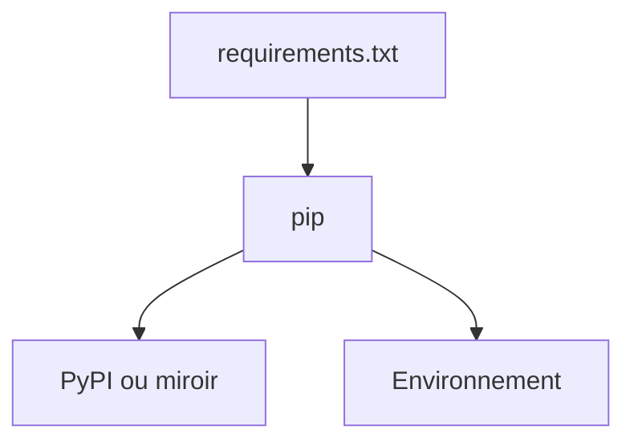

# pip

> [!warning] Fiche fusionnée le 19/11/2026
> Un concept = une fiche, quel que soit le langage ou le framework : voir [[Gestionnaire de paquets]].

> [!info] En une phrase
> Le gestionnaire de paquets de Python : il installe les bibliothèques externes depuis PyPI (ou un miroir interne).

```dataviewjs
await dv.view("10 — Templates/Scripts/learning", { view: "concept" })
```

## 1 · Comprendre
### Définition
**pip** télécharge et installe des paquets depuis **PyPI**, le dépôt public de Python. Le fichier `requirements.txt` liste les paquets d'un projet, un par ligne, avec leur version. C'est l'équivalent de [[npm]] et `package.json` pour Node.

### Pourquoi ça existe
Réutiliser des bibliothèques écrites par d'autres (requests, pytest) au lieu de tout coder.

### Le problème résolu
Télécharger et installer les bibliothèques à la main, sans savoir quelles versions utilisent les collègues.

## 2 · Explorer
### Comment ça fonctionne


### Exemple concret
```text
# requirements.txt
requests==2.32.3
requests>=2.32,<3
```
```bash
python -m pip install requests        # installer un paquet
pip install -r requirements.txt      # tout installer
pip list                             # ce qui est installé
pip freeze > requirements.txt        # figer les versions actuelles
```
Sur un réseau d'entreprise, pip passe souvent par un miroir interne :
```bash
pip install -r requirements.txt --index-url https://miroir.exemple.com/pypi/simple
```
(ou la variable d'environnement `PIP_INDEX_URL`).

### Cas d'utilisation
- Installer requests pour appeler des API, pytest pour tester
- Ligne `RUN pip install -r requirements.txt` d'un [[Dockerfile]]

> [!warning] À ne pas confondre
> `pip` peut viser un autre Python que celui que tu crois. `python -m pip` garantit que c'est celui de la commande `python`. Et un paquet sans version fixée peut changer du jour au lendemain : fixe les versions dans `requirements.txt`.

## 3 · Pratiquer

### Exercice visuel

Sur Excalidraw, **sans regarder la fiche**. Puis je compare avec la fiche, je corrige en rouge ce qui était faux, et j'explique mon dessin à voix haute ou à Claude dans le chat.

> [!example] 🛣️ Suis le trajet
> Dessine `pip install requests` : pip, PyPI (ou un miroir interne), le dossier du `.venv` où le paquet arrive.

> [!example] 🔄 Change de contexte
> Redessine-le dans un Dockerfile construit par la CI. Que faut-il donner à pip pour que ça passe ?

### Mon schéma

> [!tip] Mon dessin Excalidraw
> _Je crée le dessin « Schéma - pip » et je l'intègre ici avec `![[Schéma - pip.excalidraw]]`, puis je coche `schema`._

### Appliquer dans le fil rouge
- [[Dépenses 10 - Un environnement propre]]

## 4 · Relier
- **Prérequis** : [[Environnement virtuel Python]]
- **Complémentaires** : [[npm]] · [[Proxy]]
- **Utilisé par** : [[Appeler une API HTTP (requests)]] · [[pytest]] · [[Python dans Docker]]
- **Commandes** : [[pip install]]

## 5 · Réviser
> [!question] Me faire interroger
> Je demande à Claude de m'interroger sur cette notion pour vérifier que je l'ai comprise.

### Validation de la maîtrise
Trois cases à cocher dans les propriétés de la fiche :
- `schema` : mon dessin du concept est dans « Mon schéma » ;
- `exercice_visuel` : j'ai fait et corrigé les exercices visuels de la section 3 ;
- `fil_rouge` : je l'ai appliqué dans le fil rouge (coché tout seul quand une étape qui l'utilise est réussie).

Les trois cochées : la notion compte comme **comprise**. **Maîtrisé** : c'est moi qui le mets dans `status`, quand je le sens.

```dataviewjs
await dv.view("10 — Templates/Scripts/learning", { view: "maitrise" })
```
