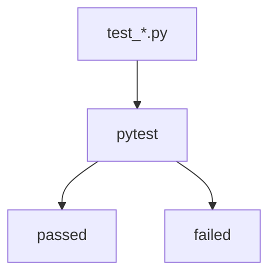

# pytest

> [!warning] Fiche fusionnée le 19/11/2026
> Un concept = une fiche, quel que soit le langage ou le framework : voir [[Test automatisé]].

> [!info] En une phrase
> L'outil de test le plus utilisé en Python : il trouve les fonctions test_… et vérifie leurs assert.

```dataviewjs
await dv.view("10 — Templates/Scripts/learning", { view: "concept" })
```

## 1 · Comprendre
### Définition
**pytest** cherche les fichiers `test_*.py`, y exécute chaque fonction `test_…`, et signale celles dont un `assert` est faux. Il sort avec un code non nul si un test échoue, ce qui fait échouer la CI.

### Pourquoi ça existe
Vérifier automatiquement, à chaque modification, que le code fait toujours ce qu'on attend.

### Le problème résolu
Tester à la main après chaque changement est long, et on oublie toujours un cas.

## 2 · Explorer
### Comment ça fonctionne


### Exemple concret
```python
# outils.py
def extension(nom: str) -> str:
    return nom.rsplit(".", 1)[-1].lower()
```
```python
# test_outils.py
from outils import extension

def test_extension_en_minuscules():
    assert extension("Photo.PNG") == "png"

def test_plusieurs_points():
    assert extension("archive.tar.gz") == "gz"
```
```bash
pip install pytest
pytest            # tous les tests
pytest -v         # détail de chaque test
pytest -k zip     # seulement ceux dont le nom contient "zip"
pytest -x         # s'arrêter au premier échec
```
La fixture `tmp_path` donne un dossier temporaire neuf à chaque test, idéal pour tester un script qui crée des fichiers.

### Cas d'utilisation
- Tester les fonctions de ton script de zip

> [!warning] À ne pas confondre
> Un test qui passe vérifie seulement **ce qu'il teste**. Avant de modifier ou débloquer un test, lis ce qu'il vérifie vraiment. Et `skipped` (test non lancé) n'est pas `passed`.

## 3 · Pratiquer

### Exercice visuel

Sur Excalidraw, **sans regarder la fiche**. Puis je compare avec la fiche, je corrige en rouge ce qui était faux, et j'explique mon dessin à voix haute ou à Claude dans le chat.

> [!example] 🛣️ Suis le trajet
> Dessine `pytest` lancé dans le dossier de l'API : il trouve les fichiers `test_*.py`, les tests (même ceux écrits avec unittest), lance les vérifications, rend un code de sortie.

> [!example] ⚖️ Avant / après
> Avant / après : un test écrit avec unittest puis avec pytest. Dessine ce qui change dans la forme du test.

### Mon schéma

> [!tip] Mon dessin Excalidraw
> _Je crée le dessin « Schéma - pytest » et je l'intègre ici avec `![[Schéma - pytest.excalidraw]]`, puis je coche `schema`._

### Appliquer dans le fil rouge
- Pas encore d'étape du fil rouge pour cette notion : elle sera pratiquée dans le fil rouge de son niveau (voir [[Niveaux]]).

## 4 · Relier
- **Au travail** : [pytest au travail](obsidian://open?vault=Travail&file=pytest%20au%20travail)
- **Prérequis** : [[Fonction]] · [[Module et import]]
- **Complémentaires** : [[Code de sortie]]
- **Utilisé par** : [[Pipeline GitLab CI]] · [[Tester l'image, pas le dépôt]]

## 5 · Réviser
> [!question] Me faire interroger
> Je demande à Claude de m'interroger sur cette notion pour vérifier que je l'ai comprise.

### Validation de la maîtrise
Trois cases à cocher dans les propriétés de la fiche :
- `schema` : mon dessin du concept est dans « Mon schéma » ;
- `exercice_visuel` : j'ai fait et corrigé les exercices visuels de la section 3 ;
- `fil_rouge` : je l'ai appliqué dans le fil rouge (coché tout seul quand une étape qui l'utilise est réussie).

Les trois cochées : la notion compte comme **comprise**. **Maîtrisé** : c'est moi qui le mets dans `status`, quand je le sens.

```dataviewjs
await dv.view("10 — Templates/Scripts/learning", { view: "maitrise" })
```
