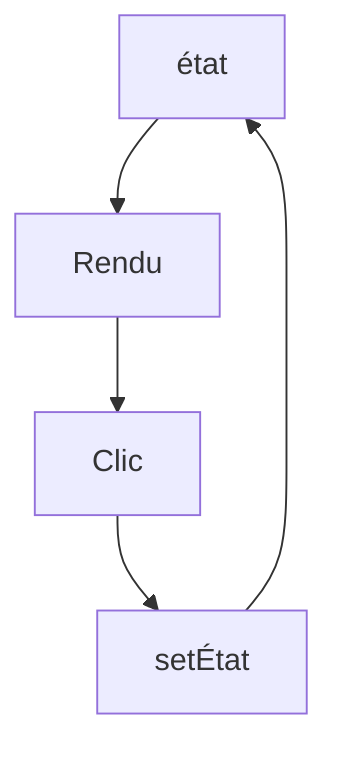

# État React (useState)

> [!warning] Fiche fusionnée le 19/11/2026
> Un concept = une fiche, quel que soit le langage ou le framework : voir [[État et réactivité]].

> [!info] En une phrase
> L'état est une donnée qui appartient à un composant et peut changer ; quand on la change avec la fonction fournie par useState, React réaffiche le composant.

```dataviewjs
await dv.view("10 — Templates/Scripts/learning", { view: "concept" })
```

## 1 · Comprendre
### Définition
```tsx
const [taches, setTaches] = useState<Tache[]>([]);
const [chargement, setChargement] = useState(false);
```
`useState(valeurInitiale)` renvoie la valeur **actuelle** et une fonction pour la **remplacer**.
Règles :
- **Ne jamais modifier** l'état directement (`taches.push(x)` ne réaffiche rien) : crée une **nouvelle** valeur.
```tsx
setTaches([...taches, nouvelle]);                       // ajouter
setTaches(taches.filter((t) => t.id !== id));           // retirer
setTaches(taches.map((t) => t.id === id ? { ...t, fini: true } : t));   // modifier
setN((ancien) => ancien + 1);                           // à partir de l'ancienne valeur
```
- La nouvelle valeur n'est visible **qu'au rendu suivant**.
- Garde l'état au plus près de ceux qui l'utilisent ; s'il est partagé par deux enfants, remonte-le dans leur parent.

### Pourquoi ça existe
Une interface a des choses qui changent : saisie, liste chargée, fenêtre ouverte. React doit savoir quand réafficher.

### Le problème résolu
Lier l'affichage aux données : on change la donnée, l'écran suit tout seul.

## 2 · Explorer
### Comment ça fonctionne


### Exemple concret
```tsx
function Taches() {
  const [texte, setTexte] = useState("");
  const [liste, setListe] = useState<string[]>([]);
  return (
    <form onSubmit={(e) => { e.preventDefault(); if (texte) { setListe([...liste, texte]); setTexte(""); } }}>
      <input value={texte} onChange={(e) => setTexte(e.target.value)} />
      <button>Ajouter</button>
      <ul>{liste.map((t, i) => <li key={i}>{t}</li>)}</ul>
    </form>
  );
}
```
Un champ dont la valeur vient de l'état est un **champ contrôlé**.

### Cas d'utilisation
- Formulaires
- Chargement et erreurs
- Fenêtres, onglets, filtres

> [!warning] À ne pas confondre
> Modifier l'objet en place (`tache.fini = true; setTache(tache)`) : React voit le même objet et ne réaffiche pas. Et une valeur **calculable** à partir d'un autre état (un total, une liste filtrée) ne doit pas être un état : calcule-la au rendu.

## 3 · Pratiquer

### Exercice visuel

Sur Excalidraw, **sans regarder la fiche**. Puis je compare avec la fiche, je corrige en rouge ce qui était faux, et j'explique mon dessin à voix haute ou à Claude dans le chat.

> [!example] 🛣️ Suis le trajet
> Dessine ce qui se passe quand on clique sur « Ajouter » : `setDepenses`, nouvel état, nouveau rendu.

> [!example] 🔄 Change de contexte
> Redessine-le avec une `ref` en Vue. Qui déclenche le nouvel affichage dans chaque cas ?

### Mon schéma

> [!tip] Mon dessin Excalidraw
> _Je crée le dessin « Schéma - État React (useState) » et je l'intègre ici avec `![[Schéma - État React (useState).excalidraw]]`, puis je coche `schema`._

### Appliquer dans le fil rouge
- Pas encore d'étape du fil rouge pour cette notion : elle sera pratiquée dans le fil rouge de son niveau (voir [[Niveaux]]).

## 4 · Relier
- **Prérequis** : [[Props React]] · [[Liste et dictionnaire]]
- **Complémentaires** : [[Effet React (useEffect)]]

## 5 · Réviser
> [!question] Me faire interroger
> Je demande à Claude de m'interroger sur cette notion pour vérifier que je l'ai comprise.

### Validation de la maîtrise
Trois cases à cocher dans les propriétés de la fiche :
- `schema` : mon dessin du concept est dans « Mon schéma » ;
- `exercice_visuel` : j'ai fait et corrigé les exercices visuels de la section 3 ;
- `fil_rouge` : je l'ai appliqué dans le fil rouge (coché tout seul quand une étape qui l'utilise est réussie).

Les trois cochées : la notion compte comme **comprise**. **Maîtrisé** : c'est moi qui le mets dans `status`, quand je le sens.

```dataviewjs
await dv.view("10 — Templates/Scripts/learning", { view: "maitrise" })
```
