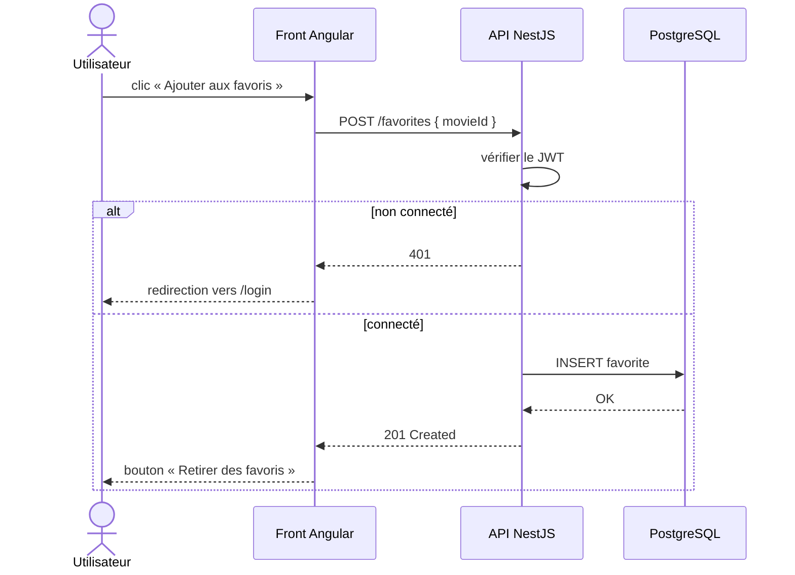
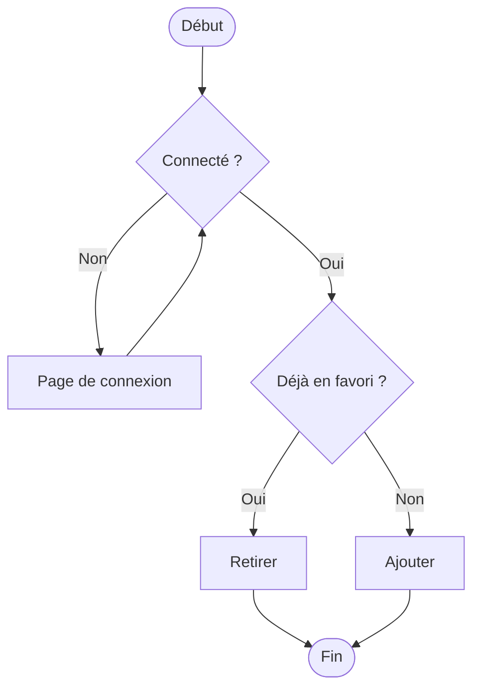

# UML séquence et activité

```dataviewjs
await dv.view("Systeme/notion")
```

> **En une phrase** : Le **diagramme de séquence** montre **qui parle à qui, dans quel ordre** : parfait pour comprendre un appel d'API ou une connexion.

## Le problème

**Pourquoi c'est utile ?**
Pour montrer qui parle à qui et dans quel ordre (séquence), ou les étapes et les choix d'un processus (activité).

**Qu'est-ce qui se passait sans ça ?**
Un échange front → API → base, ou un parcours avec des conditions, s'expliquait avec les mains. Chacun en avait une version différente.

## Comment ça marche
*Explique avec tes mots, comme à un collègue.*

Le **diagramme d'activité** montre un **processus avec ses choix** (« connecté ? oui / non »). Les deux s'écrivent en Mermaid, donc directement dans tes notes et tes README.

### Le diagramme de séquence

Ajouter un favori dans CinéTrack :



| Syntaxe | Sens |
|---|---|
| `A->>B: texte` | A appelle B |
| `B-->>A: texte` | B répond à A |
| `alt … else … end` | deux chemins possibles |
| `opt … end` | étape optionnelle |
| `loop … end` | répétition |

Le temps s'écoule **de haut en bas**.

### Le diagramme d'activité

Le même processus, vu comme un parcours avec des décisions :



### Lequel choisir

| Je veux montrer… | Diagramme |
|---|---|
| les échanges entre front, API, base, service externe | **séquence** |
| un processus métier avec des choix | **activité** |
| qui peut faire quoi | cas d'utilisation |
| la structure des données | classes |

## 🧪 Exemple

### Sur tes projets

Un diagramme de séquence pour chaque flux **important** dans le README de l'API : connexion (JWT + refresh), ajout de favori, appel à TMDB avec cache. Un schéma d'une minute évite une heure d'explication.

## ⚠️ Limites et pièges

- **Trop de détails** (chaque méthode interne) : garde les échanges entre **composants**.
- **Oublier les cas d'erreur** : le bloc `alt` est fait pour ça.

## 🔗 Liens

- **Prérequis :** 
- **Voir aussi :** [[07 HTTP|HTTP]], [[10 Authentification JWT NestJS|Authentification JWT NestJS]]
- **Utilisé dans :** 

## 📚 Notes

- Source : https://mermaid.js.org/syntax/sequenceDiagram.html
