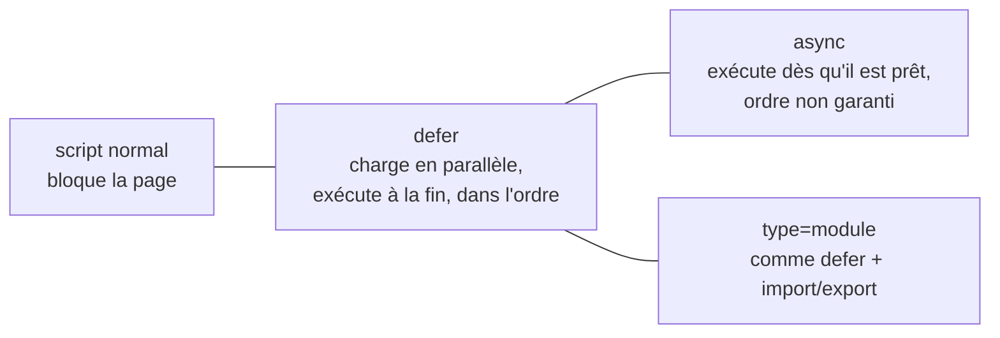

# Head meta et chargement des scripts

```dataviewjs
await dv.view("Systeme/notion")
```

> **En une phrase** : Le `<head>` contient tout ce qui ne s'affiche pas mais compte : l'encodage, l'adaptation au mobile, le titre de l'onglet, la description pour Google, l'aperçu quand on partage le lien, l'icône.

## Le problème

**Pourquoi c'est utile ?**
Pour régler tout ce qui ne s'affiche pas mais compte : encodage, mobile, titre, partage, chargement des scripts.

**Qu'est-ce qui se passait sans ça ?**
Accents cassés, page minuscule sur mobile, aperçu vide quand on partage le lien, et scripts qui bloquaient l'affichage.

## Comment ça marche
*Explique avec tes mots, comme à un collègue.*

C'est aussi là qu'on charge les scripts. Pour le Portfolio, c'est ce qui fait un bon aperçu sur LinkedIn.

### Le `<head>` d'un site vitrine

```html
<head>
  <meta charset="utf-8">                                                  <!-- accents OK -->
  <meta name="viewport" content="width=device-width, initial-scale=1">  <!-- adapté au mobile -->

  <title>Ton Nom — Développeur full stack TypeScript</title>           <!-- onglet + Google -->
  <meta name="description" content="Applications web sécurisées et performantes avec Angular, Vue et NestJS.">

  <!-- Aperçu quand on partage le lien (LinkedIn, Slack, WhatsApp…) -->
  <meta property="og:title" content="Ton Nom — Développeur full stack">
  <meta property="og:description" content="Mes projets et études de cas.">
  <meta property="og:image" content="https://ton-site.fr/apercu.png">  <!-- 1200 × 630 px -->
  <meta property="og:url" content="https://ton-site.fr">

  <link rel="icon" href="/favicon.svg" type="image/svg+xml">              <!-- icône d'onglet -->
  <link rel="stylesheet" href="/styles.css">
  <script type="module" src="/main.js"></script>
</head>
```

| Balise | Oubliée, ça donne… |
|---|---|
| `charset` | des accents cassés (`é`) |
| `viewport` | un site minuscule sur mobile |
| `title` + `description` | un mauvais référencement |
| `og:*` | un lien partagé sans image ni texte |

Avec Vue Router ou Angular, on change le `title` à chaque page (champ `title` des routes Angular, `document.title` ou `useHead` en Vue).

## 🧪 Exemple

### Charger un script



| Écriture | Quand |
|---|---|
| `<script src>` dans le `<head>` | **à éviter** : la page attend le script |
| `<script defer src>` | ton code qui touche la page |
| `<script async src>` | un script indépendant (statistiques) |
| `<script type="module" src>` | code moderne avec `import` (ce que génère Vite) |

Angular CLI et Vite écrivent ces balises pour toi : tu dois surtout savoir les lire.

## ⚠️ Limites et pièges

- **Même `title` sur toutes les pages** : Google et l'historique du navigateur s'y perdent.
- **Image `og:image` en chemin relatif** (`/apercu.png`) : il faut l'URL complète.
- **Script sans `defer` dans le `<head>`** qui cherche un élément : il n'existe pas encore → `null`.

## 🏋️ S'entraîner

### Exercices

#### Exercice 1 · Compléter le `<head>`

Écris le `<head>` minimal d'une page « CinéTrack » : encodage, affichage mobile, titre, description, et un script chargé sans bloquer l'affichage.

> [!success]- Solution
> ```html
> <head>
>   <meta charset="utf-8" />
>   <meta name="viewport" content="width=device-width, initial-scale=1" />
>   <title>CinéTrack · Films populaires</title>
>   <meta name="description" content="Découvre, note et garde tes films préférés." />
>   <link rel="stylesheet" href="styles.css" />
>   <script type="module" src="main.js"></script>
> </head>
> ```
>
> Un script `type="module"` est différé : il s'exécute après la lecture du HTML.

#### Exercice 2 · `defer` ou pas ?

Ce script plante avec « Cannot read properties of null ». Pourquoi, et quelles sont deux corrections ?

```html
<head>
  <script src="app.js"></script>
</head>
<body>
  <button id="like">J'aime</button>
</body>
```

```js
// app.js
document.querySelector('#like').addEventListener('click', like);
```

> [!success]- Solution
> Le script est exécuté **dès qu'il est lu**, dans le `<head>` : le `<button>` n'existe pas encore, `querySelector` renvoie `null`.
>
> Corrections :
> 1. `<script src="app.js" defer></script>` : exécution après la lecture de toute la page.
> 2. ou placer le `<script>` juste avant `</body>`.

## 🔗 Liens

- **Prérequis :** [[01 Structure HTML et sémantique|Structure HTML et sémantique]]
- **Voir aussi :** [[02 Aide-mémoire des balises HTML|Aide-mémoire des balises HTML]], [[01 Compilé vs interprété|Compilé vs interprété]]
- **Utilisé dans :** 

## 📚 Notes

- Source : https://developer.mozilla.org/fr/docs/Learn/HTML/Introduction_to_HTML/The_head_metadata_in_HTML
