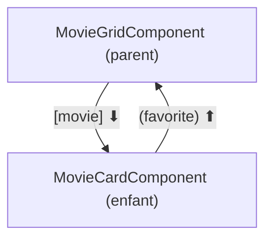

# Communication parent-enfant Angular

```dataviewjs
await dv.view("Systeme/notion")
```

> **En une phrase** : Un parent **donne des données** à un enfant avec `input()`.

## Le problème

**Pourquoi c'est utile ?**
Pour faire passer des données du parent à l'enfant et des événements de l'enfant au parent.

**Qu'est-ce qui se passait sans ça ?**
Les composants se modifiaient les uns les autres directement, et on ne savait plus qui changeait quoi.

## Comment ça marche
*Explique avec tes mots, comme à un collègue.*

L'enfant **prévient** son parent avec `output()`. `model()` combine les deux pour une valeur modifiable par l'enfant. Les données descendent, les événements remontent : exactement comme les props et emits de Vue.

### Le schéma



### Côté parent

```html
@for (m of movies(); track m.id) {
  <app-movie-card
    [movie]="m"
    [highlighted]="m.rating > 8"
    (favorite)="favorites.toggle($event)"
  />
}
```

- `[movie]="m"` → donne une **donnée**.
- `(favorite)="…"` → écoute l'**événement** ; `$event` contient la valeur émise (l'id).

### `model()` : une valeur modifiable par l'enfant

Pour un composant de filtre ou un champ personnalisé :

```ts
// genre-filter.component.ts
export class GenreFilterComponent {
  genre = model<string | null>(null);
}
```
```html
<!-- dans le filtre -->
<button type="button" (click)="genre.set('action')">Action</button>

<!-- dans le parent -->
<app-genre-filter [(genre)]="selectedGenre" />
```

`[(genre)]` : quand le parent change `selectedGenre`, le filtre se met à jour ; quand le filtre fait `genre.set(…)`, `selectedGenre` change aussi.

### Transformer un input

```ts
disabled = input(false, { transform: booleanAttribute });   // permet d'écrire <app-x disabled />
```

### Et quand ce n'est pas parent-enfant ?

| Situation | Solution |
|---|---|
| parent ↔ enfant direct | `input` / `output` |
| composants éloignés (en-tête et carte) | un **service** partagé (voir State management) |
| le parent veut appeler une méthode de l'enfant | `viewChild(MovieCardComponent)` (rare) |

### Anciennes écritures

Tu les verras dans du code existant : `@Input() movie!: Movie;` et `@Output() favorite = new EventEmitter<number>();`. Même principe, sans signals.

## 🧪 Exemple

### Côté enfant

```ts
@Component({
  selector: 'app-movie-card',
  changeDetection: ChangeDetectionStrategy.OnPush,
  template: `
    <article [class.highlighted]="highlighted()">
      <h3>{{ movie().title }}</h3>
      <button type="button" (click)="favorite.emit(movie().id)">♡</button>
    </article>
  `,
})
export class MovieCardComponent {
  movie = input.required<Movie>();        // obligatoire
  highlighted = input(false);             // optionnel, false par défaut
  favorite = output<number>();            // événement qui transporte un id
}
```

## ⚠️ Limites et pièges

- **Modifier un input dans l'enfant** : impossible (lecture seule). Émets un événement, ou utilise `model()`.
- **Oublier les crochets** : `movie="m"` passe le texte « m ».
- **Faire passer une donnée sur 4 niveaux** : utilise un service.

## 🏋️ S'entraîner

### Exercices

#### Exercice 1 · Parent et enfant

`MovieCard` reçoit un film et prévient le parent quand on clique sur « favori ». Écris l'enfant et l'utilisation dans le parent.

> [!success]- Solution
> ```ts
> // enfant
> export class MovieCard {
>   movie = input.required<Movie>();
>   favoriteToggle = output<number>();
> }
> ```
>
> ```html
> <!-- template de l'enfant -->
> <button (click)="favoriteToggle.emit(movie().id)">♥</button>
> ```
>
> ```html
> <!-- parent -->
> <app-movie-card [movie]="m" (favoriteToggle)="store.toggle($event)" />
> ```

#### Exercice 2 · Une valeur modifiable par l'enfant

Crée un composant `RatingStars` dont la note peut être lue **et** modifiée par le parent avec `[(rating)]`.

> [!success]- Solution
> ```ts
> @Component({
>   selector: 'app-rating-stars',
>   template: `
>     @for (star of [1, 2, 3, 4, 5]; track star) {
>       <button type="button" (click)="rating.set(star)">{{ star <= rating() ? '★' : '☆' }}</button>
>     }
>   `,
> })
> export class RatingStars {
>   rating = model(0);
> }
> ```
>
> ```html
> <app-rating-stars [(rating)]="myRating" />
> ```

## 🔗 Liens

- **Prérequis :** [[01 Fondamentaux Angular|Fondamentaux Angular]]
- **Voir aussi :** [[02 Composants Angular|Composants Angular]], [[12 Signals Angular|Signals Angular]]
- **Utilisé dans :** 

## 📚 Notes

- Source : https://angular.dev/guide/components/inputs
