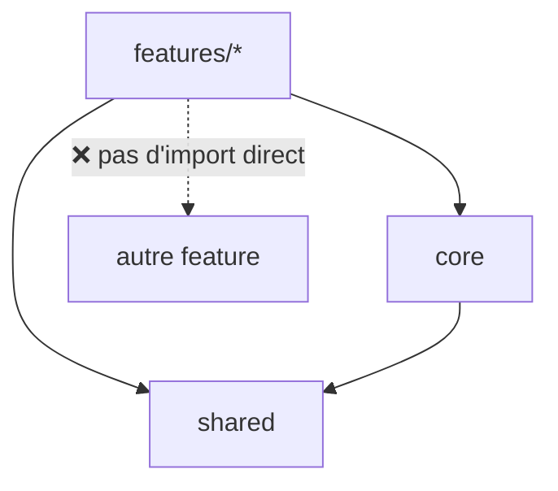

# Architecture d'un projet Angular

```dataviewjs
await dv.view("Systeme/notion")
```

> **En une phrase** : Les **principes** qui gardent un projet Angular lisible quand il grossit (50 écrans, 10 développeurs).

## Le problème

**Pourquoi c'est utile ?**
Pour garder un projet Angular lisible quand il grossit.

**Qu'est-ce qui se passait sans ça ?**
Tout dans le même dossier, des dépendances dans tous les sens : chaque nouvelle fonctionnalité cassait autre chose.

## Comment ça marche
*Explique avec tes mots, comme à un collègue.*

L'arborescence concrète et le code de chaque couche sont dans [[Template d'architecture Angular]] ; le modèle général, valable aussi pour Vue et NestJS, dans [[Structure de projet]].

### Les 5 principes

#### 1. Par fonctionnalité

Un dossier par fonctionnalité métier (`features/movies`, `features/favorites`, `features/auth`), plutôt qu'un dossier géant `components/` et un dossier géant `services/`.

#### 2. Pages et composants d'affichage

| | Page (conteneur) | Composant d'affichage |
|---|---|---|
| Rôle | récupère les données, gère les actions | affiche ce qu'on lui donne |
| Injecte des services | oui | **non** |
| Communique par | stores / services | `input()` / `output()` |
| Testabilité | tests avec faux services | très simple |

#### 3. Une couche d'accès aux données

`api` (HTTP) → `mapper` (DTO → modèle) → `store` (état). Les composants ne voient jamais la forme brute de l'API : si TMDB change, ou si tu passes par ton API NestJS, seuls ces fichiers bougent.

#### 4. Des règles d'import



- une feature n'importe pas une autre feature : le code commun va dans `shared` ;
- `shared` ne connaît rien du métier ;
- `core` contient ce qui existe une seule fois (intercepteurs, layout, configuration).

Sur un gros projet, ces règles peuvent être vérifiées automatiquement (ESLint, Nx).

#### 5. Tout est chargé à la demande

Chaque feature a son fichier de routes, chargé avec `loadChildren`. Le premier écran ne télécharge que ce dont il a besoin.

### Adapter à la taille

| Projet | Organisation |
|---|---|
| petit (quelques écrans) | `core` + `shared` + 2-3 features, un service par feature |
| moyen (CinéTrack) | structure complète, stores par feature |
| gros, plusieurs équipes ou applications | monorepo **Nx** avec des librairies et des règles d'import vérifiées |

## 🧪 Exemple

> À compléter avec un exemple tiré de ton travail.

## ⚠️ Limites et pièges

- **`shared` qui devient un fourre-tout** : n'y mets que ce qui est vraiment utilisé par plusieurs features.
- **Un service qui fait tout** : sépare accès aux données et état.
- **Au travail** : suis la structure existante, et propose des améliorations progressives.

## 🏋️ S'entraîner

### Exercices

#### Exercice 1 · Ranger les fichiers

Où ranges-tu chaque fichier : `core`, `shared` ou `features/…` ?
1. l'intercepteur TMDB ;
2. le composant `MovieCard` utilisé dans 3 pages ;
3. la page « Mes favoris » ;
4. le pipe `runtime` ;
5. `AuthService`.

> [!success]- Solution
> 1. `core/http/` : une seule instance, utile à toute l'application.
> 2. `shared/ui/` : réutilisé par plusieurs features.
> 3. `features/account/pages/`.
> 4. `shared/pipes/`.
> 5. `core/auth/`.

#### Exercice 2 · Les règles d'import

Quels imports sont interdits, et pourquoi ?
1. `features/movies` importe `shared/ui/movie-card` ;
2. `shared/ui/movie-card` importe `features/account/data/account.api` ;
3. `features/account` importe `features/movies/pages/movies-page` ;
4. `features/movies` importe `core/config`.

> [!success]- Solution
> - 1 et 4 : **autorisés** (une feature peut utiliser `shared` et `core`).
> - 2 : **interdit** : `shared` ne doit dépendre d'aucune feature, sinon il n'est plus réutilisable.
> - 3 : **interdit** : les features ne s'importent pas entre elles. Ce qui est commun remonte dans `shared` ou `core`.

## 🔗 Liens

- **Prérequis :** [[Fondamentaux Angular]]
- **Voir aussi :** [[Architecture frontend]], [[MVC et architecture en couches]]
- **Utilisé dans :** 

## 📚 Notes

- Source : https://angular.dev/style-guide
