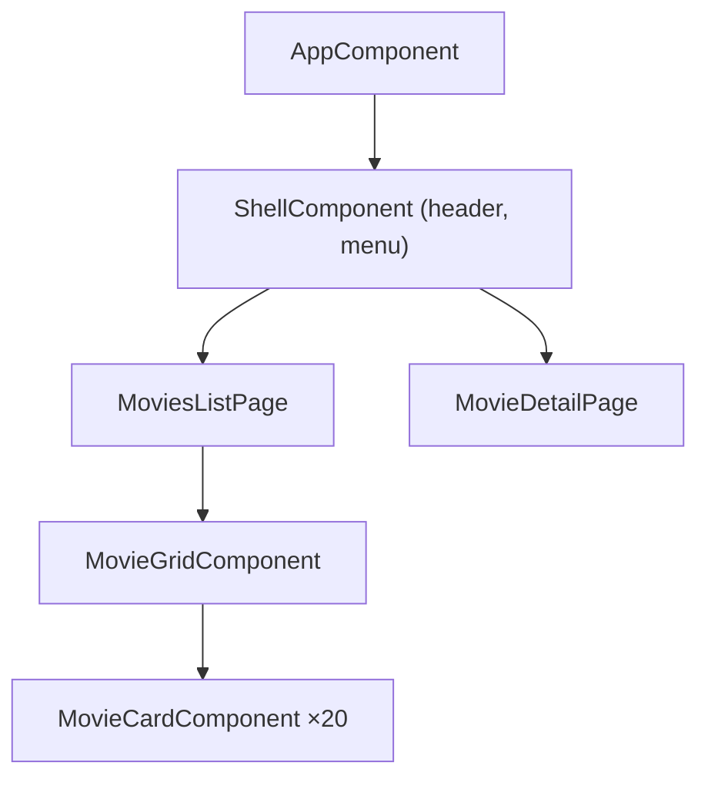

# Composants Angular

```dataviewjs
await dv.view("Systeme/notion")
```

> **En une phrase** : Un composant est un morceau d'écran réutilisable : une carte de film, un en-tête, une page.

## Le problème

**Pourquoi c'est utile ?**
Pour découper l'écran en morceaux réutilisables qui ont chacun leur HTML, leur style et leur logique.

**Qu'est-ce qui se passait sans ça ?**
Une page entière dans un seul gros fichier HTML + JS, impossible à réutiliser ou à faire évoluer.

## Comment ça marche
*Explique avec tes mots, comme à un collègue.*

En Angular, c'est une **classe TypeScript** avec le décorateur `@Component`, qui contient son template (HTML) et ses styles. Une page = un assemblage de composants.

### Anatomie

```ts
// movie-card.component.ts
import { Component, ChangeDetectionStrategy, input } from '@angular/core';
import type { Movie } from '../data/movie.model';

@Component({
  selector: 'app-movie-card',                         // <app-movie-card />
  changeDetection: ChangeDetectionStrategy.OnPush,    // à mettre partout (voir plus bas)
  templateUrl: './movie-card.component.html',         // ou template: `…` si court
  styleUrl: './movie-card.component.scss',
})
export class MovieCardComponent {
  movie = input.required<Movie>();                    // donnée reçue du parent
}
```

```html
<!-- movie-card.component.html -->
<article class="card">
  
  <h3>{{ movie().title }}</h3>
  <p>{{ movie().year }}</p>
</article>
```

### Découper CinéTrack



| Type | Rôle | Injecte des services ? |
|---|---|---|
| **Page** (`movies-list.page.ts`) | récupère les données, assemble | oui |
| **Composant d'affichage** (`movie-card.component.ts`) | affiche ce qu'on lui donne | **non** |

### `OnPush` : à mettre partout

`changeDetection: ChangeDetectionStrategy.OnPush` dit à Angular : « ne revérifie ce composant que si ses entrées ou ses signals changent ». C'est plus rapide et ça t'oblige à bien faire circuler les données. Voir [[Détection de changement Angular|Détection de changement]].

### Conventions

| Quoi | Convention |
|---|---|
| Fichier | `movie-card.component.ts` (kebab-case) |
| Classe | `MovieCardComponent` |
| Sélecteur | `app-movie-card` (préfixe `app-`) |
| Génération | `ng g c features/movies/components/movie-card` |

## 🧪 Exemple

### Utiliser un composant dans un autre

Il faut l'**importer** dans le composant qui l'utilise :

```ts
@Component({
  selector: 'app-movie-grid',
  imports: [MovieCardComponent],                      // ← sinon : balise inconnue
  template: `
    @for (m of movies(); track m.id) {
      <app-movie-card [movie]="m" />
    }
  `,
})
export class MovieGridComponent {
  movies = input.required<Movie[]>();
}
```

Depuis Angular 17, les composants sont **standalone** : chacun déclare lui-même ce qu'il importe. Tu croiseras l'ancienne méthode (NgModules) dans du code existant : [[NgModules Angular|NgModules]].

## ⚠️ Limites et pièges

- **Oublier l'import** dans `imports: […]` : erreur « is not a known element ».
- **Un composant de 400 lignes** : découpe.
- **Appeler une API depuis un composant d'affichage** : passe par un service et une page.

## 🏋️ S'entraîner

### Exercices

#### Exercice 1 · Créer la carte de film

Génère un composant `MovieCard` dans `shared/ui/` avec le CLI. Il reçoit un film en entrée (obligatoire) et affiche son titre et son année. Active `OnPush`.

> [!success]- Solution
> ```bash
> ng generate component shared/ui/movie-card
> ```
>
> ```ts
> import { ChangeDetectionStrategy, Component, input } from '@angular/core';
>
> @Component({
>   selector: 'app-movie-card',
>   changeDetection: ChangeDetectionStrategy.OnPush,
>   template: `
>     <article>
>       <h3>{{ movie().title }}</h3>
>       <p>{{ movie().year }}</p>
>     </article>
>   `,
> })
> export class MovieCard {
>   movie = input.required<Movie>();
> }
> ```

#### Exercice 2 · Découper une page

Découpe la page « Films populaires » en composants : lesquels crées-tu, et lequel charge les données ?

> [!success]- Solution
> ```text
> MoviesPage          ← la page : charge les films (appelle le service)
> ├── SearchBar       ← émet le texte recherché
> ├── MovieGrid       ← reçoit la liste, affiche la grille
> │   └── MovieCard   ← reçoit un film, émet « favori »
> └── Paginator       ← reçoit page / total, émet le changement de page
> ```
>
> Seule la **page** parle au service. Les autres composants reçoivent des données (`input`) et émettent des événements (`output`) : ils sont réutilisables et faciles à tester.

## 🔗 Liens

- **Prérequis :** [[Fondamentaux Angular]]
- **Voir aussi :** 
- **Utilisé dans :** 

## 📚 Notes

- Source : https://angular.dev/guide/components
