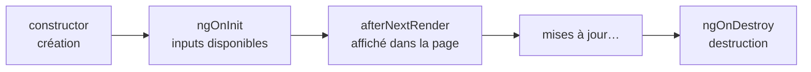

# Cycle de vie des composants Angular

```dataviewjs
await dv.view("Systeme/notion")
```

> **En une phrase** : Un composant est **créé**, **affiché**, **mis à jour**, puis **détruit**.

## Le problème

**Pourquoi c'est utile ?**
Pour exécuter du code au bon moment : création, affichage, destruction d'un composant.

**Qu'est-ce qui se passait sans ça ?**
Des abonnements jamais arrêtés (fuites de mémoire) et du code lancé trop tôt, avant que les données soient là.

## Comment ça marche
*Explique avec tes mots, comme à un collègue.*

Angular permet d'exécuter du code à ces moments-là avec des méthodes spéciales (*hooks*). Avec les signals, tu en as beaucoup moins besoin qu'avant : `ngOnInit`, `ngOnDestroy` et `afterNextRender` couvrent presque tout.

### Les moments utiles



| Moment | Hook | Usage |
|---|---|---|
| Création | `constructor` / propriétés | `inject()`, créer les signals et `computed` |
| Inputs disponibles | `ngOnInit` | lancer un chargement qui dépend d'un input |
| Affiché dans la page | `afterNextRender(() => …)` | donner le focus, mesurer, démarrer une librairie graphique |
| Destruction | `ngOnDestroy` ou `inject(DestroyRef).onDestroy(…)` | nettoyer minuteurs et écouteurs |

### Ce que les signals remplacent

| Avant | Maintenant |
|---|---|
| `ngOnChanges` pour réagir au changement d'un input | `computed(() => … this.id() …)` ou `effect` |
| `ngOnInit` + `subscribe` + `ngOnDestroy` + `unsubscribe` | `toSignal(obs$)` ou `httpResource` (nettoyés automatiquement) |
| `ngAfterViewInit` pour accéder au DOM | `afterNextRender` + `viewChild()` |

## 🧪 Exemple

### Exemple

```ts
export class MovieDetailPage implements OnInit {
  id = input.required<number>();
  private store = inject(MovieDetailStore);

  constructor() {
    afterNextRender(() => document.querySelector<HTMLElement>('h1')?.focus());

    const timer = setInterval(() => this.store.refreshRating(), 60_000);
    inject(DestroyRef).onDestroy(() => clearInterval(timer));
  }

  ngOnInit() {
    this.store.load(this.id());   // les inputs ne sont pas encore là dans le constructeur
  }
}
```

## ⚠️ Limites et pièges

- **Lire un input dans le constructeur** : il n'a pas encore de valeur. Utilise `ngOnInit`, ou mieux un `computed`.
- **Oublier de nettoyer** un `setInterval` ou un `addEventListener` sur `window` : il continue après la destruction.
- **Accéder au DOM dans `ngOnInit`** : il n'est pas encore affiché. Utilise `afterNextRender`.

## 🏋️ S'entraîner

### Exercices

#### Exercice 1 · Au bon moment

Pour chaque besoin, quel moment du cycle de vie (ou quel outil moderne) utilises-tu ?
1. lancer une animation sur un élément du DOM après son affichage ;
2. arrêter un `setInterval` quand le composant disparaît ;
3. recalculer une valeur quand un input change.

> [!success]- Solution
> 1. **`afterNextRender`** (le DOM est prêt).
> 2. **`DestroyRef.onDestroy`** (ou `ngOnDestroy`).
> 3. **`computed`** à partir de l'input signal (plus besoin de `ngOnChanges`).

#### Exercice 2 · Nettoyer

Écris un composant qui met à jour un signal `now` chaque seconde et arrête le minuteur quand il est détruit.

> [!success]- Solution
> ```ts
> export class Clock {
>   now = signal(new Date());
>
>   constructor() {
>     const id = setInterval(() => this.now.set(new Date()), 1000);
>     inject(DestroyRef).onDestroy(() => clearInterval(id));
>   }
> }
> ```

## 🔗 Liens

- **Prérequis :** [[Fondamentaux Angular]]
- **Voir aussi :** [[Composants Angular]], [[Détection de changement Angular]]
- **Utilisé dans :** 

## 📚 Notes

- Source : https://angular.dev/guide/components/lifecycle
