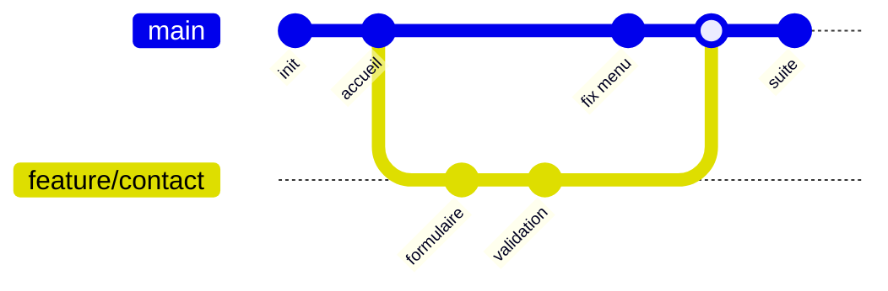

# Branches merge et rebase

```dataviewjs
await dv.view("Systeme/notion")
```

> **En une phrase** : Une **branche** est une ligne de travail à part : tu développes le formulaire de contact sans toucher à `main`.

## Le problème

**Pourquoi c'est utile ?**
Pour travailler sur une fonctionnalité à part, puis l'intégrer proprement.

**Qu'est-ce qui se passait sans ça ?**
Tout le monde modifiait directement la même version : du code à moitié fini cassait le travail des autres.

## Comment ça marche
*Explique avec tes mots, comme à un collègue.*

Quand c'est prêt, tu **réintègres** ton travail : avec un **merge** (on fusionne, l'historique garde la trace de la branche) ou un **rebase** (on rejoue tes commits par-dessus, l'historique devient une ligne droite).

### L'image

`main` est la **route principale**. Une branche est une **déviation** pour faire des travaux sans bloquer la circulation. Une fois les travaux finis, la déviation rejoint la route.



### Merge : fusionner

```bash
git switch main
git merge feature/contact
```

Git crée un **commit de fusion** qui relie les deux histoires. Rien n'est réécrit : c'est sûr, mais l'historique peut devenir touffu.

### Rebase : rejouer par-dessus

```bash
git switch feature/contact
git rebase main                     # rejoue mes commits après les derniers de main
```

Avant : ta branche est partie d'un vieux `main`. Après : c'est comme si tu avais commencé ton travail sur le `main` d'aujourd'hui. Historique **linéaire**, plus lisible.

| | Merge | Rebase |
|---|---|---|
| Historique | garde les embranchements | ligne droite |
| Réécrit les commits | non | **oui** (nouveaux identifiants) |
| Sûr sur une branche partagée | oui | **non** |
| Usage typique | intégrer une MR dans `main` | mettre à jour **ta** branche avant la MR |

### La règle d'or du rebase

> **Ne jamais rebaser une branche que d'autres utilisent déjà.**

Le rebase crée de nouveaux commits. Si un collègue avait les anciens, vos historiques divergent. Rebaser **ta** branche perso avant de la proposer : oui. Rebaser `main` : jamais.

Après un rebase d'une branche déjà poussée :

```bash
git push --force-with-lease        # force, mais refuse si quelqu'un d'autre a poussé entretemps
```

### Au travail

Suis la convention de l'équipe : certaines équipes fusionnent (merge), d'autres rebasent ou « squashent » (tous les commits de la MR réunis en un seul). Voir [[Workflows Git en équipe|Workflows]].

## 🧪 Exemple

### Les commandes

```bash
git switch -c feature/contact      # créer une branche et y aller
git switch main                    # revenir sur main
git branch                         # lister les branches locales
git branch -d feature/contact      # supprimer une branche fusionnée
```

**Nommer ses branches :** `feature/contact-form`, `fix/menu-mobile`, `chore/update-deps`.

## ⚠️ Limites et pièges

- **Travailler directement sur `main`**.
- **Une branche qui vit 3 semaines** : les conflits s'accumulent. Petites branches, fusionnées vite.
- **`git push --force`** sans `-with-lease` : peut effacer le travail d'un collègue.

## 🏋️ S'entraîner

### Exercices

#### Exercice 1 · Travailler sur une branche

Écris les commandes pour : créer une branche `feature/search` depuis `main` à jour, y commiter, puis revenir sur `main` et fusionner la branche.

> [!success]- Solution
> ```bash
> git switch main
> git pull
> git switch -c feature/search
> # … modifications …
> git add .
> git commit -m "feat: ajoute la recherche de films"
> git switch main
> git merge feature/search
> ```
>
> En équipe, la fusion se fait plutôt par une merge request.

#### Exercice 2 · Merge ou rebase ?

Ta branche `feature/search` est en retard sur `main`. Quelle commande pour la mettre à jour **si tu es seul dessus** ? Et pourquoi ne jamais faire de rebase sur `main` ?

> [!success]- Solution
> ```bash
> git switch feature/search
> git fetch
> git rebase origin/main
> git push --force-with-lease
> ```
>
> Le rebase **réécrit** les commits (ils changent d'identifiant). Sur une branche partagée comme `main`, les autres auraient un historique qui ne correspond plus au leur. Règle : on ne rebase que ses propres branches non partagées.

## 🔗 Liens

- **Prérequis :** [[Git fondamentaux]]
- **Voir aussi :** [[Conflits Git]]
- **Utilisé dans :** 

## 📚 Notes

- Source : https://git-scm.com/book/fr/v2/Les-branches-avec-Git-Rebaser-Rebasing
