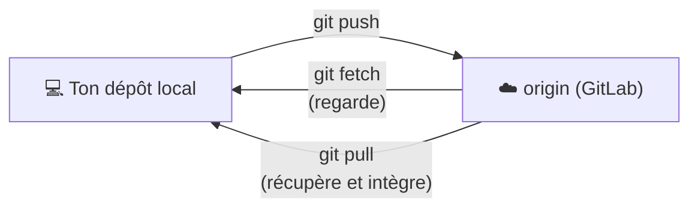

# Dépôts distants

```dataviewjs
await dv.view("Systeme/notion")
```

> **En une phrase** : Ton dépôt Git est sur ton ordinateur.

## Le problème

**Pourquoi c'est utile ?**
Pour sauvegarder le code en ligne et le partager avec l'équipe.

**Qu'est-ce qui se passait sans ça ?**
Le code n'existait que sur un ordinateur : une panne de disque et tout était perdu, et on s'échangeait des zip.

## Comment ça marche
*Explique avec tes mots, comme à un collègue.*

Un **dépôt distant** (*remote*) est une copie hébergée en ligne, sur GitLab ou GitHub, pour sauvegarder ton travail et le partager. Trois gestes : **envoyer** (`push`), **récupérer** (`pull`), **regarder ce qui a changé** (`fetch`).

### Le schéma



`origin` est le nom donné par défaut au dépôt distant.

### `fetch` ou `pull` ?

| | `fetch` | `pull` |
|---|---|---|
| Télécharge | oui | oui |
| Modifie tes fichiers | **non** | **oui** (merge ou rebase) |
| Quand | « qu'est-ce qui a changé ? » | « je veux la dernière version » |

### SSH ou HTTPS ?

| | SSH (`git@gitlab.com:…`) | HTTPS (`https://gitlab.com/…`) |
|---|---|---|
| Authentification | une clé SSH, configurée une fois | identifiant + jeton d'accès |
| Au quotidien | **rien à taper** | le gestionnaire d'identifiants s'en souvient |

Créer une clé SSH (dans WSL) :

```bash
ssh-keygen -t ed25519 -C "ton.email@exemple.fr"
cat ~/.ssh/id_ed25519.pub     # à coller dans GitLab → Préférences → Clés SSH
ssh -T git@gitlab.com         # test
```

### Le déroulé quotidien

```bash
git switch main && git pull              # partir d'un main à jour
git switch -c feature/filtre-technos     # nouvelle branche
# … coder, commiter …
git push -u origin feature/filtre-technos
# → GitLab propose de créer une Merge Request
```

Voir [[Merge requests|Merge Requests]].

## 🧪 Exemple

### Les commandes

```bash
git clone git@gitlab.com:ton-nom/portfolio.git   # copier un dépôt distant

git remote -v                           # voir les dépôts distants
git remote add origin <url>             # relier un dépôt local à un distant

git push -u origin feature/contact      # 1re fois : envoyer ET relier la branche
git push                                # ensuite

git fetch                               # télécharger les nouveautés sans rien modifier
git pull                                # télécharger ET intégrer dans ta branche
git pull --rebase                       # pareil, en rebasant (historique propre)
```

## ⚠️ Limites et pièges

- **« rejected: non-fast-forward »** au `push` : quelqu'un a poussé avant toi. Fais `git pull --rebase`, puis repousse.
- **Travailler plusieurs jours sans `pull`** : les conflits s'accumulent.
- **Oublier `-u` au premier push** : ensuite `git push` tout court ne sait pas où envoyer.

## 🏋️ S'entraîner

### Exercices

#### Exercice 1 · Publier un projet

Tu as un dépôt local avec des commits. Écris les commandes pour le relier à un dépôt GitLab vide et envoyer la branche `main`.

> [!success]- Solution
> ```bash
> git remote add origin git@gitlab.com:mon-compte/cinetrack.git
> git push -u origin main
> ```
>
> `-u` relie la branche locale à la branche distante : ensuite, un simple `git push` suffit.

#### Exercice 2 · `fetch` ou `pull` ?

Quelle est la différence entre `git fetch` et `git pull` ? Dans quel cas préférer `fetch` ?

> [!success]- Solution
> - `git fetch` **télécharge** les nouveautés du serveur sans toucher à tes fichiers.
> - `git pull` = `fetch` **+ fusion** dans ta branche actuelle.
>
> On préfère `fetch` quand on veut d'abord **regarder** ce qui a changé (`git log origin/main`) avant de l'intégrer.

## 🔗 Liens

- **Prérequis :** [[Git fondamentaux]]
- **Voir aussi :** [[Fondamentaux GitLab]], [[Merge requests]]
- **Utilisé dans :** 

## 📚 Notes

- Source : https://git-scm.com/book/fr/v2/Les-bases-de-Git-Travailler-avec-des-d%C3%A9p%C3%B4ts-distants
