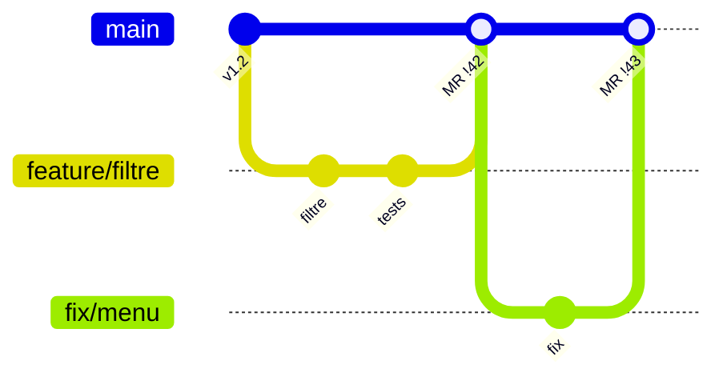
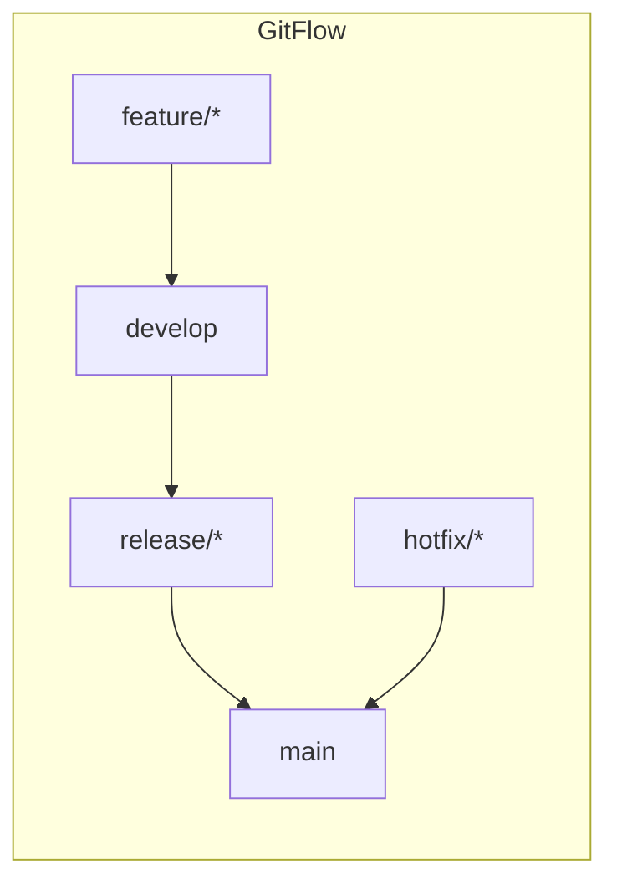

# Workflows Git en équipe

```dataviewjs
await dv.view("Systeme/notion")
```

> **En une phrase** : Un **workflow** Git, c'est la règle du jeu de l'équipe : quelles branches existent, qui peut écrire où, comment on intègre le travail.

## Le problème

**Pourquoi c'est utile ?**
Pour que toute l'équipe suive les mêmes règles de branches et d'intégration.

**Qu'est-ce qui se passait sans ça ?**
Chacun faisait à sa façon : branches qui vivaient des mois, fusions douloureuses, et main souvent cassée.

## Comment ça marche
*Explique avec tes mots, comme à un collègue.*

Le plus courant aujourd'hui : **une branche par tâche, une Merge Request, puis fusion dans `main`**. Au travail, tu suis celui de ton équipe.

### Le workflow par branches de fonctionnalité (le plus courant)



1. `main` est **protégée** : personne ne pousse directement dessus.
2. Une tâche = une branche (`feature/…`, `fix/…`).
3. Une **Merge Request** avec revue de code et pipeline vert.
4. Fusion dans `main`, suppression de la branche.
5. Déploiement depuis `main` (souvent automatique).

C'est celui que tu utilises dans tes projets. Voir [[Merge requests|Merge Requests]].

### Les bonnes pratiques de l'équipe

- **Branches courtes** : quelques jours maximum.
- **Petites MR** : une MR de 200 lignes est relue sérieusement, une de 2 000 est survolée.
- **`main` toujours déployable** : ce qui y entre est testé.
- **Un nom de branche lié au ticket** : `feature/123-filtre-technos`.
- **Stratégie de fusion commune** : merge, rebase ou squash, mais tout le monde pareil.

## 🧪 Exemple

### Les autres workflows

| Workflow | Principe | Pour |
|---|---|---|
| **Feature branches + MR** (GitHub / GitLab Flow) | branches courtes vers `main` | la plupart des équipes |
| **GitFlow** | `main` + `develop` + branches `release/` et `hotfix/` | versions planifiées (logiciel livré par version) |
| **Trunk-based** | tout le monde intègre dans `main` plusieurs fois par jour, fonctionnalités cachées derrière des interrupteurs | équipes très matures, déploiement continu |



GitFlow est plus lourd : beaucoup de branches à maintenir. Tu le croiseras dans des projets existants.

## ⚠️ Limites et pièges

- **Pousser directement sur `main`** « juste pour une petite correction ».
- **Une branche `develop` qui diverge** pendant des semaines de `main`.
- **Imposer ton workflow** dans une équipe qui en a déjà un : propose, mais suis l'existant.

## 🏋️ S'entraîner

### Exercices

#### Exercice 1 · Le déroulé d'une fonctionnalité

Décris dans l'ordre les étapes pour livrer la fonctionnalité « favoris » dans une équipe qui utilise des branches de fonctionnalité et des merge requests.

> [!success]- Solution
> 1. Partir de `main` à jour : `git switch main && git pull`.
> 2. Créer la branche : `git switch -c feature/favorites`.
> 3. Commiter par petites étapes, pousser : `git push -u origin feature/favorites`.
> 4. Ouvrir une **merge request** vers `main`, liée au ticket.
> 5. La CI passe (lint, tests, build), un collègue relit.
> 6. Corriger selon les retours, puis fusionner.
> 7. Supprimer la branche.

#### Exercice 2 · Une bonne merge request

Qu'est-ce qui rend une MR facile à relire ? Donne 4 critères.

> [!success]- Solution
> 1. **Petite** : une seule fonctionnalité ou correction (idéalement moins de 400 lignes).
> 2. **Un titre et une description claires** : quoi, pourquoi, comment tester, capture d'écran si c'est visuel.
> 3. **La CI est verte** avant de demander une relecture.
> 4. **Des commits propres** (messages clairs, pas de « wip », « fix », « fix2 »).

## 🔗 Liens

- **Prérequis :** [[Git fondamentaux]]
- **Voir aussi :** [[Merge requests]], [[Pipeline CI CD full stack]]
- **Utilisé dans :** 

## 📚 Notes

- Source : https://www.atlassian.com/git/tutorials/comparing-workflows
