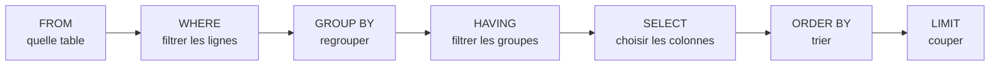

# Fondamentaux SQL et SELECT

```dataviewjs
await dv.view("Systeme/notion")
```

> **En une phrase** : **SQL** est le langage pour parler à une base de données relationnelle (PostgreSQL).

## Le problème

**Pourquoi c'est utile ?**
Pour lire les données d'une base relationnelle avec un langage standard.

**Qu'est-ce qui se passait sans ça ?**
Chaque base avait son propre langage, ou on lisait des fichiers à la main avec du code spécifique.

## Comment ça marche
*Explique avec tes mots, comme à un collègue.*

Les données sont rangées dans des **tables** (comme des feuilles de tableur), et on les lit avec `SELECT`. Même avec Prisma, tu dois savoir lire et écrire du SQL : pour déboguer, pour comprendre ce que Prisma exécute, et pour les requêtes complexes.

### Une table = un tableau

Table `movies` :

| id | title | release_year | rating |
|---|---|---|---|
| 27205 | Inception | 2010 | 8.4 |
| 438631 | Dune | 2021 | 7.8 |
| 949 | Heat | 1995 | 7.9 |

- Une **ligne** = un enregistrement (un film).
- Une **colonne** = une information (le titre).
- La **clé primaire** (`id`) identifie chaque ligne de façon unique.

### L'ordre d'écriture et l'ordre d'exécution

On écrit dans cet ordre : `SELECT … FROM … WHERE … GROUP BY … HAVING … ORDER BY … LIMIT`.

Mais la base **exécute** dans cet ordre :



C'est pour ça qu'on ne peut pas utiliser dans le `WHERE` un alias créé dans le `SELECT` : il n'existe pas encore.

## 🧪 Exemple

### Lire avec `SELECT`

```sql
SELECT title, release_year      -- quelles colonnes
FROM movies                     -- quelle table
WHERE release_year >= 2000      -- quelles lignes
ORDER BY rating DESC            -- dans quel ordre
LIMIT 10;                       -- combien
```

Résultat : les titres et années des films sortis depuis 2000, du mieux noté au moins bien noté, 10 maximum.

```sql
SELECT * FROM movies;                              -- toutes les colonnes (à éviter dans le code)
SELECT title AS titre FROM movies;                 -- renommer une colonne
SELECT DISTINCT release_year FROM movies;          -- sans doublons
SELECT title, rating * 10 AS note_sur_100 FROM movies;   -- calculer
```

## ⚠️ Limites et pièges

- **`SELECT *` dans le code** : tu ramènes des colonnes inutiles (et parfois sensibles). Liste les colonnes.
- **Oublier le `;`** en fin de requête dans `psql`.
- **Les textes entre apostrophes simples** : `'Dune'`. Les guillemets doubles `"…"` servent aux **noms** de colonnes ou de tables.

## 🏋️ S'entraîner

### S'entraîner

- **pgexercises.com** : exercices progressifs en PostgreSQL.
- **`npx prisma studio`** ou **DBeaver** ou **DataGrip** (JetBrains) : pour voir tes tables et lancer des requêtes.
- En local : `docker run -p 5432:5432 -e POSTGRES_PASSWORD=pg -d postgres:17` puis `psql`.

### Exercices

#### Exercice 1 · Première requête

Avec la table `movies (id, title, release_year, genre, rating)`, écris la requête qui affiche le titre et l'année de tous les films, avec la colonne `release_year` renommée `annee`.

> [!success]- Solution
> ```sql
> SELECT title, release_year AS annee
> FROM movies;
> ```

#### Exercice 2 · L'ordre d'exécution

Pourquoi cette requête provoque-t-elle une erreur ? Comment la corriger ?

```sql
SELECT title, rating * 10 AS score
FROM movies
WHERE score > 80;
```

> [!success]- Solution
> SQL exécute `FROM`, puis `WHERE`, **puis** `SELECT`. Au moment du `WHERE`, l'alias `score` n'existe pas encore.
>
> ```sql
> SELECT title, rating * 10 AS score
> FROM movies
> WHERE rating * 10 > 80;
> ```

## 🔗 Liens

- **Prérequis :** 
- **Voir aussi :** [[01 Modèle relationnel et SGBD|Modèle relationnel et SGBD]]
- **Utilisé dans :** 

## 📚 Notes

### La suite

[[02 Filtrer trier et paginer en SQL|Filtrer, trier, paginer]] → [[03 Jointures SQL|Jointures]] → [[04 Agrégation et GROUP BY|Regroupements]] → [[06 INSERT UPDATE et DELETE|Modifier les données]].

- Source : https://www.postgresql.org/docs/current/tutorial-select.html
