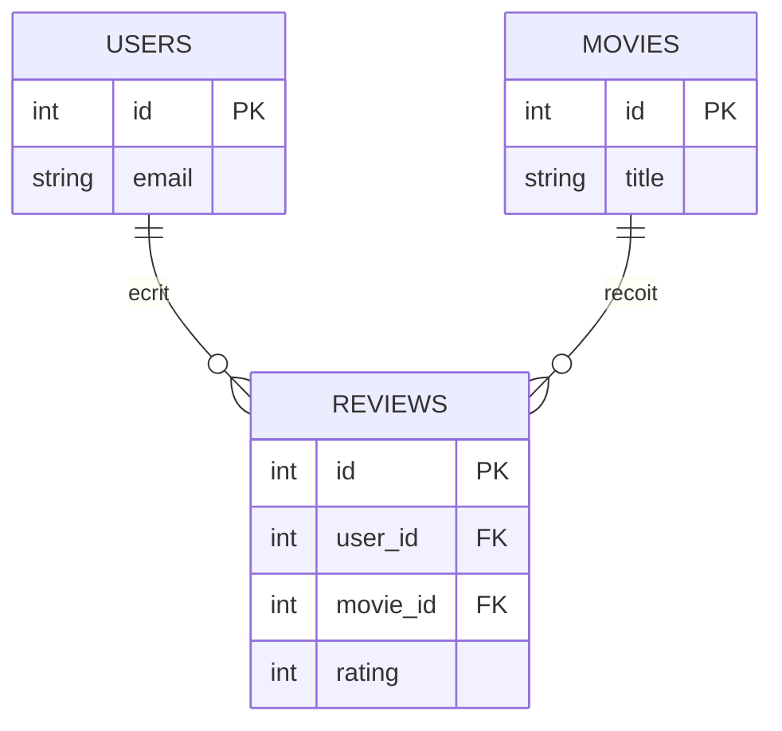

# Jointures SQL

```dataviewjs
await dv.view("Systeme/notion")
```

> **En une phrase** : Les données sont réparties dans plusieurs tables : les critiques d'un côté, les utilisateurs de l'autre.

## Le problème

**Pourquoi c'est utile ?**
Pour assembler des données réparties dans plusieurs tables grâce à une colonne commune.

**Qu'est-ce qui se passait sans ça ?**
On faisait une requête par table puis on recollait les résultats dans le code, avec des boucles et beaucoup de requêtes.

## Comment ça marche
*Explique avec tes mots, comme à un collègue.*

Une **jointure** (`JOIN`) les **assemble** grâce à une colonne commune, pour obtenir par exemple « chaque critique avec l'e-mail de son auteur ». C'est ce que fait `include` en Prisma.

### Les tables de CinéTrack



`reviews.user_id` pointe vers `users.id` : c'est une **clé étrangère**.

### `LEFT JOIN` : tout ce qui est à gauche, même sans correspondance

Tous les films, **y compris ceux sans critique** :

```sql
SELECT m.title, COUNT(r.id) AS nb_critiques
FROM movies m
LEFT JOIN reviews r ON r.movie_id = m.id
GROUP BY m.id, m.title;
```

Pour un film sans critique, les colonnes de `r` valent `NULL` et `COUNT(r.id)` donne 0.

### Les jointures en image

| Jointure | Garde |
|---|---|
| `INNER JOIN` | seulement les lignes qui ont une correspondance des **deux** côtés |
| `LEFT JOIN` | **toutes** les lignes de la table de gauche, avec `NULL` si pas de correspondance |
| `RIGHT JOIN` | l'inverse (rare : on préfère inverser les tables et faire un `LEFT`) |
| `FULL JOIN` | tout des deux côtés (rare) |

### Trouver ce qui manque

Les films qu'aucun utilisateur n'a mis en favori :

```sql
SELECT m.title
FROM movies m
LEFT JOIN favorites f ON f.movie_id = m.id
WHERE f.movie_id IS NULL;
```

### Relation plusieurs-à-plusieurs

Un utilisateur a plusieurs films favoris, un film est le favori de plusieurs utilisateurs : on passe par une **table de liaison** (`favorites` avec `user_id` et `movie_id`).

```sql
SELECT m.title
FROM favorites f
JOIN movies m ON m.id = f.movie_id
WHERE f.user_id = 42;
```

Comment concevoir ces tables : [[Normalisation|Modélisation]].

## 🧪 Exemple

### `INNER JOIN` : seulement ce qui correspond des deux côtés

```sql
SELECT r.rating, r.comment, u.email, m.title
FROM reviews r
JOIN users u  ON u.id = r.user_id
JOIN movies m ON m.id = r.movie_id
WHERE m.id = 27205
ORDER BY r.created_at DESC;
```

`r`, `u`, `m` sont des **alias** : des surnoms courts pour les tables. `JOIN` tout court = `INNER JOIN`.

## ⚠️ Limites et pièges

- **Oublier la condition `ON`** : chaque ligne est combinée avec **toutes** les autres (des millions de lignes).
- **Un `WHERE` sur la table de droite après un `LEFT JOIN`** (`WHERE r.rating > 5`) : il supprime les lignes `NULL` et transforme la jointure en `INNER`. Mets la condition dans le `ON`.
- **Une jointure lente** : vérifie qu'il y a un **index** sur la clé étrangère (voir [[Clés index et performance|Index]]).

## 🏋️ S'entraîner

### Exercices

#### Exercice 1 · Afficher les critiques avec leur auteur

Avec `users (id, email)`, `movies (id, title)` et `reviews (id, user_id, movie_id, rating)`, affiche pour chaque critique : l'e-mail de l'auteur, le titre du film et la note.

> [!success]- Solution
> ```sql
> SELECT u.email, m.title, r.rating
> FROM reviews r
> JOIN users u  ON u.id = r.user_id
> JOIN movies m ON m.id = r.movie_id;
> ```

#### Exercice 2 · Les films sans critique

Liste les films qui n'ont **aucune** critique. Quelle jointure faut-il et pourquoi ?

> [!success]- Solution
> ```sql
> SELECT m.title
> FROM movies m
> LEFT JOIN reviews r ON r.movie_id = m.id
> WHERE r.id IS NULL;
> ```
>
> Un `LEFT JOIN` garde **tous** les films, même sans critique : pour eux, les colonnes de `reviews` valent `NULL`. Un `INNER JOIN` les aurait fait disparaître.

## 🔗 Liens

- **Prérequis :** [[Fondamentaux SQL et SELECT]]
- **Voir aussi :** [[Normalisation]], [[Prisma Client requêtes et relations]]
- **Utilisé dans :** 

## 📚 Notes

- Source : https://www.postgresql.org/docs/current/queries-table-expressions.html
